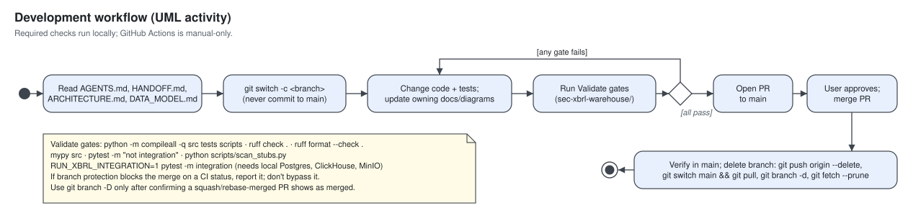

# SEC XBRL Warehouse

The application lives in `sec-xbrl-warehouse/`. It downloads SEC filings (and, with
the `esef` source enabled, EU/UK ESEF reports from filings.xbrl.org; with `edinet`
and `dart`, Japanese and Korean periodic reports from EDINET and OpenDART; with `nse`
and `mca`, Indian filings, and with `acra`, Singapore ACRA financial statements, that
the operator places in a local file inbox), extracts
XBRL and inline XBRL facts with Arelle, stores them in PostgreSQL, ClickHouse, and
MinIO/S3, and serves them through a CLI and a FastAPI query API (`/docs`).

- System design and UML views (component, deployment, class, activity, state machine,
  sequence) with a coverage index: [ARCHITECTURE.md](sec-xbrl-warehouse/docs/ARCHITECTURE.md)
- Security model: [SECURITY.md](sec-xbrl-warehouse/docs/SECURITY.md)
- Operations: [OPERATIONS.md](sec-xbrl-warehouse/docs/OPERATIONS.md),
  [INGESTION_RUNBOOK.md](sec-xbrl-warehouse/docs/INGESTION_RUNBOOK.md),
  [DEPLOYMENT.md](sec-xbrl-warehouse/docs/DEPLOYMENT.md),
  [BACKUP_RESTORE.md](sec-xbrl-warehouse/docs/BACKUP_RESTORE.md)
- Current state and acceptance gates: [HANDOFF.md](sec-xbrl-warehouse/HANDOFF.md)

## Rules

- Before changing application code, read `sec-xbrl-warehouse/AGENTS.md` (the data and
  validation contract), `HANDOFF.md`, `docs/ARCHITECTURE.md`, and `docs/DATA_MODEL.md`.
- Check `HANDOFF.md` for live ingestion state before starting a worker, enqueueing
  jobs, or running discovery. Only one process can send SEC traffic at a time: the
  SEC rate limiter is process-local, so a PostgreSQL advisory lock (`SecEgressLock`)
  makes a second SEC-active process fail fast with `SecEgressBusyError`. Every other
  source in `XBRL_ENABLED_SOURCES` has its own lock (`xbrl:<source>-egress`), so run
  one fetch worker per source (OPERATIONS.md, "Sources and per-source egress").
  Don't enable `esef` until filings.xbrl.org's reuse terms are confirmed and the
  ESEF/IFRS taxonomies are pinned (OPERATIONS.md, "ESEF filings"). `edinet` and
  `dart` need the operator's own API keys in `.env` (never in code, tests, logs, or
  stored URLs) and pinned taxonomies (OPERATIONS.md, "EDINET and DART filings").
  `nse`, `mca` and `acra` never fetch: the operator obtains files under the source's
  terms and places them with an `index.csv` in `XBRL_INBOX_DIR/<code>/`; run
  `xbrl-warehouse inbox check --source <code>` before discovery (OPERATIONS.md,
  "Operator file inbox"). Never crawl NSE, BSE, or MCA. Never automate BizFile+ or
  any ACRA/SGX site or handle Singpass credentials; enable `acra` outside local
  testing only after the operator records how files are obtained and confirms
  redistribution terms (OPERATIONS.md, "ACRA financial statements (Singapore)").
- `worker run --job-type <type>` (repeatable) claims only those job types and leaves
  other queued jobs untouched. Filings are two jobs: `fetch_filing` (SEC download,
  then it queues the parse) and `parse_filing` (no SEC client), e.g.
  `--job-type fetch_filing` on the one SEC-active worker and
  `XBRL_WORKER_CONCURRENCY=N XBRL_ARELLE_OFFLINE=true worker run --job-type parse_filing`
  beside it. Legacy queued `ingest_filing` jobs still run. Completed parses queue a
  coalesced `rebuild_series` job per company, which those workers also claim.
- Retain Arelle semantics, immutable raw artifacts, reversible canonical mappings,
  idempotent replay, and diagnostics for rejected or drifting inputs.
- Keep secrets out of source control. Preserve query budgets, download and parser
  limits, and checkpoint-ownership protections.
- Use repository evidence, make the smallest safe change, and preserve unrelated work.
- Use the unslop skill for user-facing prose and Ponytail when implementing code.
- Subagents are opt-in per request. When authorized, use only `general` subagents for
  narrow, independent tasks. The root agent owns discovery, implementation, testing,
  review, and completion.
- When a change alters a component boundary, public interface, data flow, trust
  boundary, secret, deployment step, or canonical command, update the owning document
  and its SVGs in `sec-xbrl-warehouse/docs/diagrams/` in the same change.

## Run locally

From `sec-xbrl-warehouse/`. Copy `.env.example` to `.env` only on a fresh install;
preserve an existing `.env`. Set `XBRL_SEC_USER_AGENT` to a real name and monitored email,
and keep `XBRL_RETAIN_FILING_SOURCE_FILES=true`. Use `docker-compose` if the
`docker compose` plugin isn't installed.

```bash
docker compose build api worker admin
docker compose up -d postgres clickhouse minio minio-init
docker compose run --rm --entrypoint alembic admin upgrade head
docker compose run --rm admin db init-clickhouse
./ops/provision/provision_identities.sh
docker compose run --rm admin taxonomy sync
docker compose run --rm admin doctor
docker compose up -d api
```

`doctor` fails while a pinned taxonomy package is missing; `taxonomy sync` installs them.

Privileged commands (migrations, `db`, `taxonomy`, `storage` maintenance, `doctor`) run
through the on-demand `admin` service, which holds the owner credentials. Workers
connect as least-privilege identities (`xbrl_worker`, `xbrl_writer`, and an object-store
user without delete); `provision_identities.sh` and `minio-init` create them, and
queue-only operator commands (`catalog`, `backfill`, `filing`, `mapping`, `company`,
`jobs`) work through either service. The `api` service has no writer credentials or
data volume. It connects as `xbrl_api` to PostgreSQL and ClickHouse (see SECURITY.md). Docs are served at
`http://127.0.0.1:8080/docs` and the browser UI at `http://127.0.0.1:8080/ui/`. Agents
can call the API through the stdio MCP server `xbrl-warehouse-mcp` (OPERATIONS.md,
"Web UI and MCP server"). Avoid `docker compose down -v`, which deletes data volumes.

## Validate

Run from `sec-xbrl-warehouse/` with the Python 3.12 virtualenv active:

```bash
python -m compileall -q src tests scripts
ruff check .
ruff format --check .
mypy src
pytest -m "not integration"
python scripts/scan_stubs.py
RUN_XBRL_INTEGRATION=1 pytest -m integration
```

The integration run needs the local storage services. It creates and removes its own
databases and bucket. In PowerShell, set `$env:RUN_XBRL_INTEGRATION = "1"` first.

## Development workflow



## Merging

- Target branch is `main`. Work on a feature branch and merge through a pull request.
  Never push directly to `main` or force-push it.
- Required checks run locally, not in CI. `.github/workflows/ci.yml` is manual-only
  (`workflow_dispatch`) to avoid Actions charges. Merge only after every command in
  **Validate** passes on the branch and the user explicitly approves. Don't wait on or
  re-run GitHub Actions. If branch protection requires a CI status check that blocks the
  merge, report it to the user instead of bypassing it.
- After the merge is verified in `main`, delete the feature branch:
  - remote: `git push origin --delete <branch>` (skip if GitHub already deleted it);
  - local: `git switch main && git pull`, then `git branch -d <branch>`;
  - prune: `git fetch --prune`.
- If `git branch -d` refuses because the PR was squash- or rebase-merged, confirm the PR
  shows as merged, then use `git branch -D <branch>`. Never delete a branch whose PR is
  unmerged or still open.
- Recommended: enable "Automatically delete head branches" in the GitHub repository
  settings. Agents don't change it without the user's approval.

## Production

Local operation isn't production acceptance. Before public exposure, complete the
gates in `HANDOFF.md` and the "Before public exposure" list in SECURITY.md.
