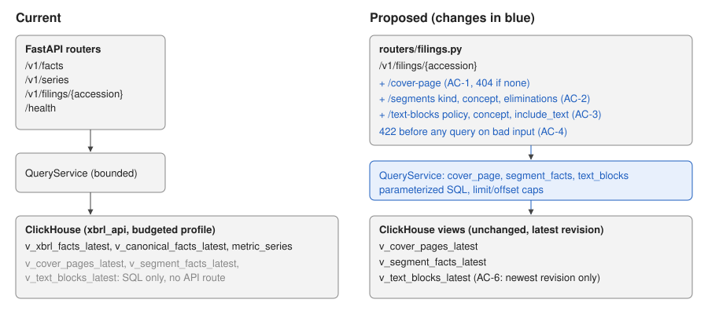

# 16 — Read endpoints for cover pages, segment breakdowns, and text blocks

Status: approved for implementation (11 October 2026). Runs as an implementer
session, then a separate verifier session. Builds on plan 12, which stores the data but left its
"optional read endpoints" unbuilt.

## Problem

Plan 12 writes cover pages, segment/geographic breakdowns, and text blocks to
ClickHouse (`v_cover_pages_latest`, `v_segment_facts_latest`, `v_text_blocks_latest`),
but the API has no route for them. A consumer needs ClickHouse credentials and
hand-written SQL to read a filing's segment revenue or accounting policies.

### Before / after

| Request | Before | After |
|---|---|---|
| Apple FY2025 cover page | SQL on `v_cover_pages_latest` | `GET /v1/filings/0000320193-25-000079/cover-page` |
| Its segment revenue | SQL over `v_segment_facts_latest` | `GET …/segments?kind=segment&concept=us-gaap:Revenues` → Americas 178,000, … |
| Its accounting policies, with text | SQL on `v_text_blocks_latest WHERE is_policy` | `GET …/text-blocks?policy=true&include_text=true` |

## Scope

Likely files:

- `src/sec_xbrl_warehouse/api/routers/filings.py`: three routes under
  `/v1/filings/{accession}`.
- `src/sec_xbrl_warehouse/query/service.py`: three bounded `QueryService` methods.
- `tests/unit/test_api.py`: regression tests the implementer adds.
- Docs: `docs/DATA_MODEL.md` (example API calls next to the SQL examples),
  `docs/ARCHITECTURE.md` where it lists API routes, `README.md` if it lists routes.

Exclusions:

- No new tables, views, migrations, or DDL. No ClickHouse grant changes:
  `xbrl_api` already has `SELECT` on the whole warehouse database.
- No company-level history endpoint (segments across filings). `xbrl_segment_facts`
  is sorted by accession, so a per-company scan has no index; that's a separate plan.
- Text-block HTML is returned as filed, not stripped or summarized.

Invariants:

- Every route reads only the `*_latest` views, so only each filing's newest published
  extraction revision is visible.
- User values reach ClickHouse only as query parameters.
- The existing API-key middleware, concurrency slots, and the `xbrl_api` profile
  budgets apply unchanged.



Feature map: `api/app.py` (middleware: API key, slots) → `routers/filings.py` →
`QueryService` → `ClickHouseWarehouse.query` → the three views from
`sql/clickhouse/040_views.sql` over `xbrl_cover_pages` and `xbrl_segment_facts`
(`027_disclosure_tables.sql`) and `v_xbrl_facts_latest`. Writers (plan 12,
`ingestion/incremental.py`) are untouched. Consumers: API clients only; the CLI isn't
affected.

## Contract

All three routes take `accession` matching `^\d{10}-\d{2}-\d{6}$` (else 422).
Dates are ISO strings. Numbers are JSON numbers equal to the stored decimal.

**`GET /v1/filings/{accession}/cover-page`** returns one object:
`accession, cik, form, filed_date, document_type, period_end_date, registrant_name,
filer_category, amendment` (bool or null)`, trading_symbol, exchange, auditor_name,
shares_outstanding, shares_outstanding_date, public_float, extraction_revision`, and
`securities`: a list of `{member, title, symbol, exchange}` built from the four
`security_*` arrays in order. `_row_hash` and `_ingested_at` are not returned. No row
→ 404.

**`GET /v1/filings/{accession}/segments`**

| Parameter | Rule |
|---|---|
| `kind` | repeatable; each one of `segment, product, geography, consolidation`. A row matches when any of its members has a requested kind (a segment × product row matches `kind=product`). |
| `concept` | optional qname `prefix:LocalName` (`^[A-Za-z_][\w.-]*:[A-Za-z_][\w.-]*$`, ≤ 512 chars) |
| `include_eliminations` | bool, default true; false drops rows with `is_elimination` |
| `limit` | 1–10,000, default 1,000 |
| `offset` | 0–10,000, default 0 |

Response `{accession, items, count, limit, offset}`. Each item:
`fact_id, concept_qname, kind, member_label, members, value, unit, period_start,
period_end, period_instant, is_elimination` (bool). `kind` is the stored `axis`
column; `members` is `[{kind, qname, label}]` zipped from `member_axes`,
`member_qnames`, `member_labels` in stored order. Order: `concept_qname, kind,
member_label, coalesce(period_end, period_instant), fact_id`. No rows → 200 with
empty `items`.

**`GET /v1/filings/{accession}/text-blocks`**

| Parameter | Rule |
|---|---|
| `policy` | optional bool; true keeps only policy text blocks, false only the others |
| `concept` | optional qname, same rule as above |
| `include_text` | bool, default false |
| `limit` | 1–1,000, default 200; at most 100 when `include_text=true` (else 422) |
| `offset` | 0–10,000, default 0 |

Response `{accession, items, count, limit, offset}`. Each item: `fact_id,
concept_qname, is_policy` (bool)`, period_start, period_end, period_instant, language,
dimensions_json, text_length` (characters of `value_text`), and `text` only when
`include_text=true`. Order: `concept_qname, fact_id`. No rows → 200 with empty
`items`.

## Acceptance criteria

- **AC-1 Cover page.** The route returns the filing's latest cover page in the shape
  above, with `securities` objects and without internal columns; 404 when absent.
- **AC-2 Segments.** The route returns the filing's breakdown rows in the shape and
  order above. `kind`, `concept`, and `include_eliminations` filter in the query;
  `limit`/`offset` page without overlap. Another filing's rows never appear.
- **AC-3 Text blocks.** The route lists the filing's text blocks with `is_policy`,
  filters by `policy` and `concept`, and returns `text` only on request.
- **AC-4 Input bounds.** Malformed accession, unknown `kind`, malformed `concept`,
  non-boolean flags, and out-of-range `limit`/`offset` (including the 100-row
  `include_text` cap) return 422 without any warehouse query. The accession and
  filters are passed as query parameters, never formatted into SQL.
- **AC-5 Auth.** With `XBRL_API_KEY` set, the routes return 401 without the bearer
  token and work with it.
- **AC-6 Latest revision.** After a filing is re-extracted at a higher revision, all
  three routes return only the newer revision's data.
- **AC-7 Docs (manual).** The routes appear in `/docs` with parameter descriptions,
  and DATA_MODEL.md shows example calls.

| Criterion | Acceptance (visible) | Verification (held back) |
|---|---|---|
| AC-1 | cover shape, securities, 404 | latest revision, unknown filing 404 |
| AC-2 | shape, `kind` filter | multi-axis order, eliminations, `concept`, repeated `kind`, isolation, paging |
| AC-3 | policy filter, text opt-in, `text_length` | `policy=false` + `concept`, paging order |
| AC-4 | bad accession/kind/concept/limits, parameterized SQL | injection strings, bad bools, offset bounds, cap boundary at 100 |
| AC-5 | — | 401 without key, 200 with it |
| AC-6 | — | revision 2 replaces revision 1 everywhere |
| AC-7 | manual | manual |

## Implementation sequence

1. `QueryService` methods with validation (AC-4) and SQL over the three views
   (AC-1–AC-3, AC-6).
2. Routes in `routers/filings.py`, mapping `ValueError` to 422 like the other routers.
3. Unit regression tests in `tests/unit/test_api.py`; docs (AC-7).
4. Run the Validate gates.

## Verification

Run from `sec-xbrl-warehouse/` with ClickHouse running (`docker compose up -d
postgres clickhouse minio`) and `.env` present (copy or symlink it from the main
checkout into a worktree; it is git-ignored):

```bash
RUN_XBRL_INTEGRATION=1 .venv/bin/pytest -c pyproject.toml --rootdir . ../Implementations/16-disclosure-api/acceptance
RUN_XBRL_INTEGRATION=1 .venv/bin/pytest -c pyproject.toml --rootdir . ../Implementations/16-disclosure-api/verification
```

In a worktree without its own `.venv`, use the main checkout's interpreter
(`<main>/sec-xbrl-warehouse/.venv/bin/pytest`); the test conftests put the
worktree's `src/` first on `sys.path`, so the worktree's code is what runs. The
integration ClickHouse database is session-scoped, so every test that loads data
uses its own accession.

Then the repository gates from AGENTS.md "Validate".

### Baseline (audit/speed-security-storage @ c52c2ea, 11 October 2026)

- Acceptance: 16 failed. Every failure is the missing route (404 instead of 422/200,
  or no `items` key); the synthetic bundle loads and publishes without error.
- Verification: 14 failed for the same reason, 0 passed.

## Completion evidence

To be filled in by the implementer and the verifier. The plan author (the
coordinating session) wrote both test sets; the implementer session is told not to
read `verification/`, which isn't in its worktree, but this is an instruction, not an
enforced boundary.

### Implementer record

Implementer session, 11 October 2026, branch `plan/16-disclosure-api` (cut from
`audit/speed-security-storage` @ c52c2ea). `verification/` was not read or copied.

Criteria:

- AC-1: `QueryService.cover_page` selects the listed columns from
  `v_cover_pages_latest` (no `_row_hash`, `_ingested_at`), zips the four `security_*`
  arrays into `securities`, and returns `amendment` as bool or null. The route
  returns 404 when there is no row.
- AC-2: `QueryService.segment_facts` filters `kind` with
  `hasAny(member_axes, %(kinds)s)`, `concept` with `concept_qname = %(concept)s`, and
  `include_eliminations=false` with `is_elimination = 0`, orders as the contract
  says, and pages with `LIMIT/OFFSET`. Every query is scoped by
  `accession = %(accession)s`. `members` is zipped from the three member arrays in
  stored order.
- AC-3: `QueryService.text_blocks` filters `is_policy = %(policy)s` and `concept`,
  returns `text_length` as `lengthUTF8(coalesce(value_text, ''))`, and selects
  `value_text AS text` only with `include_text`.
- AC-4: the routes declare the accession pattern, `kind` as a `Literal`, the qname
  pattern with `max_length=512`, bools, and `limit`/`offset` ranges, so FastAPI
  returns 422 before the handler runs. The service repeats these checks for direct
  callers and raises `ValueError` (the 100-row `include_text` cap is checked there),
  which the routes map to 422 before any query. User values are passed only as
  `%(name)s` parameters.
- AC-5: no change needed. The existing API-key middleware covers the new paths; a
  unit test checks 401 without the token and 200 with it.
- AC-6: all three methods read only the `*_latest` views. The extended integration
  test republishes a filing at revision 2 and checks all three methods return only
  revision 2 data.
- AC-7: each route has a docstring with an example call and every parameter has a
  description in OpenAPI (checked with `create_app().openapi()`). DATA_MODEL.md has
  example `curl` calls and the response shapes; ARCHITECTURE.md names the routes in
  its disclosure bullet. README.md doesn't list routes, so it is unchanged. No
  diagram changed: the API → ClickHouse boundary is the same.

Commands, run from `sec-xbrl-warehouse/` with the main checkout's `.venv`:

| Command | Result |
|---|---|
| `RUN_XBRL_INTEGRATION=1 pytest -c pyproject.toml --rootdir . ../Implementations/16-disclosure-api/acceptance` | 16 passed |
| `python -m compileall -q src tests scripts` | pass |
| `ruff check .` | pass |
| `ruff format --check .` | pass (177 files) |
| `mypy src` | pass (79 files) |
| `pytest -m "not integration"` | 436 passed, 1 skipped |
| `python scripts/scan_stubs.py` | 0 markers |
| `RUN_XBRL_INTEGRATION=1 pytest -m integration` | 47 passed |

Tests added: `test_disclosure_routes_validate_filter_and_shape_rows` in
`tests/unit/test_api.py` (bad bools, injection-shaped and over-long `concept`,
offset bounds, the 100-row cap, auth, SQL parameters for repeated `kind`, member
zipping, decimal output). `test_disclosures_keep_recast_filings_and_latest_revision_only`
in `tests/integration/test_clickhouse_inserts.py` now also has a text block and
checks the three service methods after the revision 2 republish.

Deviations and interpretations:

- Text-block `limit` default: the contract gives a default of 200 and a 100-row cap
  with `include_text=true`, and the visible AC-3 test calls
  `?policy=true&include_text=true` without a `limit` and expects 200 OK. So `limit` is
  optional: it defaults to 200, or 100 with `include_text`, and an explicit `limit`
  above 100 with `include_text` is 422. The response's `limit` is the effective value.
- JSON numbers: FastAPI serializes `Decimal` as a string, so `value`,
  `shares_outstanding`, and `public_float` are converted in the service: integral
  values become exact integers, others the nearest double.

Limitations:

- A non-integral decimal with more than about 15 significant digits loses precision
  as a double. XBRL monetary and share values are almost always integral, so this
  mostly affects per-share and ratio values with long fractions.
- The text-block route reads `v_text_blocks_latest`, which is built on
  `v_xbrl_facts_latest`; its cost per filing is whatever that view costs for one
  accession. It was not benchmarked on the full AAPL corpus here.

### Verifier record
