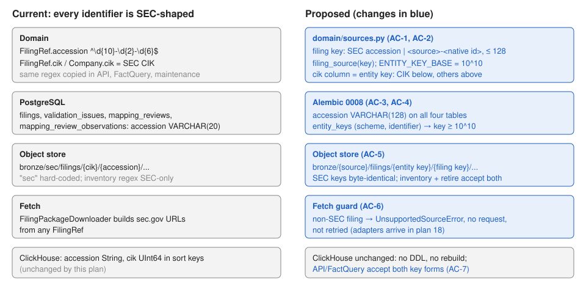

# 17 — Source-neutral filing keys and entity keys

Status: implemented, verified (accept) and merged to main. First of the multi-exchange plans. Depends
on plan 16 being accepted (its routes take the new key form too).

Multi-exchange sequence (each a separate implementer + verifier round):

| Plan | Scope |
|---|---|
| **17 (this)** | Filing keys and entity keys that aren't SEC-shaped; storage paths by source |
| 18 | Source adapter port: per-source HTTP client, host allowlist, rate limit, egress lock, fetch routing in the worker, per-source fiscal-field and taxonomy hooks |
| 19 | EU/UK ESEF through filings.xbrl.org (IFRS taxonomy pinning, LEI entities) |
| 20 | Japan EDINET and Korea DART (API keys, local taxonomies) |
| 21 | India (MCA21 / NSE / BSE; access terms first) |
| 22 | Singapore (ACRA BizFile+; paid access first) |

## Problem

Every identifier in the warehouse assumes the SEC. `FilingRef.accession` must match
`^\d{10}-\d{2}-\d{6}$`, the same regex is copied into the API, `FactQuery` and
storage maintenance, four PostgreSQL columns are `VARCHAR(20)`, issuers are keyed by
CIK, and object keys hard-code `bronze/sec/`. An ESEF report, an EDINET document or a
DART filing can't be represented, stored or queried, so no non-US source can be added
without first changing these.

### Before / after

| | Before | After |
|---|---|---|
| ESEF report `5493001KJTIIGC8Y1R12-2023-12-31-ESEF-GB-0` | `FilingRef` rejects it | key `esef-5493001KJTIIGC8Y1R12-2023-12-31-ESEF-GB-0`, source `esef` |
| Issuer with an LEI and no CIK | no key | entity key ≥ 10,000,000,000 from `entity_keys`, stable forever |
| Package archive path | `bronze/sec/filings/320193/0000320193-25-000079/…` | unchanged for SEC; `bronze/esef/filings/10000000001/esef-…/…` |
| SEC downloader given a non-SEC filing | builds a sec.gov URL from it | `UnsupportedSourceError`, no request, not retried |

## Design choice

The `accession` and `cik` columns keep their names and types in ClickHouse and their
names in PostgreSQL; their meaning widens to "filing key" and "entity key".

- A **filing key** is either a bare SEC accession or `<source>-<native id>`, where
  `source` is `[a-z][a-z0-9]{1,15}` and the native id is `[A-Za-z0-9][A-Za-z0-9._-]*`,
  128 characters at most in total. SEC accessions start with a digit, so the two forms
  never overlap, and `sec-…` is invalid (SEC filings keep the bare accession). The
  source is read from the key; no separate `source` column is stored.
- An **entity key** is the SEC CIK for SEC issuers (all CIKs are below 10^10) and an
  allocated number at or above `ENTITY_KEY_BASE = 10_000_000_000` for everything else.
  `entity_keys` maps `(scheme, identifier)` (for example the LEI scheme
  `http://standards.iso.org/iso/17442` and an LEI) to that number.

This keeps every ClickHouse sort key and column as it is: no DDL, no
`upgrade-clickhouse`, no re-extraction, and every existing SEC row and object key
stays byte-identical. Renaming the columns (`filing_key`, `entity_key`) would touch
every table, view, query and API field for no functional gain; the API field names
stay `accession` and `cik` and the docs explain the widened meaning.

## Scope

Likely files:

- New `src/sec_xbrl_warehouse/domain/sources.py`: `FILING_KEY_PATTERN`,
  `filing_source(key) -> str` (raises `ValueError`), `SEC_SOURCE = "sec"`,
  `SEC_CIK_SCHEME = "http://www.sec.gov/CIK"`, `ENTITY_KEY_BASE`.
- `domain/models.py`: `FilingRef` uses the filing-key pattern and checks the entity
  key range against the source.
- `exceptions.py`: `UnsupportedSourceError(XbrlWarehouseError)`, classified as not
  retryable by `worker.is_retryable_exception`.
- `migrations/versions/0008_…`: widen `accession` to `VARCHAR(128)` on `filings`,
  `validation_issues`, `mapping_reviews`, `mapping_review_observations` (and any FK
  column that references `filings.accession`); create `entity_keys` with a sequence
  starting at 10^10 and a unique `(scheme, identifier)`. `postgres_models.py` matches.
- `infrastructure/storage/postgres.py`: `async resolve_entity_key(scheme, identifier)
  -> int`.
- `ingestion/filing_downloader.py`: `filing_object_key`, `filing_package_key` and the
  manifest key use `filing_source(...)`; `download_package` and `fetch_index` raise
  `UnsupportedSourceError` for a non-SEC filing before touching the client.
- `infrastructure/storage/inventory.py`, `infrastructure/storage/maintenance.py`: accept
  both key forms (the maintenance check also guards the SQL it formats; the key
  pattern contains no quotes or spaces, which keeps that guarantee).
- `query/service.py`, `api/routers/filings.py` (including plan 16's routes): accept both
  key forms through the shared pattern.
- Docs: DATA_MODEL.md (filing and entity keys, `entity_keys`), ARCHITECTURE.md (class
  view: FilingRef), SCHEMA_EVOLUTION.md (0008), SECURITY.md (key pattern as input
  validation), the class diagram SVG if it shows `FilingRef`.

Exclusions:

- No source adapter, no non-SEC HTTP, discovery or worker routing (plan 18).
- No ClickHouse DDL. No change to SEC discovery, the SEC client, bulk datasets, or
  `edgartools_adapter.py` (SEC-only by nature).
- No company metadata for non-SEC issuers beyond the entity key (country, LEI fields
  come with the source plans).

Invariants:

- Every existing SEC accession, CIK, row, object key and API response is unchanged.
- A key that `filing_source` accepts never contains quotes, spaces, slashes or
  control characters, so code that formats keys into SQL or object paths stays safe.
- Entity keys are never reused or renumbered; SEC CIKs are never written to
  `entity_keys`.
- Downgrading 0008 is refused while any non-SEC key exists (truncation would corrupt
  keys); otherwise it restores `VARCHAR(20)` and drops `entity_keys`.



Feature map: `FilingRef` is built by SEC discovery (`ingestion/filing_discovery.py`),
CLI `filing enqueue`, and job payloads, and consumed by the downloader, incremental
ingest (silver keys `accession=…`), ClickHouse writers (`cik`, `accession` columns),
the control plane (`upsert_filing`, issues, mapping reviews), maintenance
(`retire-revisions`, `recompress-extractions`), inventory (`storage report`), and the
API. ClickHouse readers filter on these columns as opaque values, so they need no
change.

## Acceptance criteria

- **AC-1 Filing keys.** `filing_source` returns `sec` for a bare SEC accession and the
  prefix for `<source>-<native id>`; it raises `ValueError` for anything else
  (wrong case, empty native id, `sec-…`, path separators, whitespace, non-ASCII, longer
  than 128, sources outside 2–16 characters).
- **AC-2 FilingRef.** `FilingRef` accepts both key forms. An SEC filing's `cik` must be
  below `ENTITY_KEY_BASE`; a non-SEC filing's must be at or above it.
- **AC-3 Entity keys.** `resolve_entity_key(SEC_CIK_SCHEME, "0000320193")` returns
  320193 without a row. Any other `(scheme, identifier)` gets a key ≥ 10^10 that is the
  same on every later call, across repository instances and under concurrent first
  use; a different scheme or identifier gets a different key. Empty scheme or
  identifier, or a non-numeric or over-10-digit CIK, raises `ValueError`.
- **AC-4 Control plane.** After `alembic upgrade head`, every `accession` column holds
  128 characters, and `upsert_filing` stores a non-SEC filing (idempotently).
- **AC-5 Object storage.** Package, loose-member and manifest keys use the filing's
  source (`bronze/<source>/filings/<entity key>/<filing key>/…`); SEC keys are
  unchanged. `storage report` classifies both forms; `retire-revisions` retires a
  non-SEC filing's superseded revision when its saved extraction exists.
- **AC-6 Fetch guard.** `FilingPackageDownloader.download_package` and `fetch_index`
  raise `UnsupportedSourceError` for a non-SEC filing before any client call, also on a
  parse-only worker; the worker treats it as not retryable.
- **AC-7 API.** `/v1/filings/{key}` (and plan 16's sub-routes) and `/v1/facts?accession=`
  accept both key forms and reject malformed keys with 422 without a query.
- **AC-8 SEC regression (suite).** All existing unit and integration tests pass
  unchanged.

| Criterion | Acceptance (visible) | Verification (held back) |
|---|---|---|
| AC-1 | four sources, six malformed keys | 128-char edge, odd characters, source length, whitespace |
| AC-2 | non-SEC key, both range violations | exact range edges, largest CIK |
| AC-3 | SEC passthrough, stable, distinct | concurrency, restart, scheme separation, bad inputs |
| AC-4 | long key stored | all four columns widened, idempotent upsert, manifest lookup |
| AC-5 | package/object keys, SEC unchanged | inventory classes, retire-revisions |
| AC-6 | refusal, no calls, not retryable | parse-only worker, `fetch_index` |
| AC-7 | non-SEC key routes, bad key 422 | malformed keys, no query |
| AC-8 | Validate gates | Validate gates |

## Implementation sequence

1. `domain/sources.py`, `FilingRef`, `UnsupportedSourceError` (AC-1, AC-2, AC-6 part).
2. Alembic 0008, models, `resolve_entity_key` (AC-3, AC-4).
3. Object keys, inventory, maintenance (AC-5); downloader guard (AC-6).
4. API and `FactQuery` (AC-7). Docs. Validate gates (AC-8).

## Verification

From `sec-xbrl-warehouse/` with the storage containers running and `.env` present:

```bash
RUN_XBRL_INTEGRATION=1 .venv/bin/pytest -c pyproject.toml --rootdir . ../Implementations/17-filing-and-entity-keys/acceptance
RUN_XBRL_INTEGRATION=1 .venv/bin/pytest -c pyproject.toml --rootdir . ../Implementations/17-filing-and-entity-keys/verification
```

The integration PostgreSQL database is session-scoped and migrated to head, so the
tests use fresh identifiers. Then every command in AGENTS.md "Validate".

Manual check (operator, separate approval): back up PostgreSQL, run `alembic upgrade
head` on the live control database through the `admin` service, then `doctor`.

### Baseline (audit/speed-security-storage @ c52c2ea, 11 October 2026)

- Acceptance: 16 failed: `domain.sources` missing, `FilingRef`/`FactQuery` reject
  the ESEF key, `UnsupportedSourceError` missing, `resolve_entity_key` missing.
- Verification: 8 failed for the same reasons, plus `classify` returns `other` for a
  non-SEC package, `retire-revisions` keeps the non-SEC revision, and the four
  `accession` columns are 20 characters.

## Completion evidence

The plan author (coordinating session) wrote both test sets. The implementer is told
not to read `verification/`; that boundary is an instruction, not enforced.

### Implementer record

Branch `claude/17-filing-and-entity-keys-43e0e3` (cut from `verify/16-disclosure-api`
@ b8df8d8), 11 October 2026. `verification/` was not read, copied or run.

Criteria:

- **AC-1** `domain/sources.py`: `FILING_KEY_PATTERN` (shape) plus
  `FILING_KEY_MAX_LENGTH = 128`, `filing_source`, `is_filing_key`, `SEC_SOURCE`,
  `SEC_CIK_SCHEME`, `ENTITY_KEY_BASE`. The pattern has no look-ahead (pydantic's Rust
  regex has none), so `sec` is excluded by spelling out the source alternatives, and
  it uses ASCII classes (`[0-9]`, not `\d`, which matches non-ASCII digits).
  `filing_source` uses `fullmatch`, so a trailing newline is rejected.
- **AC-2** `FilingRef.accession` uses the pattern and max length; a model validator
  requires `cik < 10^10` for SEC keys and `>= 10^10` otherwise. Read-only
  `FilingRef.source` property.
- **AC-3** `PostgresControlRepository.resolve_entity_key`: CIK passthrough (1-10 ASCII
  digits, no row); otherwise SELECT, then `INSERT ... ON CONFLICT DO NOTHING
  RETURNING`, then a re-read in a new transaction if a concurrent caller won.
  Empty/blank scheme or identifier raises `ValueError`.
- **AC-4** Alembic `0008_filing_entity_keys`: `accession` widened to 128 on `filings`,
  `validation_issues` (the only FK column), `mapping_reviews`,
  `mapping_review_observations`; `entity_keys` (`entity_key` from `entity_key_seq`
  starting at 10^10 with a range check, unique `(scheme, identifier)`, `created_at`).
  Downgrade is refused while any accession isn't SEC-shaped, any `filings.cik >= 10^10`,
  or `entity_keys` has a row (dropping it would allow renumbering). Models match.
- **AC-5** Package, loose-member and manifest keys use `filing_source`; SEC keys are
  byte-identical. `storage report` classifies `bronze/<source>/filings/...`;
  `retire-revisions` gates on `is_filing_key` (still keeps the SQL-safety guarantee).
- **AC-6** `UnsupportedSourceError` (not retryable in `is_retryable_exception`);
  `fetch_index` and `download_package` call `_require_sec` before `_sec()`, so it also
  fires on a parse-only worker (`http=None`).
- **AC-7** `FactQuery.accession`, the filings router `Accession` path type (shared by
  plan 16's sub-routes) and `QueryService._check_accession`/`filing_summary` use the
  shared pattern/`is_filing_key`.
- **AC-8** Validate gates below.

Commands (from `sec-xbrl-warehouse/`, main checkout's `.venv`):

- Acceptance: `RUN_XBRL_INTEGRATION=1 pytest -c pyproject.toml --rootdir . ../Implementations/17-filing-and-entity-keys/acceptance`: 16 passed.
- `python -m compileall -q src tests scripts`: ok.
- `ruff check .`: all checks passed. `ruff format --check .`: 180 files formatted.
- `mypy src`: no issues in 80 source files.
- `pytest -m "not integration"`: 468 passed, 1 skipped (`sec-2024.zip` taxonomy package
  not installed locally; skipped before this change too).
- `python scripts/scan_stubs.py`: 0 markers.
- `RUN_XBRL_INTEGRATION=1 pytest -m integration`: 50 passed.

Regression tests added: `tests/unit/test_filing_keys.py` (key edges incl. 128/129
characters, source lengths, `sec-`, whitespace, newline, quotes, non-ASCII digits;
range edges; object keys and inventory classes; downloader guard without a client;
retire-revisions with a non-SEC key and an unsafe key; API 422 on all four filing
routes and `/v1/facts` with no query); `tests/integration/test_postgres_control.py`
(20 concurrent first calls across 4 repositories, scheme separation, bad inputs,
idempotent non-SEC upsert); `tests/integration/test_control_plane_migrations.py`
(0007 → head widths, sequence start, refused downgrades, clean downgrade, re-upgrade).

Deviations:

- The AC-6 acceptance test builds `LocalObjectStore(tmp_path / "objects")` with one
  argument, but the constructor required `bucket`. `bucket` now defaults to
  `"sec-xbrl"` (the `Settings.object_store_bucket` default). No assertion changed.
- `tests/unit/test_cli.py` stubs the database revision with the Alembic head; it now
  returns `0008_filing_entity_keys` (every earlier migration bumped the same line).
  This is the only edit to an existing test.
- `HANDOFF.md` gained a note that 0008 still has to be applied to the live control
  database.

Limitations:

- Nothing produces non-SEC filings yet (plan 18); the CLI `filing enqueue` and SEC
  discovery still build SEC `FilingRef`s only.
- `entity_keys` isn't truncated by the integration fixtures, so tests use fresh
  identifiers.
- The live control database is still at 0007 (manual operator step above).

### Verifier record

Verifier session, 11 October 2026, branch `claude/verify-17-filing-entity-keys-d938c4`
(cut from the implementer's 131a87f). `verification/` copied from the main checkout;
`.env` symlinked from the main checkout and not committed; main checkout's `.venv`
used. The suites' conftests put this worktree's `src` first on `sys.path`, so the
results apply to this branch. No implementation code or test was changed. No alembic
run against the live control database, no SEC traffic.

**Overall verdict: accept.**

| Criterion | Verdict | Evidence |
|---|---|---|
| AC-1 Filing keys | accept | acceptance and verification pass; independent property check below |
| AC-2 FilingRef | accept | range edges at `ENTITY_KEY_BASE` both ways (verification `test_ac2_range_edges`) |
| AC-3 Entity keys | accept | concurrency, restart, scheme separation, bad inputs (integration) |
| AC-4 Control plane | accept | all four `accession` columns 128 wide, idempotent non-SEC upsert |
| AC-5 Object storage | accept | SEC keys byte-identical; inventory classes; retire-revisions on non-SEC key |
| AC-6 Fetch guard | accept | `download_package` and `fetch_index` refuse with `http=None`, nothing written; not retryable |
| AC-7 API | accept | malformed keys 422 with zero queries; non-SEC key routes to 404 |
| AC-8 SEC regression | accept | all Validate gates pass; the one existing-test edit is the Alembic head stub |

Commands (from `sec-xbrl-warehouse/`):

- `RUN_XBRL_INTEGRATION=1 pytest -c pyproject.toml --rootdir . ../Implementations/17-filing-and-entity-keys/acceptance`: 16 passed.
- `RUN_XBRL_INTEGRATION=1 pytest -c pyproject.toml --rootdir . ../Implementations/17-filing-and-entity-keys/verification`: 8 passed.
- `python -m compileall -q src tests scripts`: ok.
- `ruff check .`: all checks passed. `ruff format --check .`: 180 files already formatted.
- `mypy src`: no issues in 80 source files.
- `pytest -m "not integration"`: 468 passed, 1 skipped (`sec-2024.zip` not installed
  locally; pre-existing), 50 deselected.
- `python scripts/scan_stubs.py`: 0 markers.
- `RUN_XBRL_INTEGRATION=1 pytest -m integration`: 50 passed.

Failures: none.

Review of `git diff b8df8d8..131a87f` against the contract:

- **Key pattern.** The `_SOURCE` alternation is exactly `[a-z][a-z0-9]{1,15}` minus
  `sec` (checked by hand and by an exhaustive comparison over every 2–3 character
  source plus 20,000 random ones). 200,000 random keys with quotes, spaces, slashes,
  backslashes, control and non-ASCII characters (`é`, Arabic-Indic digit, NBSP,
  U+2028): Python `filing_source` and pydantic's Rust engine agreed on every key, and
  every accepted key matched `[A-Za-z0-9._-]+`. Trailing newline rejected by both
  (`fullmatch`; Rust `$` has no newline exception). 128 accepted, 129 rejected.
- **SEC keys byte-identical.** `_filing_prefix`/`_manifest_prefix` yield
  `bronze/sec/filings/<cik>/<accession>/` and `manifests/sec/filings/<accession>/`
  for bare accessions, the same strings as before. API field names unchanged.
- **No ClickHouse DDL.** The diff touches no ClickHouse schema or DDL file.
- **Downgrade guard.** Counts non-SEC values in all four `accession` columns (NULL
  `validation_issues.accession` is not counted, correctly), `filings.cik >= 10^10`, and
  any `entity_keys` row, and raises before any DDL. The migration test covers refusal
  and a clean downgrade/re-upgrade.
- **Fetch guard.** `_require_sec` is the first statement of both `fetch_index` and
  `download_package`, ahead of `ensure_directories()` and `_sec()`; member downloads
  (`_fetch_member`) are only reached through `download_package`.
- **Not retryable.** `UnsupportedSourceError` sits in the first permanent-error check of
  `is_retryable_exception`.
- **SQL formatting.** `retire-revisions` gates on `is_filing_key` before formatting
  `'{a}'` into `ALTER TABLE ... DELETE`; the property above keeps that safe.
- **Entity keys.** SELECT, then `INSERT ... ON CONFLICT DO NOTHING RETURNING`, then a
  re-read in a new session: under READ COMMITTED the losing INSERT waits for the
  winner's commit, so the re-read sees it. Sequence gaps from lost races are harmless
  (keys are never reused). SEC CIKs never reach the table.

Findings (none blocking):

1. `resolve_entity_key` stores non-SEC identifiers verbatim, so `"LEI…"` and
   `"LEI… "` (or a lower-cased LEI) get different keys. The AC only requires blank
   input to fail. Recommend that plan 19 normalise LEIs (strip, upper-case) before
   calling it, since a second key for one issuer can't be undone.
2. Remaining SEC-only regexes (`filing_discovery.py`, `edgartools_adapter.py`) and
   `bronze/sec/daily-index`, `bronze/sec/fsnds` keys are within the plan's exclusions.

Deviations:

- **`LocalObjectStore(bucket="sec-xbrl")` default: acceptable.** It equals
  `Settings.object_store_bucket`'s default, the only production constructor
  (`object_store.py:400`) still passes the setting explicitly, and the bucket name
  has no effect on local storage paths. It changes no behaviour and no assertion.
- **`tests/unit/test_cli.py` stub bumped to `0008_filing_entity_keys`: acceptable.**
  The stub stands in for the database revision that `doctor` compares with the
  Alembic head; c52c2ea made the same one-line bump for 0007. No assertion weakened.
