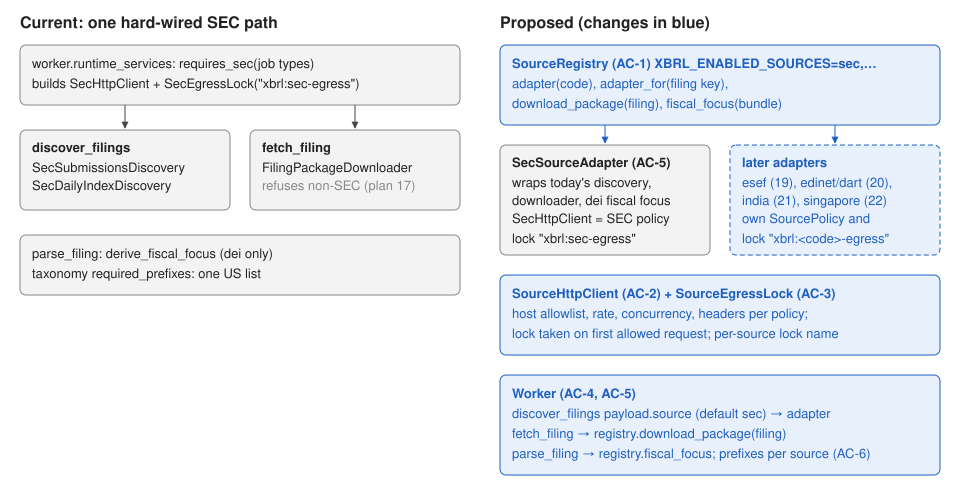

# 18 — Source adapters: per-regulator fetch, discovery, and egress

Status: draft for review (11 October 2026). Depends on plan 17 (filing keys, entity
keys, `UnsupportedSourceError`). Second of the multi-exchange plans; plans 19–22 each
add one adapter on top of this one.

## Problem

After plan 17 the warehouse can store a non-SEC filing but can't fetch, discover or
parse one. Every network path is the SEC's:

- `SecHttpClient` refuses every host except `www.sec.gov`, `sec.gov`, `data.sec.gov`,
  sends the SEC user agent, and uses the SEC rate limit.
- `SecEgressLock` (`xbrl:sec-egress`) is the only egress lock; `worker.requires_sec`
  decides whether a worker builds a client at all.
- `discover_filings` calls `SecSubmissionsDiscovery` or `SecDailyIndexDiscovery`;
  `fetch_filing` calls `FilingPackageDownloader`, which now refuses non-SEC filings.
- `parse_filing` fills fiscal fields with `derive_fiscal_focus`, which reads SEC `dei`
  facts only; `taxonomy_packages.required_prefixes` is one US list.

### Before / after

| | Before | After |
|---|---|---|
| `discover_filings {"source": "esef", …}` | ignored `source`, ran SEC discovery | runs the `esef` adapter's discovery (once plan 19 registers it) |
| `fetch_filing` for `esef-…` | `UnsupportedSourceError` | the `esef` adapter downloads the package |
| SEC worker and ESEF worker at once | impossible (one lock, one client) | each holds its own lock (`xbrl:sec-egress`, `xbrl:esef-egress`) |
| `doctor` taxonomy coverage | US prefixes only | US prefixes plus each enabled source's |

## Scope

Contract surface (names the tests use):

- `sec_xbrl_warehouse/sources/base.py`:
  - `SourcePolicy(code, allowed_hosts: frozenset[str], max_requests_per_second,
    max_concurrency, headers: dict[str, str])`.
  - `DiscoveryRequest(filed_from: date | None, filed_to: date | None, entity: str | None,
    forms: tuple[str, ...])`. `entity` is the source's issuer identifier as text
    (SEC: the CIK digits).
  - `DiscoveryResult(filings: tuple[FilingRef, ...], companies: tuple[Company, ...])`.
  - `SourceAdapter` protocol: `code: str`, `taxonomy_prefixes: tuple[str, ...]`,
    `async discover(request) -> DiscoveryResult`, `async download_package(filing) ->
    FilingPackageManifest`, `fiscal_focus(bundle) -> (bundle, issues)`.
- `sec_xbrl_warehouse/sources/registry.py`: `SourceRegistry(adapters)` with `codes`
  (sorted), `adapter(code)`, `adapter_for(filing_key)`, `download_package(filing)`,
  `fiscal_focus(bundle)`. Unknown or disabled codes raise `UnsupportedSourceError`;
  duplicate or malformed adapter codes raise `ValueError` at construction.
- `sec_xbrl_warehouse/sources/sec.py`: `SecSourceAdapter`, wrapping today's SEC
  discovery, `FilingPackageDownloader` and `derive_fiscal_focus` without behavior
  change.
- `infrastructure/http/source_client.py`: `SourceHttpClient(settings, policy, client=None,
  egress_lock=None)` with `get_json`, `get_bytes`, `get_text`, `download` like the SEC
  client: host allowlist (also on redirects), the policy's rate, concurrency and
  headers, byte limits from settings, and the egress lock taken once before the first
  allowed request. `SecHttpClient` keeps its name, `ALLOWED_HOSTS` and behavior; it may
  become a `SourceHttpClient` with the SEC policy.
- `exceptions.py`: `SourceAccessError(XbrlWarehouseError)`; `SecAccessError` becomes its
  subclass (existing `except SecAccessError` sites are unchanged).
- `infrastructure/http/egress_lock.py`: `lock_name(source)`, `SourceEgressLock(settings,
  *, source)`, `EgressBusyError`; `SecEgressLock` is the `sec` lock and still raises
  `SecEgressBusyError` (a subclass of `EgressBusyError`). `LOCK_NAME` stays
  `"xbrl:sec-egress"`.
- `config.py`: `enabled_sources: tuple[str, ...] = ("sec",)` (`XBRL_ENABLED_SOURCES`),
  each a valid source token.
- `infrastructure/xbrl/taxonomy_packages.py`: `required_prefixes` adds
  `source_required_prefixes[<code>]` for each enabled source (scheme-less, like today).
- `worker.py`: services gain `"sources": SourceRegistry`. `discover_filings` reads
  `payload["source"]` (default `sec`), calls that adapter with a `DiscoveryRequest`
  (legacy `cik` payloads become `entity`), upserts returned companies, refuses filings
  whose key belongs to another source (`ValueError`), and enqueues `fetch_filing`
  jobs as today. `runtime_services` builds the registry from `enabled_sources`, a
  client and lazy lock per source that fetch/discover job types need, and passes the
  registry to `IncrementalFilingIngestor` as its package store; parse uses
  `registry.fiscal_focus`. `requires_sec` becomes "requires network for source X".
- Docs: ARCHITECTURE (component, deployment, sequence views and coverage index),
  SECURITY (per-source trust boundary and host allowlists), OPERATIONS (one
  fetch worker per source, `XBRL_ENABLED_SOURCES`), SEC_ACCESS (unchanged SEC rules),
  `.env.example`.

Exclusions:

- No real non-SEC adapter (plans 19–22). No new job types, no ClickHouse or Alembic
  changes. No change to SEC request URLs, headers, rates, retries or limits.
- Bulk SEC datasets (`download_bulk`, `load_bulk`) stay SEC-only and keep using the
  SEC client directly.

Invariants:

- SEC behavior is identical: same requests in the same order, same user agent, same
  rate and concurrency, same lock name, same object keys, same job keys and payloads.
  Existing tests pass unchanged.
- A source's client can never reach another source's hosts; one process per source
  sends traffic for it.
- An unknown or disabled source is never retried and never falls back to SEC.



Feature map: `cli.py` (`filing discover`, `worker run`, `doctor`, `taxonomy`) →
`worker.runtime_services` (clients, locks, services) → `build_handlers`
(`_discover`, `_fetch_filing`, `_ingest_filing`, `_parse_filing`) →
`IncrementalFilingIngestor` (`fetch` → `package_store.download_package`, `parse` →
`derive_fiscal_focus`) → `FilingPackageDownloader`, `SecSubmissionsDiscovery`,
`SecDailyIndexDiscovery` → `SecHttpClient` → `SecEgressLock`. Taxonomy:
`taxonomy_packages.required_prefixes` → `coverage_gaps` → `doctor` and offline
extraction refusal.

## Acceptance criteria

- **AC-1 Registry.** `SourceRegistry` routes by code and by filing key, dispatches
  `download_package` and `fiscal_focus` to the filing's adapter, raises
  `UnsupportedSourceError` for unknown/disabled sources, and rejects duplicate or
  malformed codes. `Settings.enabled_sources` defaults to `("sec",)` and validates
  tokens.
- **AC-2 Source client.** `SourceHttpClient` only requests hosts in its policy (also
  after redirects, which it doesn't follow off-policy), sends the policy's headers,
  holds the policy's rate, and takes its egress lock once, on the first allowed
  request. `SecHttpClient.ALLOWED_HOSTS` is unchanged and `SecAccessError` is a
  `SourceAccessError`.
- **AC-3 Locks.** `lock_name("sec") == LOCK_NAME == "xbrl:sec-egress"`; other sources
  get `xbrl:<code>-egress`. Locks of different sources don't block each other; a
  second holder of the same source gets `EgressBusyError` (`SecEgressBusyError` for
  SEC); a released lock can be retaken.
- **AC-4 Discovery jobs.** `discover_filings` uses `payload["source"]` (default `sec`;
  `cik` becomes `entity`), stores returned companies, enqueues `fetch:<key>:<revision>`
  jobs, rejects filings from another source, and fails without retry for a disabled
  source.
- **AC-5 SEC through the adapter.** Fetch, discovery and parse for SEC run through
  `SecSourceAdapter` with identical behavior (existing SEC worker, downloader,
  discovery and fiscal-focus tests pass unchanged; reviewed in the diff).
- **AC-6 Taxonomy prefixes.** `required_prefixes` is the US list plus
  `source_required_prefixes` for enabled sources only.
- **AC-7 Docs (manual).** The listed documents and diagrams describe the registry,
  per-source clients and locks, and how to run one fetch worker per source.
- **AC-8 Regression (suite).** All Validate gates pass.

| Criterion | Acceptance (visible) | Verification (held back) |
|---|---|---|
| AC-1 | routing, dispatch, disabled source, settings | duplicate/malformed codes, fiscal-focus dispatch |
| AC-2 | allowlist, headers, SEC client unchanged | lock once and not on refusal, redirect refusal, rate |
| AC-3 | names, independent sources | SEC error type, release and retake |
| AC-4 | named source, fetch keys, disabled source | default SEC + `cik`, companies stored, foreign keys rejected |
| AC-5 | suite | suite + review |
| AC-6 | enabled-only union | missing source entry, scheme stripping |
| AC-7 | manual | manual |
| AC-8 | gates | gates |

## Implementation sequence

1. `sources/base.py`, `exceptions.py`, `config.enabled_sources` (AC-1 part).
2. `SourceHttpClient`, `SourceEgressLock`, SEC client and lock on top of them (AC-2,
   AC-3).
3. `SourceRegistry`, `SecSourceAdapter` (AC-1, AC-5).
4. Worker wiring, ingestor package store, parse fiscal focus (AC-4, AC-5).
5. Taxonomy prefixes, `doctor` (AC-6). Docs (AC-7). Validate (AC-8).

## Verification

From `sec-xbrl-warehouse/` with the storage containers running and `.env` present:

```bash
RUN_XBRL_INTEGRATION=1 .venv/bin/pytest -c pyproject.toml --rootdir . ../Implementations/18-source-adapters/acceptance
RUN_XBRL_INTEGRATION=1 .venv/bin/pytest -c pyproject.toml --rootdir . ../Implementations/18-source-adapters/verification
```

The verification set imports the acceptance set's `demo_source.py` fake adapter.

### Baseline (plan 17 candidate 131a87f, 11 October 2026)

- Acceptance: 9 failed (`sec_xbrl_warehouse.sources` missing, `SourceAccessError`,
  `lock_name`, `EgressBusyError` missing, `Settings.enabled_sources` missing,
  `source_required_prefixes` ignored).
- Verification: 8 failed for the same reasons; 1 passed
  (`test_ac6_prefix_edges`: with no prefix entry for an enabled source the US list is
  already returned unchanged, which is correct behavior today).

## Completion evidence

The plan author (coordinating session) wrote both test sets. The implementer is told
not to read `verification/`; that boundary is an instruction, not enforced.

### Implementer record

Branch `plan/18-source-adapters`, from plan 17 at 11137ef (11 October 2026). The
`verification/` folder was not read, copied, or run.

**Baseline (unmodified 11137ef).** Acceptance: 9 failed, 0 passed (missing
`sec_xbrl_warehouse.sources`, `SourceAccessError`, `lock_name`, `EgressBusyError`,
`Settings.enabled_sources`; `source_required_prefixes` ignored). Unit suite before the
change: 468 passed, 1 skipped.

**Criteria.**

- AC-1: `sources/base.py` (`SourcePolicy`, `DiscoveryRequest`, `DiscoveryResult`,
  `SourceAdapter`), `sources/registry.py` (`SourceRegistry`: sorted `codes`, `adapter`,
  `adapter_for`, `download_package`, `fiscal_focus`; `UnsupportedSourceError` for
  unknown or disabled codes; `ValueError` for duplicate or malformed codes).
  `Settings.enabled_sources` defaults to `("sec",)`, reads `XBRL_ENABLED_SOURCES=sec,esef`,
  and rejects invalid, duplicate, or empty lists.
- AC-2: `infrastructure/http/source_client.py` `SourceHttpClient` holds the former SEC
  client logic, parameterised by the policy (hosts on every hop, headers on every
  request, rate, concurrency, lock taken once before the first allowed request).
  `SecHttpClient` is a subclass with the SEC policy; `ALLOWED_HOSTS`, constructor,
  error types, and messages are unchanged. `SecAccessError` subclasses
  `SourceAccessError`.
- AC-3: `lock_name`, `SourceEgressLock(settings, *, source)`, `EgressBusyError`;
  `SecEgressLock` is the `sec` lock and raises `SecEgressBusyError` (subclass of
  `EgressBusyError` and `SecAccessError`); `LOCK_NAME` is unchanged.
- AC-4: `discover_filings` reads `payload["source"]` (default `sec`), maps a legacy
  `cik` to `entity`, uses SEC default forms only for SEC, refuses other sources'
  filing keys before any write (`ValueError`), stores returned companies, and enqueues
  `fetch:<key>:<revision>` jobs with the same payload as before.
- AC-5: `sources/sec.py` `SecSourceAdapter` wraps `SecSubmissionsDiscovery`,
  `SecDailyIndexDiscovery` + `enrich_companies`, `FilingPackageDownloader`, and
  `derive_fiscal_focus`. `runtime_services` builds the registry, passes it to
  `IncrementalFilingIngestor` as the package store and `fiscal_focus`. The worker
  defers any `EgressBusyError` and treats `SourceRetryDeferred` like
  `SecRetryDeferred`. Existing SEC worker, client, downloader, discovery, and
  fiscal-focus tests pass unchanged.
- AC-6: `required_prefixes` is the US list plus `source_required_prefixes[<code>]` for
  enabled sources (scheme-less); a missing entry adds nothing; a malformed entry raises
  `ConfigurationError`.
- AC-7: ARCHITECTURE (component table, job orchestration, filings idempotency,
  coverage index, alt texts), SECURITY (per-source outbound path and allowlists,
  per-source locks, checks list), OPERATIONS (new "Sources and per-source egress"),
  SEC_ACCESS ("Other sources"), HANDOFF, root AGENTS.md, `.env.example`
  (`XBRL_ENABLED_SOURCES=sec`). Diagrams: component-overview, sequence-filing,
  deployment-compose, state-job, trust-boundaries (rendered and checked).
- AC-8: all gates below.

**Regression tests added** (existing tests unchanged; only additions):
`tests/unit/test_source_adapters.py` (16 tests: duplicate/malformed codes, fiscal-focus
dispatch, missing package handler, lock once and not on refused URLs, off-policy
redirect refusal for `get_*` and `download`, policy rate/concurrency/headers, non-SEC
`Retry-After` deferral, settings parsing, SEC adapter entity/collaborator errors,
SEC fiscal focus equals `derive_fiscal_focus`, default SEC + `cik`, foreign keys
rejected before writes, legacy services SEC-only, non-SEC busy deferral,
unimplemented enabled source, `requires_network`, prefix edges);
`tests/unit/test_incremental.py::test_ingestor_routes_packages_and_fiscal_focus_through_the_source_registry`;
`tests/integration/test_postgres_control.py::test_source_egress_locks_are_per_source_and_retakable`.

**Commands** (from `sec-xbrl-warehouse/`, main checkout's venv):

| Command | Result |
| --- | --- |
| `RUN_XBRL_INTEGRATION=1 pytest -c pyproject.toml --rootdir . ../Implementations/18-source-adapters/acceptance` | 9 passed |
| `python -m compileall -q src tests scripts` | pass |
| `ruff check .` | pass |
| `ruff format --check .` | pass (186 files) |
| `mypy src` | pass (85 files) |
| `pytest -m "not integration"` | 485 passed, 1 skipped (sec-2024.zip not installed) |
| `python scripts/scan_stubs.py` | 0 markers |
| `RUN_XBRL_INTEGRATION=1 pytest -m integration` | 51 passed |

**Deviations.**

- Discovery job result: `companies_stored` is reported when the adapter returned
  companies. SEC daily-index discovery that stored none used to report
  `companies_stored: 0` and now omits the key. Enriched companies are upserted after
  the run's submissions requests instead of after each one; requests and their order
  are unchanged, but a failure part-way stores none of that run's companies (a retry
  refetches them).
- `sec_client.py` keeps an otherwise unused `import asyncio` because an existing test
  patches `sec_client.asyncio.sleep`.
- `SourceHttpClient` sends the policy headers on every request, so an injected
  `httpx.AsyncClient` sends them too (the AC-2 test needs this). For the owned SEC
  client the wire headers are the same as before.
- Additions beyond the named surface: `SourceRetryDeferred` (base of
  `SecRetryDeferred`, same SEC message), `SourceRegistry(..., packages=)` with
  `materialize_package`/`archive_package` so the registry is the ingestor's package
  store, `IncrementalFilingIngestor(fiscal_focus=)`, `worker.requires_network`,
  `sec_client.sec_policy`, `domain.sources.is_source_code`.
- `runtime_services` raises `ConfigurationError` at startup for an enabled source
  without an adapter (only `sec` exists), rather than skipping it.

**Limitations.**

- Job claims can't filter by source; "one fetch worker per source" relies on each
  source's lock and busy deferral (documented in OPERATIONS.md).
- `mapping/remap.py` (`map_canonical`) still calls `derive_fiscal_focus` directly; for
  a non-SEC bundle without dei facts the discovery values pass through. Later source
  plans should route it through the registry.
- `filing discover` has no `--source` option; non-SEC discovery is queued through the
  job payload.
- Non-SEC requests are counted in the existing `SEC_REQUESTS` and
  `SEC_THROTTLE_SECONDS` metrics (by host); online-Arelle lazy locking stays SEC-only.
- `docs/diagrams/activity-filing.svg` still describes the SEC path only; it remains
  accurate for the one implemented source.

#### Corrections (round 2)

Fixes for the verifier's findings, on top of a5ac1aa. `verification/` still not read.

- **D1 (AC-3).** `SourceEgressLock._busy` raises `SecEgressBusyError` (same SEC
  message) for any lock whose source is `sec`, so `SourceEgressLock(s, source="sec")`
  and `SecEgressLock(s)` behave the same; the `SecEgressLock` override is gone. The
  integration test `test_source_egress_locks_are_per_source_and_retakable` now also
  checks a busy `SourceEgressLock(source="sec")` raises `SecEgressBusyError`.
- **D2 (SEC behavior identical; round-1 deviation on company storage).** The SEC
  adapter writes daily-index companies itself, one per submissions request, through
  the same mirrored PostgreSQL + ClickHouse sink as before (`_MirroredCompanies`,
  passed by `runtime_services` and by the legacy-services path), via the unchanged
  `enrich_companies`. `_CollectedCompanies` is removed. `DiscoveryResult` gains
  `stored_companies: int | None = None` (companies an adapter stored itself); the
  worker reports `companies_stored` when companies were returned or
  `stored_companies` is set, so SEC daily-index discovery again reports
  `companies_stored: 0` when nothing new was stored. The round-1 result-shape
  deviation is resolved. Tests: failure-then-retry with 3 new CIKs and a
  `TimeoutError` on the third request, for both the registry and legacy-services
  wiring (attempt 1: 3 requests, CIKs 1 and 2 stored, nothing enqueued; attempt 2:
  1 more request, 4 in total, all 3 stored, 3 fetch jobs); plus the all-known case
  (`companies_stored: 0`, no requests).
- **D3 (no fallback to SEC).** `_discover` defaults to `sec` only when the `source`
  key is missing; `""`, `None`, a malformed code or a non-string raises
  `UnsupportedSourceError` (not retryable) before any adapter call. Test parametrised
  over those four values.
- **Ruling (c).** `load_published_extraction` takes `fiscal_focus=`; `map_canonical`
  passes `SourceRegistry.fiscal_focus` when the worker has a registry, like parse.
  Without one (CLI or legacy callers) it keeps the SEC dei path. Test: `map_canonical`
  uses the registry's adapter, and the SEC adapter through the registry returns the
  same bundle as the default path. The round-1 limitation about remap is resolved.
- Docs: ARCHITECTURE "Job orchestration" paragraph updated for all three points.

| Command | Result |
| --- | --- |
| Acceptance set (`RUN_XBRL_INTEGRATION=1`) | 9 passed |
| `python -m compileall -q src tests scripts` | pass |
| `ruff check .` | pass |
| `ruff format --check .` | pass (186 files) |
| `mypy src` | pass (85 files) |
| `pytest -m "not integration"` | 493 passed, 1 skipped (sec-2024.zip not installed) |
| `python scripts/scan_stubs.py` | 0 markers |
| `RUN_XBRL_INTEGRATION=1 pytest -m integration` | 51 passed |

Pre-existing tests are still unchanged; round-2 test changes are new tests plus one
added assertion in the round-1 integration test.

### Verifier record
