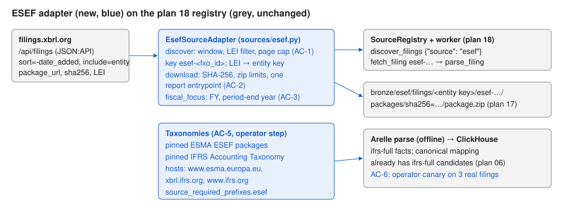

# 19 — EU/UK ESEF filings through filings.xbrl.org

Status: draft for review (11 October 2026). Depends on plans 17 (filing and entity
keys) and 18 (source adapters). First real non-SEC source.

## Problem

EU-listed issuers file annual reports in ESEF (inline XBRL, IFRS taxonomy, LEI as the
entity identifier); UK issuers file the same format. XBRL International's
filings.xbrl.org collects them and serves a free JSON:API at
`https://filings.xbrl.org/api`. After plan 18 the warehouse can host a second source,
but none exists.

Verified on 11 October 2026 from a live `GET /api/filings?include=entity`:
filing attributes are `fxo_id`, `country`, `date_added`, `processed`, `period_end`,
`sha256`, `package_url`, `report_url`, `json_url`, `viewer_url`, `error_count`,
`warning_count`, `inconsistency_count`; URLs are host-relative; the included entity
has `identifier` (the LEI) and `name`. Pagination is `page[size]`/`page[number]` with
`links.next`; `sort=-date_added` and `filter[<attribute>]=` work.

Terms: the API is free, "may be changed at any time", may be rate limited or
withdrawn, and the site states no data licence. **Before enabling `esef` in
production, the operator confirms reuse terms with XBRL International.**

### Before / after

| | Before | After |
|---|---|---|
| `discover_filings {"source": "esef", "filed_from": "2024-04-01", "filed_to": "2024-04-30"}` | `UnsupportedSourceError` | fetch jobs for each ESEF report added in that window |
| Kainos Group 2023 annual report | not reachable | `esef-213800H2PQMIF3OVZY47-2023-12-31-ESEF-GB-0`, entity key from its LEI |
| Its revenue | — | `ifrs-full:Revenue` facts in `v_xbrl_facts_latest`, mapped by the existing `ifrs-full` seeds |

## Scope

Contract surface:

- `sources/esef.py`: `ESEF_POLICY` (`code="esef"`, hosts `{"filings.xbrl.org"}`, at
  most 2 requests/s, the warehouse user agent), `LEI_SCHEME =
  "http://standards.iso.org/iso/17442"`, and `EsefSourceAdapter(settings, http,
  object_store, entity_keys)` where `entity_keys` has `async
  resolve_entity_key(scheme, identifier)` (the control repository in production).
- Settings: `esef_page_size` (default 100), `esef_max_pages` (default 50),
  `esef_countries` (default empty: all).
- **discover**: `GET /api/filings` with `sort=-date_added`, `include=entity`,
  `page[size]`, `page[number]` (and `filter[country]` per configured country). Keep
  records whose `date_added` date is inside `[filed_from, filed_to]` (open bounds
  allowed) and, when `request.entity` is set, whose LEI equals it. Stop when a page's
  oldest `date_added` is before `filed_from`, when there's no `links.next`, or at
  `esef_max_pages`. Each kept record becomes a `FilingRef`:
  `accession = "esef-" + fxo_id`, `cik = resolve_entity_key(LEI_SCHEME, LEI)`,
  `company_name` = entity name, `form = "ESEF"`, `filed_date` = `date_added` date,
  `report_date` = `period_end`, `archive_directory_url` = `https://filings.xbrl.org` +
  the package URL's directory, `primary_document_url` from `report_url`,
  `is_inline_xbrl = True`. A record whose key isn't a valid filing key is skipped and
  logged. One `Company` per LEI (`cik` = entity key, `name`).
- **download_package**: re-read the record (`filter[fxo_id]`), download
  `package_url`, check the bytes against `sha256` (`ArtifactIntegrityError` on
  mismatch, nothing stored), validate the archive with the existing zip limits
  (`filing_max_members`, `filing_max_bytes`, ratios, no absolute or `..` names), store
  it once at `filing_package_key(filing, sha256)`, and return a manifest whose members
  are the archive entries, with exactly one `is_xbrl_entrypoint` member: the inline
  report under `reports/` (`.xhtml`/`.html`). No report → `ArtifactIntegrityError`.
  Re-downloading identical bytes is idempotent.
- **fiscal_focus**: `fiscal_period = "FY"`; `fiscal_year` = `report_date.year`, or when
  absent the end year of the latest non-dimensional duration fact.
- **parse**: `parse_filing` opens the stored package and extracts from the entrypoint
  member (Arelle opens report packages). Changes to the parse path, if needed, stay
  source-neutral.
- **Taxonomies (AC-5)**: `config/taxonomy_packages.yml` gains pinned entries for the
  ESMA ESEF taxonomy packages and the IFRS Accounting Taxonomy years in use, and
  `source_required_prefixes.esef`. The taxonomy host allowlist adds
  `www.esma.europa.eu`, `xbrl.ifrs.org`, `www.ifrs.org` (SECURITY.md). Computing the
  SHA-256 pins needs one download per package: an operator step with network
  approval (see Verification).
- Docs: DATA_MODEL (ESEF keys and fields), OPERATIONS (enable `esef`, run one esef
  fetch worker, terms caveat), SECURITY (new hosts, third-party aggregator trust),
  ARCHITECTURE (deployment and component views), `.env.example`.

Exclusions: ESEF-specific validation rules (ESMA filing rules), UK FCA's own feed,
national OAMs, translation of labels, and anything beyond annual reports.

Invariants: SEC behavior unchanged; ESEF traffic only to filings.xbrl.org (and the
taxonomy hosts during `taxonomy sync`); raw packages stored byte-identical;
filings.xbrl.org's published digest is checked, never trusted blindly.



## Acceptance criteria

- **AC-1 Discovery.** Window, LEI filter, newest-first paging with stop rules and page
  cap, record mapping, one entity key and company per LEI, unsafe records skipped.
- **AC-2 Package.** Digest check, archive limits and traversal rejection, single
  report entrypoint, idempotent storage at the plan 17 key.
- **AC-3 Fiscal focus.** `FY` and the period-end year, with the fact fallback.
- **AC-4 Policy.** Only `filings.xbrl.org`, ≤ 2 requests/s, lock `xbrl:esef-egress`.
- **AC-5 Taxonomies (manual + review).** Pinned ESEF/IFRS entries and
  `source_required_prefixes.esef`; `taxonomy status` shows no `uncovered` rows with
  `esef` enabled.
- **AC-6 Canary (manual, operator).** With approval: enable `esef`, discover one week,
  ingest three filings offline, confirm `ifrs-full` facts and canonical revenue.
- **AC-7 Regression.** Validate gates.

| Criterion | Acceptance | Verification |
|---|---|---|
| AC-1 | window, stop, mapping, LEI filter | page cap, unsafe record, one key per LEI |
| AC-2 | stored archive, entrypoint, digest mismatch | traversal, non-zip, member limit, no report, idempotent |
| AC-3 | FY from report date | FY from facts |
| AC-4 | policy and lock | (host checks in AC-2) |
| AC-5–AC-6 | manual | manual |

## Implementation sequence

1. Policy, settings, adapter discovery (AC-1, AC-4).
2. Package download and manifest (AC-2); parse-path check with a stored package.
3. Fiscal focus (AC-3). Registry wiring for `esef` in `runtime_services`.
4. Taxonomy entries and hosts (AC-5, with the operator's pins). Docs. Validate.

## Verification

```bash
.venv/bin/pytest -c pyproject.toml --rootdir . ../Implementations/19-esef-source/acceptance
.venv/bin/pytest -c pyproject.toml --rootdir . ../Implementations/19-esef-source/verification
```

No live calls: the tests serve canned JSON:API pages and zip packages through
`httpx.MockTransport`. The verification set imports `acceptance/fxo_fixtures.py`.

Operator steps (each needs explicit approval because they send non-SEC traffic):

1. Confirm filings.xbrl.org reuse terms.
2. Download the ESEF and IFRS taxonomy packages once, record their SHA-256 in
   `taxonomy_packages.yml`, run `taxonomy sync` and `taxonomy status`.
3. AC-6 canary.

### Baseline (plan 17 candidate 131a87f, 11 October 2026)

All tests fail at import: `sec_xbrl_warehouse.sources` (plan 18) and
`sources.esef` don't exist yet. Rerun the baseline on the accepted plan 18 commit
before handing this plan to an implementer.

## Completion evidence

### Implementer record

Branch `plan/19-esef-source`, from plan 18's accepted commit f74a993 (11 October
2026). Only `implementation.md`, `diagrams/` and `acceptance/` were copied; the
`verification/` folder was not read, copied, or run. No network traffic was sent:
no filings.xbrl.org, ESMA, IFRS, or SEC request, and no taxonomy download. Every test
serves canned responses through `httpx.MockTransport`.

**Baseline (unmodified f74a993).** Acceptance: 6 failed, 0 passed, all with
`ModuleNotFoundError: sec_xbrl_warehouse.sources.esef`. Unit suite at that commit:
493 passed, 1 skipped (plan 18 verifier record; f74a993 changes only that record).

**Criteria.**

- AC-1: `sources/esef.py` `EsefSourceAdapter.discover` pages `GET /api/filings`
  (`sort=-date_added`, `include=entity`, `page[size]`, `page[number]`, plus
  `filter[country]` per `esef_countries`). It keeps records whose `date_added` falls
  in the window and whose LEI matches `request.entity`, and stops when a page reaches
  back before `filed_from`, when there's no `links.next`, or after `esef_max_pages`.
  Records map to `FilingRef` as the contract says. LEIs are trimmed and upper-cased
  (`normalize_lei`) before `resolve_entity_key` and before the comparison with
  `request.entity`. A request entity that isn't LEI-shaped raises `ValueError`. Each
  LEI is resolved once per run and yields one `Company`. Records with a bad filing
  key, a missing or malformed LEI or date, or a `package_url` that isn't a plain path
  on filings.xbrl.org are skipped and logged (`esef_record_skipped`). Settings:
  `esef_page_size` (100), `esef_max_pages` (50), `esef_countries` (empty).
- AC-2: `download_package` re-reads the record (`filter[fxo_id]`) and refuses a
  record without a published SHA-256. It downloads `package_url` with
  `expected_sha256`, so a mismatch raises `ArtifactIntegrityError` and stores
  nothing. The archive gets `validate_zip_integrity` bounded by `filing_max_members`
  and `filing_max_bytes`, and every entry name must pass `_safe_package_name`. The
  zip is then stored byte-identical at `filing_package_key(filing, sha256)`. The
  manifest lists the zip entries. Exactly one entry, the inline report under
  `reports/`, is the entrypoint; `report_url` picks among several, and no report or
  an ambiguous one raises `ArtifactIntegrityError`. The manifest is stored at
  `manifests/esef/filings/<key>/package-sha256=<digest>/filing-sha256=<hash>.json`.
  Fetching the same bytes again re-reads the record and returns the stored manifest
  without downloading again.
- Parse path: `parse_filing` materializes the stored package through the
  source-neutral `FilingPackageDownloader.materialize_package`. Two source-neutral
  fixes were needed for report packages. `_choose_entrypoint` prefers a flagged
  entrypoint over `META-INF/*.xml`; SEC manifests reach that branch only with no
  flagged member, so SEC behaviour is unchanged. `ArelleExtractor._load_model` sets
  the filing root to the report package's top directory (`report_package_root`)
  instead of `reports/`. It also registers the package's own `META-INF/catalog.xml`
  rewrites; a target outside the package, or a prefix that overlaps a pinned
  taxonomy prefix, raises `XbrlExtractionError`. Test: a stored package with an
  extension schema, referenced through the catalog or by a relative path, extracts
  offline with the real Arelle and no taxonomy registry. Without the fixes it fails
  with "Unlisted taxonomy host" (catalog) or "Reference escapes the filing/taxonomy
  package" (relative path).
- AC-3: `fiscal_focus` sets `FY` and `report_date.year`. Without a report date it
  uses the end year of the latest non-nil, non-dimensional duration fact. Without
  either, the year is NULL and it records a `warehouse:fiscalYearUnknown` warning.
- AC-4: `ESEF_POLICY` (`esef`, `{"filings.xbrl.org"}`, 2.0 requests/s, concurrency
  2). `esef_policy(settings)` adds `User-Agent: XBRL_SEC_USER_AGENT`. The lock is
  `xbrl:esef-egress`, and `LEI_SCHEME` is the ISO 17442 URI.
  `sources/base.check_disjoint_hosts` refuses overlapping host sets and repeated
  codes. `sources/registry.source_policies(settings)` returns the SEC and ESEF
  policies after that check, and `runtime_services` calls it at startup. With
  `esef` enabled, `runtime_services` adds `EsefSourceAdapter(settings, http, store,
  control)`. For job types that need the network it first checks the user agent and
  builds a `SourceHttpClient` with `esef_policy` and `SourceEgressLock(source="esef")`.
  Parse-only workers get `http=None`. Any other code still stops startup.
- AC-5 (partial, see operator steps): `source_required_prefixes.esef` lists ESMA
  ESEF taxonomies 2019-03-27, 2020-03-16, 2021-03-24 and 2022-03-24, and IFRS
  Accounting Taxonomies 2019-03-27 through 2024-03-27 (scheme-less). It equals
  `ESEF_TAXONOMY_PREFIXES`, and a test checks both. With `esef` enabled these are
  `uncovered` (`coverage_gaps`), so `taxonomy status` and `doctor` fail and offline
  extraction refuses to start until the operator pins packages. The taxonomy host
  allowlist (settings default, `network_policy`, `.env.example`) adds
  `www.esma.europa.eu` and `www.ifrs.org`; `xbrl.ifrs.org` was already on it. No
  pinned package entries were added.
- AC-7: the gates below.
- Docs: DATA_MODEL ("ESEF filings" field table, package, manifest, parse),
  OPERATIONS (new "ESEF filings": reuse-terms caveat, pinning step, `.env` hosts,
  enable, one ESEF fetch worker, discovery payload, canary), SECURITY
  (third-party aggregator trust boundary, digest semantics, catalog limits,
  taxonomy hosts, checks list), SEC_ACCESS, ARCHITECTURE (component table, bronze,
  filings idempotency, deployment text, coverage index, alt texts), HANDOFF, root
  AGENTS.md, `.env.example`. Diagrams `component-overview.svg`,
  `deployment-compose.svg` and `trust-boundaries.svg` gained filings.xbrl.org
  (rendered and checked).

**Regression tests added** (no existing test changed):
`tests/unit/test_esef_source.py` (25 tests: page cap, open window, unsafe records,
one key per normalized LEI, malformed request entity, countries and forms,
parse-only adapter, six invalid-package cases (traversal, absolute name, non-zip,
member limit, no report, ambiguous report) checked for nothing in `bronze/` or
`manifests/` and the package in quarantine, missing digest, idempotent re-fetch,
foreign source, materialized entrypoint, fiscal year from facts, disjoint policies,
ESEF client refusing SEC and taxonomy hosts, fail-closed taxonomy prefixes,
`runtime_services` wiring, two offline Arelle extractions of a stored report
package, catalog escape and pin override);
`tests/integration/test_postgres_control.py::test_esef_discovery_gives_one_entity_key_per_lei`
(real `resolve_entity_key`, companies and filings rows).

**Commands** (from `sec-xbrl-warehouse/`, main checkout's venv and `.env`, both
symlinked and not committed):

| Command | Result |
| --- | --- |
| `pytest -c pyproject.toml --rootdir . ../Implementations/19-esef-source/acceptance` | 5 passed every run; `test_ac2_download_stores_the_report_package` passed 3 of 10 runs (see deviation 1) |
| same, with zip entry timestamps fixed by a scratch wrapper (no test edited) | 6 passed on every run |
| `python -m compileall -q src tests scripts` | pass |
| `ruff check .` | pass |
| `ruff format --check .` | pass (188 files) |
| `mypy src` | pass (86 files) |
| `pytest -m "not integration"` with the live `.env` | 517 passed, 1 failed (`test_repository_registry_entries_are_on_allowed_hosts`, deviation 2), 1 skipped |
| `pytest -m "not integration"` with `XBRL_ARELLE_ALLOWED_TAXONOMY_HOSTS` set to the new default (an updated `.env`) | 518 passed, 1 skipped (sec-2024.zip not installed) |
| `python scripts/scan_stubs.py` | 0 markers |
| `RUN_XBRL_INTEGRATION=1 pytest -m integration` | 52 passed |

**Deviations.**

1. **Acceptance fixture is clock-dependent (reported, not changed).**
   `fxo_fixtures.report_package()` writes zip entries with `writestr(name, ...)`, so
   each entry carries the current time at 2-second resolution.
   `test_ac2_download_stores_the_report_package` builds the package in
   `two_page_feed()`, then rebuilds it after `discover` and `download_package` to
   compute the expected digest. Those calls send 4 requests: 2 pages (the AC-1 test
   requires 2) plus the contract's re-read and the download. At ≤ 2 requests/s they
   span at least 1.5 s, so the two builds differ unless they land in the same
   2-second bucket. The implementation stores the digest of the bytes it served
   (`two_page_feed`'s package), which is correct. Running the unchanged test with
   zipfile timestamps fixed passes every time. Fix in the fixture: pass a fixed
   `date_time` (`zipfile.ZipInfo(name, date_time=...)`), or compare against
   `packages[path]` from `two_page_feed()`. The verification set imports this module,
   so tests there that rebuild a package after a download may be affected too.
2. **Taxonomy host allowlist vs. the live `.env`.** The default and
   `network_policy.allowed_taxonomy_hosts` now include `www.esma.europa.eu` and
   `www.ifrs.org`, as the plan says. The live `.env` sets
   `XBRL_ARELLE_ALLOWED_TAXONOMY_HOSTS` to the old list, so the existing test that
   compares the effective setting with the registry fails until `.env` is updated
   (operator step 2). It passes without `.env` or with the updated value.
3. **Rejected but digest-valid packages are quarantined** at
   `quarantine/esef/filings/<key>/sha256=<digest>/package.zip`, following hard
   constraint 5 (malformed ZIPs are retained with diagnostics) and the SEC
   downloader's handling of a rejected `-xbrl.zip`. Digest mismatches store nothing,
   as the contract says.
4. **Names and choices beyond the contract:** `esef_policy(settings)` (the constant
   has no user agent because it can't read settings); `normalize_lei`,
   `ESEF_TAXONOMY_PREFIXES`, `check_disjoint_hosts`, `source_policies`; `SEC_HOSTS`
   in `sec_client.py` (same three hosts; `SecHttpClient.ALLOWED_HOSTS` is that
   constant), so `sec_policy` no longer reads a class attribute that an existing test
   monkeypatches. `esef_max_pages` applies per configured country. A request whose
   `forms` lack `ESEF` returns nothing without a request. `.htm` is accepted beside
   `.xhtml` and `.html`, and a report may sit at `reports/<file>` as well as
   `<top>/reports/<file>`. LEIs are checked for shape (`[A-Z0-9]{18}[0-9]{2}`), not
   for the ISO 7064 check digits.
5. **AC-5 left partly to the operator** (per the coordinating session): no package
   was downloaded and no pinned entry added.

**Fixture correction (plan author).** Deviation 1 is resolved: the plan author fixed
`acceptance/fxo_fixtures.py` so that `report_package()` writes every entry with
`zipfile.ZipInfo(name, date_time=(2024, 1, 1, 0, 0, 0))`. The same arguments now
always give the same bytes, and no assertion or contract changed. The authoritative
copy was copied byte-identical (`cmp` and `diff -r` against the main checkout's
`acceptance/` both match). The acceptance set then ran 10 times in a row with no code
change: 6 passed on every run.

**Limitations.**

- The ESEF and IFRS prefix list couldn't be checked against live filings. Verify it
  with the canary's namespaces, and add newer ESMA taxonomy years if filings import
  them.
- Online Arelle (`XBRL_ARELLE_OFFLINE=false`) would fetch unpinned IFRS taxonomies
  from `xbrl.ifrs.org` under the SEC lazy lock and user agent; parse ESEF offline.
- ESEF requests are counted in the `SEC_REQUESTS` metric (by host), as plan 18 noted
  for all non-SEC traffic. `filing discover` has no `--source`; ESEF discovery is
  queued as a job payload.
- filings.xbrl.org's `processed`, `error_count`, `warning_count` and
  `inconsistency_count` aren't stored.

**Left for the operator** (each step that sends traffic needs approval):

1. Confirm filings.xbrl.org reuse terms with XBRL International.
2. Add `www.esma.europa.eu,www.ifrs.org` to `XBRL_ARELLE_ALLOWED_TAXONOMY_HOSTS` in
   `.env`.
3. Download the ESEF and IFRS taxonomy packages once, record SHA-256 and size as
   pinned entries in `taxonomy_packages.yml`, run `taxonomy sync` and `taxonomy
   status` with `esef` enabled until nothing is `uncovered`.
4. AC-6 canary: `XBRL_ENABLED_SOURCES=sec,esef`, discover one week, ingest three
   filings with offline parsing, confirm `ifrs-full` facts and canonical revenue.

### Verifier record

Independent verifier, branch `verify/19-esef-source` from candidate a29cc21 (base
f74a993), 11 October 2026. The held-back `verification/` folder was copied from the
main checkout and no test was edited. This tree's `acceptance/` is identical to the
main checkout's copy (`diff -r`). Commands ran from `sec-xbrl-warehouse/` with the
main checkout's venv and `.env` (symlinked, not committed). No external network
traffic was sent, no container was restarted, and alembic was not run.

**Verdict: ACCEPT.**

| Command | Result |
| --- | --- |
| `pytest -c pyproject.toml --rootdir . ../Implementations/19-esef-source/verification` | 9 passed |
| same for `acceptance`, 5 consecutive runs | 6 passed on every run |
| `python -m compileall -q src tests scripts` | pass |
| `ruff check .` / `ruff format --check .` | pass / 188 files formatted |
| `mypy src` | pass (86 files) |
| `pytest -m "not integration"` with the live `.env` | 517 passed, 1 failed (`test_repository_registry_entries_are_on_allowed_hosts`), 1 skipped |
| same with `XBRL_ARELLE_ALLOWED_TAXONOMY_HOSTS` set to the new default | 518 passed, 1 skipped (sec-2024.zip not installed) |
| `python scripts/scan_stubs.py` | 0 markers |
| `RUN_XBRL_INTEGRATION=1 pytest -m integration` | 52 passed |

The single live-`.env` failure comes from the environment, not the code: the live
`.env` pins the old host list. The new default (old list plus `www.esma.europa.eu` and
`www.ifrs.org`; `xbrl.ifrs.org` was already present) matches the plan's Scope and the
"Taxonomy packages are pinned" entry in SECURITY.md. It equals
`network_policy.allowed_taxonomy_hosts` in `taxonomy_packages.yml` and `.env.example`.
Updating `.env` is operator step 2.

**Review of `git diff f74a993..a29cc21` and probes beyond the tests** (33 scratch
probes, not committed, all pass):

- *SEC unchanged.* `_choose_entrypoint`: SEC flags a loose member only when its name
  equals the primary or instance document, and either of those returns earlier. SEC
  flags an expanded `-xbrl.zip` member only together with `source_archive`, which the
  `archived` branch returns first. So the new `flagged` branch never sees an SEC
  flag, and the `.xml` fallback matches the old code. An exhaustive probe over
  SEC-shaped manifests (primary and instance present or absent, every
  archived/loose split, every flagged expanded member) gave the same result from the
  old and new functions in every case. `report_package_root` returns None for SEC
  staging layouts (`filing-*/<file>`), including when a `META-INF/` directory is
  present. It needs the entrypoint's parent or grandparent to be named `reports` with
  a sibling `META-INF/`. Without `catalog.xml`, `_register_report_package` does
  nothing. `SEC_HOSTS` is the same three hosts. With `esef` disabled,
  `required_prefixes` and `coverage_gaps` are unchanged (probe).
- *Catalog guards.* These all raise `XbrlExtractionError`: rewrite targets `/etc/`,
  `../../../`, a sibling directory, a symlink to `/etc`, and an empty rewrite;
  prefixes under, over, or equal to a pinned prefix (either scheme); and an
  upper-case, `file:`, or empty prefix. The parser doesn't expand entities. One edge:
  a rejected entry can leave a scheme twin in `remappings` before it raises. That
  doesn't persist, because the extraction fails, the child process isn't reused after
  a failure, and every new controller runs `rebuildRemappings`, which clears
  `remappings` before `_load_model` registers anything.
- *Archive safety.* The download checks the digest before anything is stored. On a
  digest mismatch nothing is written, quarantine included (probe). Traversal, absolute
  names, non-zip input, and member and byte limits go through `validate_zip_integrity`
  scoped to the filing limits and `_safe_package_name`. A deflate ratio bomb that
  passes the digest check is rejected and quarantined, never put in `bronze/` (probe).
  Retrying an invalid package still raises `ArtifactIntegrityError` and leaves one
  quarantine object.
- *LEI.* LEIs that differ only in case or whitespace, across four records, resolve to
  one key and one company. A lower-case, padded request entity matches them (probe).
- *Hosts and user agent.* `check_disjoint_hosts` refuses a case-variant overlap and a
  repeated code. Every request carries `XBRL_SEC_USER_AGENT` through
  `esef_policy(settings)`. Every request URL is `FXO_BASE` plus a validated path:
  `_site_path` rejects other hosts, `//` netlocs, `http`, non-443 ports, `..`,
  queries, and backslashes. `SourceHttpClient` validates each redirect hop against
  `{"filings.xbrl.org"}`. `links.next` is never followed.
- *AC-5 fail-closed.* With `enabled_sources=("sec", "esef")`, `coverage_gaps` returns
  exactly `ESEF_TAXONOMY_PREFIXES`, so `taxonomy status` and `doctor` report
  `uncovered`, and offline or production extraction refuses to start. With `sec`
  alone the gaps are empty.

**Deviation rulings.**

1. Clock-dependent acceptance fixture: acceptable. The implementer reported it without
   editing the fixture, and the plan author fixed it (ruling 6).
2. Taxonomy host allowlist vs. live `.env`: acceptable. The default is correct per the
   plan and SECURITY.md, and the failure is an operator `.env` update.
3. Quarantine of digest-valid invalid packages: acceptable. It follows hard
   constraint 5 and the SEC `-xbrl.zip` precedent. A digest mismatch still stores
   nothing, and the worker's object-store policy allows `PutObject` on the bucket.
4. Names and choices beyond the contract: acceptable. They are additive and covered
   by tests. Notes, none blocking: `_site_path` keeps a `/./` segment (same host,
   harmless). A multi-document report under `reports/<sub>/` isn't recognised as a
   report, so the package is refused and quarantined, which fails closed. `report_url`
   can't settle multiple reports in a package without a top folder.
5. AC-5 partly left to the operator: acceptable, as the plan expected. AC-5 and AC-6
   stay open until pins and the canary are done.
6. Plan-author fixture correction: acceptable. It is byte-identical to the main
   checkout, and no assertion changed.

**Defects:** none.
