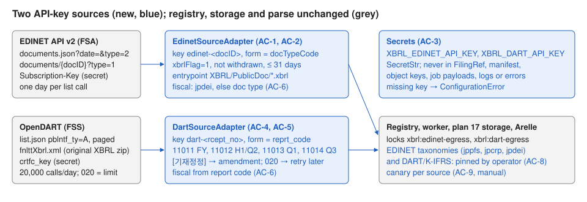

# 20 — Japan EDINET and Korea DART sources

Status: implemented, verified (accept) and merged to main. Depends on plans 17 and 18. Independent of
plan 19 (can run before or after it).

## Problem

Japanese issuers file securities reports with the FSA's EDINET, and Korean issuers
with the FSS's DART. Both regulators publish free APIs with XBRL downloads, gated by a
per-user key. The warehouse has no adapter for either.

What the plan relies on (checked 11 October 2026; items marked *verify* are confirmed
in step 0 against the official specifications before coding):

- **EDINET API v2.** `GET https://api.edinet-fsa.go.jp/api/v2/documents.json?date=YYYY-MM-DD&type=2&Subscription-Key=…`
  lists one day's documents (`docID`, `edinetCode`, `filerName`, `docTypeCode`,
  `periodStart`, `periodEnd`, `submitDateTime`, `xbrlFlag`, `withdrawalStatus`).
  `GET …/api/v2/documents/{docID}?type=1&Subscription-Key=…` returns the XBRL zip;
  errors can come back as JSON with HTTP 200. Specification: "EDINET API仕様書
  (Version 2)", FSA, October 2025. Document type codes 120/130 (annual/amended),
  140/150 (quarterly), 160/170 (semi-annual): *verify*.
- **OpenDART.** `GET https://opendart.fss.or.kr/api/list.json` (`crtfc_key`, `bgn_de`,
  `end_de`, `pblntf_ty=A` periodic reports, `page_no`, `page_count`, optional
  `corp_code`), status `000` OK, `013` no data, `020` daily limit (20,000 calls per
  key), `010`/`011` key problems. The original-XBRL download
  `GET /api/fnlttXbrl.xml?crtfc_key&rcept_no&reprt_code` returns a zip: *verify*
  (endpoint name and response). Keys may not be shared (terms).

### Before / after

| | Before | After |
|---|---|---|
| Toyota FY2023 securities report | unreachable | `edinet-S100TR7I`, form `120`, FY 2024 (period end 2024-03-31) |
| Samsung 2023 business report | unreachable | `dart-20240312000736`, form `11011`, FY 2023 |
| A key in a stored URL | n/a | never: keys only in the outgoing request |

## Scope

Contract surface:

- Settings: `edinet_api_key`, `dart_api_key` (`SecretStr | None`,
  `XBRL_EDINET_API_KEY`, `XBRL_DART_API_KEY`), `edinet_max_days` (31),
  `edinet_doc_types` (`120,130,140,150,160,170`), `dart_page_count` (100).
- `exceptions.py`: `SourceRateLimited(SourceAccessError)`, retryable in
  `is_retryable_exception` (like SEC deferrals).
- `sources/edinet.py`: `EDINET_POLICY` (`edinet`, hosts `{"api.edinet-fsa.go.jp"}`, ≤ 1
  request/s), `EDINET_SCHEME = "http://disclosure.edinet-fsa.go.jp"`,
  `EdinetSourceAdapter(settings, http, object_store, entity_keys)`.
  - discover: both bounds required, span ≤ `edinet_max_days` (`ValueError`
    otherwise); one list call per day in order; keep `xbrlFlag == "1"`,
    `withdrawalStatus == "0"`, `docTypeCode` in `request.forms` or the configured
    types, `edinetCode == request.entity` when set. `FilingRef`: `accession =
    "edinet-" + docID`, `cik = resolve_entity_key(EDINET_SCHEME, edinetCode)`, `form =
    docTypeCode`, `filed_date` = submit date, `report_date = periodEnd`,
    `is_amendment` for 130/150/170, `archive_directory_url` without the key.
    `metadata.status != "200"` → `SourceAccessError`.
  - download: zip (`type=1`); a non-zip body → `SourceAccessError`; existing zip
    limits; exactly one entrypoint: the `XBRL/PublicDoc/*.xbrl` instance (AuditDoc
    excluded), else `ArtifactIntegrityError`.
  - fiscal_focus: `jpdei_cor:CurrentFiscalYearEndDateDEI` year and
    `TypeOfCurrentPeriodDEI` (`FY`, `Q1`–`Q3`, `HY` → `H1`); without them, `FY` and the
    `report_date` year for 120/130, else unchanged.
- `sources/dart.py`: `DART_POLICY` (`dart`, hosts `{"opendart.fss.or.kr"}`, ≤ 1
  request/s), `DART_SCHEME = "https://opendart.fss.or.kr/corp_code"`,
  `DartSourceAdapter(settings, http, object_store, entity_keys)`.
  - discover: `list.json` with the window as `bgn_de`/`end_de`, `pblntf_ty=A`,
    `corp_code` when `request.entity` is set, all pages to `total_page`. Without
    `corp_code`, OpenDART searches at most 3 months, so a longer window is split into
    consecutive requests, each from its start date to the day before the same day three
    calendar months later (or `filed_to`), in order. With `corp_code` the window is sent
    whole. Keep
    사업보고서 (11011), 반기보고서 (11012), 분기보고서 (11013 for a `.03` period,
    11014 for `.09`); a `[기재정정]` prefix sets `is_amendment`; other reports are
    skipped. `FilingRef`: `accession = "dart-" + rcept_no`, `cik =
    resolve_entity_key(DART_SCHEME, corp_code)`, `form` = report code, `filed_date =
    rcept_dt`, `report_date` = last day of the `(YYYY.MM)` month. Status `013` → empty
    result; `020` → `SourceRateLimited`; other non-`000` → `SourceAccessError`.
  - download: `fnlttXbrl.xml` with `rcept_no` and `reprt_code`; a non-zip body →
    `SourceAccessError` (or `SourceRateLimited` for `020`); one `.xbrl` entrypoint.
  - fiscal_focus: 11011 `FY`, 11012 `H1`, 11013 `Q1`, 11014 `Q3`; year =
    `report_date` year.
- **Secrets (AC-3).** Keys are sent only as the regulator requires and are absent
  from `FilingRef`, manifests (`source_url`), object keys, job payloads, log records
  and exception messages (redact URLs before logging or raising). A missing key raises
  `ConfigurationError` before any request.
- **Taxonomies (AC-8).** Pinned EDINET taxonomy packages (FSA publishes yearly
  packages) and the taxonomies DART filings reference; `source_required_prefixes` for
  `edinet` and `dart`; taxonomy host allowlist additions recorded in SECURITY.md.
  Hashes come from an operator download (approval needed).
- Docs: DATA_MODEL (keys, forms, fiscal rules), OPERATIONS (keys, daily limits, one
  fetch worker per source), SECURITY (secrets, hosts, terms), `.env.example`.

Exclusions: EDINET CSV (`type=5`) and English documents, DART's JSON financial
statement APIs (`fnlttSinglAcntAll`), Japanese/Korean label translation, non-periodic
filings.

Invariants: keys never persisted or logged; each adapter only reaches its own host;
SEC behavior unchanged.



## Acceptance criteria

- **AC-1 EDINET discovery.** Per-day listing, filters, mapping, window bounds, missing
  key refusal.
- **AC-2 EDINET package.** Single PublicDoc instance entrypoint; JSON error body is an
  access error; missing instance rejected.
- **AC-3 Secrets.** No key in filings, manifests, object keys, errors or logs.
- **AC-4 DART discovery.** Report-code and amendment mapping, paging, entity filter,
  status `013`/`020`/others.
- **AC-5 DART package.** Original XBRL zip, single `.xbrl` entrypoint, missing
  instance rejected.
- **AC-6 Fiscal fields.** EDINET jpdei with fallback; DART from the report code.
- **AC-7 Policies.** Hosts and rates.
- **AC-8 Taxonomies (manual + review).** Pins and coverage; `taxonomy status` clean
  with both sources enabled.
- **AC-9 Canary (manual, operator).** With approval and the user's own keys: one week
  of each source, three filings each parsed offline.
- **AC-10 Regression.** Validate gates.

| Criterion | Acceptance | Verification |
|---|---|---|
| AC-1 | day listing, filters, mapping | no key, window bounds, withdrawn, amended, forms/entity |
| AC-2 | entrypoint, download URL | JSON body, no instance |
| AC-3 | success path + EDINET error | DART error path and logs |
| AC-4 | mapping, 013, 020 | paging, Q3, corp_code |
| AC-5 | download and entrypoint | no instance |
| AC-6 | fallbacks | jpdei facts, `HY` → `H1` |
| AC-7 | hosts and rates | — |
| AC-8–AC-9 | manual | manual |

## Implementation sequence

0. Verify the *verify* items against the official specifications (no keys needed to
   read them); record differences here before coding.
1. Settings, `SourceRateLimited`, policies (AC-7).
2. EDINET adapter (AC-1, AC-2, AC-6) with secret redaction (AC-3).
3. DART adapter (AC-4, AC-5, AC-6).
4. Registry wiring, taxonomy entries (AC-8, with operator pins). Docs. Validate.

## Verification

```bash
.venv/bin/pytest -c pyproject.toml --rootdir . ../Implementations/20-edinet-dart-sources/acceptance
.venv/bin/pytest -c pyproject.toml --rootdir . ../Implementations/20-edinet-dart-sources/verification
```

No live calls (canned responses through `httpx.MockTransport`). The verification set
imports `acceptance/api_fixtures.py`.

### Baseline (plan 17 candidate 131a87f, 11 October 2026)

All tests fail at import (`sec_xbrl_warehouse.sources` from plan 18 is missing).
Rerun on the accepted plan 18 commit before implementation.

### Plan-author correction (11 October 2026)

The implementer's step 0 found that OpenDART limits searches without `corp_code` to
3 months, while `test_ac4_dart_discovery` pinned one 4-month request. The test was
wrong against the official specification. The contract now splits long windows (above),
the acceptance test uses a 3-month window (2024-03-01 to 2024-05-31, amendment row
dated 2024-05-20), and the verification set gained a splitting test. No other
assertion changed.

## Completion evidence

### Implementer record

Branch `plan/20-edinet-dart-sources`, from plan 19's accepted commit 6e8e5d3 (11 October
2026). Only `implementation.md`, `diagrams/` and `acceptance/` were copied; the
`verification/` folder was not read, copied, or run. The copied `acceptance/` is
identical to the main checkout's (`diff -r`). No request went to EDINET, OpenDART, the
SEC, or a taxonomy host from code or tests (every test uses `httpx.MockTransport`). No
API key was used or invented. The main checkout's `.venv` and `.env` are symlinked and
not committed; no container was restarted and alembic was not run.

**Step 0 (specifications read with web tools, no keys).**

Sources: "EDINET API仕様書 (Version 2)", FSA 企画市場局 企業開示課, **June 2026**
edition (`https://disclosure2dl.edinet-fsa.go.jp/guide/static/disclosure/download/ESE140206.pdf`;
the plan cites the October 2025 edition); OpenDART developer guides
"공시검색" (`https://opendart.fss.or.kr/guide/detail.do?apiGrpCd=DS001&apiId=2019001`),
"재무제표 원본파일(XBRL)" (`https://opendart.fss.or.kr/guide/detail.do?apiGrpCd=DS003&apiId=2019019`),
and the English guide's status table (`https://engopendart.fss.or.kr/guide/detail.do?apiGrpCd=DE003&apiId=AE00030`).

Confirmed:

- EDINET document list `GET https://api.edinet-fsa.go.jp/api/v2/documents.json?date=YYYY-MM-DD&type=2&Subscription-Key=…`
  (3-1-1). `type` 1 = metadata only (default), 2 = list and metadata. Fields
  `docID`, `edinetCode`, `filerName`, `docTypeCode`, `periodStart`, `periodEnd`,
  `submitDateTime` (`YYYY-MM-DD hh:mm`, Japan time), `xbrlFlag`, `withdrawalStatus`
  (3-1-2-2). `metadata.status` is `"200"` on success.
- EDINET document download `GET …/api/v2/documents/{docID}?type=1&Subscription-Key=…`
  (3-2). `type=1` is the "submitted document and audit report" zip with
  `XBRL/PublicDoc/` and `XBRL/AuditDoc/`; 2 = PDF, 3 = attachments, 4 = English, 5 =
  CSV. Success is `application/octet-stream`; failure is `application/json`.
- EDINET errors come back **with HTTP 200** and a JSON body (3-3). Statuses: 400, 401
  (invalid key), 404, 429 (Too Many Requests), 500.
- Document type codes (4-1): 120 有価証券報告書, 130 訂正有価証券報告書, 140
  四半期報告書, 150 訂正四半期報告書, 160 半期報告書, 170 訂正半期報告書. The plan's
  mapping is right.
- OpenDART `list.json`: `crtfc_key` (40 characters), `corp_code`, `bgn_de`, `end_de`,
  `pblntf_ty` (`A` = periodic), `page_no`, `page_count` (1–100, default 10). Response:
  `status`, `message`, `page_no`, `page_count`, `total_count`, `total_page`, `list`
  (`corp_code`, `corp_name`, `report_nm`, `rcept_no`, `rcept_dt`, `rm`). Statuses:
  `000` OK, `010` unregistered key, `011` suspended key, `012` IP not allowed, `013`
  no data, `014` no file, `020` call limit ("usually 20,000", may differ per key),
  `021`, `100`, `101`, `800`, `900`, `901`.
- OpenDART original XBRL: endpoint `https://opendart.fss.or.kr/api/fnlttXbrl.xml`,
  parameters `crtfc_key`, `rcept_no`, `reprt_code` (11013 Q1, 11012 half-year, 11014
  Q3, 11011 annual). Success returns a binary zip; errors return
  `result.status`/`result.message`.

Different from the plan, or extra facts:

1. **EDINET 401/429 error shape.** The specification shows
   `{"StatusCode": 401, "message": "Access denied due to invalid subscription key. …"}`
   (top-level `StatusCode`, a number) for 401 and 429, and
   `{"metadata": {"title", "status": "404", "message"}}` for 400/404/500. The
   acceptance fixture answers 401 in the `metadata` shape. This isn't a contradiction
   (the test only needs a `SourceAccessError` without the key), so the adapter accepts
   both shapes. 429 raises `SourceRateLimited`.
2. **OpenDART three-month limit.** Without `corp_code`, the search range is limited to
   three months. `test_ac4_dart_discovery` sends one request for 2024-03-01 to
   2024-06-30 without a company (four months) and pins that single request's
   `bgn_de`/`end_de`, so the adapter can't split the window. The spec doesn't say what
   the server answers to a longer window; the adapter turns any non-`000` status into
   a `SourceAccessError`, so it fails loudly, never silently. OPERATIONS.md tells
   operators to keep windows to three months without an entity. **For the plan
   author:** consider a `dart_max_days`-style split (it would need a different
   acceptance window).
3. EDINET `withdrawalStatus` is `"0"` normal, `"1"` withdrawal notice, `"2"` withdrawn
   (3-1-5). Records with `docInfoEditStatus` `"1"` are later notices that the FSA
   corrected an earlier document's metadata (3-1-6), and `disclosureStatus` `"1"`/`"2"`
   marks documents the FSA hid. The adapter skips all three (a field missing from a
   record counts as `"0"`).
4. The `date` parameter is the list's file date: a day's list also carries documents
   submitted by disk or paper earlier, plus metadata notices. `filed_date` comes from
   `submitDateTime`, as the plan says, and no date filter is applied.
5. OpenDART's `rm` remark uses `철` for a withdrawn filing; such reports are skipped.
   `report_nm` can carry correction tags such as `[기재정정]` and `[첨부정정]`; both
   set `is_amendment`.
6. The OpenDART guide lists `rcept_no` as `STRING(8)` but describes 14 digits; the
   adapter requires 14 digits.
7. I couldn't confirm the DART taxonomy's namespace host from official pages.
   `source_required_prefixes.dart` is `dart.fss.or.kr/`, marked unverified; no DART
   taxonomy host was added to the allowlist.

**Baseline (unmodified 6e8e5d3).** Acceptance: 8 failed, 0 passed: 7
`ModuleNotFoundError` (`sources.edinet`, `sources.dart`) and 1 `ImportError`
(`SourceRateLimited`).

**Criteria.**

- AC-1: `sources/edinet.py` `EdinetSourceAdapter.discover` requires both bounds,
  `filed_from <= filed_to`, and at most `edinet_max_days` days (inclusive), and
  validates the entity (EDINET code `[A-Z][0-9]{5}`, upper-cased) before any request.
  It reads one list per day, oldest first, with `type=2`, and keeps the records the
  plan names (plus step-0 item 3). Mapping is as the contract says: `cik` from
  `resolve_entity_key(EDINET_SCHEME, edinetCode)` once per code per run, one `Company`
  per code, and records with a malformed `docID`, code or date skipped and logged
  (`edinet_record_skipped`). `metadata.status != "200"` (or a top-level `StatusCode`)
  raises `SourceAccessError`; 429 raises `SourceRateLimited`.
- AC-2: `download_package` fetches `type=1` through `SourceHttpClient.download`
  (filing byte limit). A non-zip body is parsed as EDINET's error JSON and raises
  `SourceAccessError` (or `SourceRateLimited`), storing nothing. The zip goes through
  `sources/keyed.store_zip_package`: the bulk ZIP checks scoped to
  `filing_max_members`/`filing_max_bytes`, safe member names, exactly one
  `XBRL/PublicDoc/*.xbrl` entrypoint (AuditDoc and nested folders excluded), and
  storage byte-identical at `filing_package_key(filing, sha256)`. A failing zip is
  quarantined at `quarantine/edinet/filings/<key>/sha256=<digest>/package.zip`. The
  manifest is stored at the plan 19 key shape and reused when identical bytes come
  back.
- AC-3: see "Secrets" below.
- AC-4: `sources/dart.py` `DartSourceAdapter.discover` requires both bounds and an
  8-digit `corp_code` entity. It sends `bgn_de`/`end_de`, `pblntf_ty=A`, `page_no`,
  `page_count` (`dart_page_count`) and `corp_code`, and pages through `total_page`.
  `report_code()` maps 사업보고서 → 11011, 반기보고서 → 11012, 분기보고서 `.03` → 11013
  and `.09` → 11014 (other quarter months are skipped: a non-December year end's
  quarter can't be told apart without the year end), and sets the report date to the
  last day of the `(YYYY.MM)` month. `013` gives an empty result, `020` raises
  `SourceRateLimited` (retry no earlier than 00:05 KST the next day), and any other
  non-`000` raises `SourceAccessError`.
- AC-5: `download_package` calls `fnlttXbrl.xml` with `rcept_no` and `reprt_code`
  (the filing's form). A non-zip body is parsed as OpenDART's XML or JSON status (`020`
  → `SourceRateLimited`, otherwise `SourceAccessError`) and stores nothing. The zip
  needs exactly one `.xbrl` member and otherwise goes to `quarantine/dart/`.
- AC-6: EDINET reads the non-nil, non-dimensional jpdei facts
  `CurrentFiscalYearEndDateDEI` (year) and `TypeOfCurrentPeriodDEI` (`FY`, `Q1`,
  `Q2`, `Q3`, `HY` → `H1`). Conflicting or unknown values fall back with a
  `warehouse:fiscalFocusInvalid` warning. Without them, 120/130 get `FY` and the
  report-date year, and other forms keep their values. DART: 11011 `FY`, 11012 `H1`,
  11013 `Q1`, 11014 `Q3`, and the report-date year.
- AC-7: `EDINET_POLICY` (`edinet`, `{"api.edinet-fsa.go.jp"}`) and `DART_POLICY`
  (`dart`, `{"opendart.fss.or.kr"}`), each 1 request/s with concurrency 1.
  `edinet_policy(settings)` and `dart_policy(settings)` add the warehouse user agent.
  `source_policies` now returns all four policies after `check_disjoint_hosts`, and
  no source host is a taxonomy host.
- AC-8 (partial, see operator steps): `source_required_prefixes.edinet =
  [disclosure.edinet-fsa.go.jp/taxonomy/]` and `.dart = [dart.fss.or.kr/]`, equal to
  `EDINET_TAXONOMY_PREFIXES` and `DART_TAXONOMY_PREFIXES` (a test checks both). With
  either source enabled the prefix is `uncovered`, so `taxonomy status` and `doctor`
  fail and offline extraction refuses to start until pins exist (fail closed). The
  taxonomy host allowlist (settings default, `network_policy`, `.env.example`) adds
  `disclosure.edinet-fsa.go.jp` and `disclosure2dl.edinet-fsa.go.jp`. No pinned
  package was added.
- Wiring: `runtime_services` adds `EdinetSourceAdapter`/`DartSourceAdapter` for
  enabled sources. A worker whose job types need the network checks the key first
  (`ConfigurationError` before any client, lock, or store is built), checks the user
  agent, and builds a `SourceHttpClient` with the source's policy and
  `SourceEgressLock(source=<code>)`. Parse-only workers get `http=None` and need no
  key.
- Settings: `edinet_api_key`, `dart_api_key` (`SecretStr | None`; empty means unset),
  `edinet_max_days` (31), `edinet_doc_types` (`120,…,170`, three-digit codes),
  `dart_page_count` (100, 1–100). `SourceRateLimited` is a `SourceRetryDeferred` (so a
  `SourceAccessError`) with a `retry_at`, retryable in `is_retryable_exception`, and the
  worker schedules the retry no earlier than `retry_at`.

**Secrets (AC-3).** Keys are sent only as `Subscription-Key` / `crtfc_key` in the
outgoing request. `SourcePolicy.secret_params` names those parameters, and
`SourceHttpClient` masks their values (`[REDACTED]`) in every URL it logs (retry
warnings), every error message, and the resumable-download sidecar. It also masks
library exception arguments before chaining, and a `logging.Filter` on the
`httpx`/`httpcore` loggers masks their request logs. The adapters build filing
references, manifest `source_url`s, object metadata and job payloads from keyless
URLs, and `sources/keyed.redacted` re-raises any failure whose text or chain still
holds the key, masked and unchained. A missing key raises `ConfigurationError` before
any request. Two gaps found while reviewing were closed: the Arelle child's
`child_settings` now blanks both keys, and the `worker-parse` Compose service blanks
`XBRL_EDINET_API_KEY`/`XBRL_DART_API_KEY` (the `api` service never receives `.env`).
For SEC traffic nothing changes: its policy has no secret parameters, so every masked
string equals the original.

**Regression tests added:** `tests/unit/test_edinet_dart_sources.py`, 34 tests.
They cover: missing key refused before any request; window, entity and bound checks
sending nothing; inclusive day limit; filters (withdrawn 1/2, hidden, edit notice,
forms, entity, malformed ID, duplicate) and mapping; both EDINET error shapes and
429; JSON body on download storing nothing; four invalid EDINET packages quarantined;
idempotent, keyless storage; foreign source refused; report-code table; DART paging,
`rm` withdrawal, unknown quarter month, entity and forms filters; key-status errors
without the key; download `020` (XML and JSON) and `014`; invalid DART packages
quarantined; jpdei fiscal focus (H1, Q2, unchanged, conflict); DART fiscal focus;
`redact_params`; a log-capture test (structlog events and stdlib records including
httpx request logs, through a 503 retry, a transport-error retry, an HTTP 401, and two
successful downloads) asserting no record, error chain, manifest, payload, object key
or stored byte holds either key; interrupted-download sidecar masked; settings repr,
`child_settings` and doc-type parsing; Compose `worker-parse`/`api` without keys; the
adapter guard; disjoint policies, user agent and cross-host refusal; fail-closed
prefixes; and `runtime_services` wiring (locks, parse-only without keys, missing-key
refusal before anything is built).

**Existing test changed (one line).** `tests/unit/test_esef_source.py::test_policies_have_disjoint_hosts`
asserted `set(source_policies(...)) == {"sec", "esef"}`. Adding the two policies to
`source_policies` (the plan's "extend the existing check") makes that exact set
`{"sec", "esef", "edinet", "dart"}`. The assertion was updated to the new set; nothing
else in the test changed and nothing was weakened.

**Commands** (from `sec-xbrl-warehouse/`, the main checkout's venv and `.env`):

| Command | Result |
| --- | --- |
| `pytest -c pyproject.toml --rootdir . ../Implementations/20-edinet-dart-sources/acceptance` (3 runs) | 8 passed every run |
| `python -m compileall -q src tests scripts` | pass |
| `ruff check .` | pass |
| `ruff format --check .` | pass (192 files) |
| `mypy src` | pass (89 files) |
| `pytest -m "not integration"` with the live `.env` | 551 passed, 1 failed (`test_repository_registry_entries_are_on_allowed_hosts`, deviation 2), 1 skipped |
| `pytest -m "not integration"` with `XBRL_ARELLE_ALLOWED_TAXONOMY_HOSTS` set to the new default | 552 passed, 1 skipped (sec-2024.zip not installed) |
| `python scripts/scan_stubs.py` | 0 markers |
| `RUN_XBRL_INTEGRATION=1 pytest -m integration` | 52 passed |

**Deviations.**

1. The OpenDART three-month window (step-0 item 2): implemented as the acceptance test
   pins it (one request per window); a longer window without a company fails loudly
   with OpenDART's status.
2. **Taxonomy host allowlist vs. the live `.env`.** As in plan 19: the live `.env`
   still sets `XBRL_ARELLE_ALLOWED_TAXONOMY_HOSTS` to the pre-plan-19 list, so the
   existing registry test fails with it and passes with the new default.
3. Additions beyond the contract: `sources/keyed.py` (shared key, redaction and
   package code), `SourcePolicy.secret_params` and `redact_params`, `edinet_policy` /
   `dart_policy`, `report_code`, `normalize_edinet_code`, skipping hidden documents,
   edit notices and `rm` withdrawals, `[첨부정정]` as an amendment, the
   `SourceRateLimited` `retry_at` (15 minutes for EDINET 429, next 00:05 KST for DART
   `020`), the DART bounds and entity checks, `child_settings` and Compose key
   blanking, and quarantine of invalid zips (plan 19's precedent, hard constraint 5).
   `is_inline_xbrl` is false for both sources because the entrypoint is the `.xbrl`
   instance. `archive_directory_url` is the keyless API URL (EDINET document,
   DART `fnlttXbrl.xml` query).
4. Neither API publishes a digest, so a re-fetch downloads again and reuses the stored
   package and manifest only when the bytes match.

**Limitations.**

- No live response was seen. The EDINET zip layout (`XBRL/PublicDoc/` at the zip
  root) follows the specification's figure; the DART zip layout (a flat set with one
  `.xbrl`) and taxonomy host are unverified until the canary.
- Quarterly DART reports for March year-end (and other non-December) companies use
  months other than `.03`/`.09` and are skipped; half-year and annual reports are
  kept.
- `SourceRateLimited` spends a job attempt (it isn't a lock deferral): a DART backfill
  that keeps hitting `020` can go dead after `worker_max_attempts` days.
- EDINET/DART requests are counted in the `SEC_REQUESTS` metric by host (as for ESEF).

**Left for the operator** (each step that sends traffic needs approval):

1. Register your own EDINET and OpenDART API keys and put them in `.env`
   (`XBRL_EDINET_API_KEY`, `XBRL_DART_API_KEY`); never share or commit them.
2. Add `disclosure.edinet-fsa.go.jp,disclosure2dl.edinet-fsa.go.jp` (and the plan 19
   hosts) to `XBRL_ARELLE_ALLOWED_TAXONOMY_HOSTS` in `.env`.
3. Download the FSA's EDINET taxonomy packages and the taxonomy DART filings import,
   record SHA-256 and size as pinned entries, narrow `source_required_prefixes` to the
   releases in use (and confirm DART's host and add it to the allowlist), then run
   `taxonomy sync` and `taxonomy status` until nothing is `uncovered`.
4. AC-9 canary: enable `edinet` and `dart`, discover one week of each, ingest three
   filings each with offline parsing, and confirm the facts (OPERATIONS.md, "EDINET
   and DART filings").

#### Corrections (round 2)

The plan author ruled on step-0 item 2: the acceptance test was wrong against the
specification, and the contract now splits long DART windows (see "Plan-author
correction"). This supersedes step-0 item 2, deviation 1, and the OPERATIONS.md advice
to split windows by hand.

- `acceptance/test_edinet_dart_acceptance.py` was copied from the main checkout
  byte-identical (`cmp`; `diff -r` of `acceptance/` matches). The only change is
  `test_ac4_dart_discovery`'s 3-month window (2024-03-01 to 2024-05-31, amendment
  row dated 2024-05-20). The two plan edits (the extended `discover:` bullet and the
  "Plan-author correction" section) were applied here; everything above the
  Implementer record now matches the main checkout's copy.
- `sources/dart.search_windows(start, end, by_company)` returns the searches. With a
  corp_code it returns one window. Without one, each window runs from its start to the
  day before the same day three calendar months later, or to `filed_to` if earlier,
  and the next starts the following day. A day the target month lacks becomes that
  month's last day (2023-11-30 → 2024-02-28; 2024-01-31 → 2024-04-29), so no day is
  skipped or searched twice. `discover` runs the windows in order and pages each to
  its `total_page`; a `013` window is empty and the next one still runs.
- Regression tests (`tests/unit/test_edinet_dart_sources.py`, now 36):
  `test_search_windows_split_into_three_calendar_months` covers the contract example
  (2024-01-15..2024-08-10 → (20240115, 20240414), (20240415, 20240714), (20240715,
  20240810)), an exact 3-month window, month-end starts in a leap year, a one-day
  window, the corp_code case, and every start day from 2023-01-01 to 2024-12-31 over
  a 401-day range: windows tile the range with no gap or overlap and none exceeds 92
  days. `test_dart_long_window_is_searched_in_order_and_paged` checks the request
  sequence (window 1 pages 1–2, window 2 `013`, window 3) and that a corp_code search
  sends the whole window once.
- Docs: OPERATIONS.md describes the automatic split and its effect on the daily call
  budget; DATA_MODEL.md, "DART filings", states the rule.

| Command (round 2) | Result |
| --- | --- |
| acceptance, 3 runs | 8 passed every run |
| `python -m compileall -q src tests scripts` | pass |
| `ruff check .` / `ruff format --check .` | pass / 192 files formatted |
| `mypy src` | pass (89 files) |
| `pytest -m "not integration"` with the live `.env` | 553 passed, 1 failed (`test_repository_registry_entries_are_on_allowed_hosts`, deviation 2), 1 skipped |
| same with `XBRL_ARELLE_ALLOWED_TAXONOMY_HOSTS` set to the new default | 554 passed, 1 skipped (sec-2024.zip not installed) |
| `python scripts/scan_stubs.py` | 0 markers |
| `RUN_XBRL_INTEGRATION=1 pytest -m integration` | 52 passed |

### Verifier record

**Verdict: ACCEPT** candidate 5627947 (11 October 2026), with two non-blocking
follow-ups below.

Setup: branch `verify/20-edinet-dart-sources` at 5627947. `verification/` was copied
from the main checkout. `acceptance/` matches the main checkout's copy (`diff -r`), and
so do lines 1–164 of this file, everything above "Completion evidence" (`cmp`). The
main checkout's `.env` and `.venv` are symlinked and not committed. No container was
touched, alembic wasn't run, nothing reached a regulator, and no API key was used.

| Command (from `sec-xbrl-warehouse/`) | Result |
| --- | --- |
| verification set | 9 passed (includes `test_ac4_dart_long_window_is_split`) |
| acceptance set, 3 runs | 8 passed every run |
| `python -m compileall -q src tests scripts` | pass |
| `ruff check .` / `ruff format --check .` | pass / 192 files formatted |
| `mypy src` | pass (89 files) |
| `pytest -m "not integration"` with the live `.env` | 553 passed, 1 failed (`test_repository_registry_entries_are_on_allowed_hosts`), 1 skipped |
| same with `XBRL_ARELLE_ALLOWED_TAXONOMY_HOSTS` set to the new default | 554 passed, 1 skipped (sec-2024.zip not installed) |
| `python scripts/scan_stubs.py` | 0 markers |
| `RUN_XBRL_INTEGRATION=1 pytest -m integration` | 52 passed |

The single failure with the live `.env` comes from the `.env` itself, which pins the
pre-plan-19 host list. The new default adds only `disclosure.edinet-fsa.go.jp` (where
the EDINET taxonomy namespaces and schemas live) and `disclosure2dl.edinet-fsa.go.jp`
(the FSA's download host). Neither is a source API host, and both stay behind
`reject_unlisted_hosts`/`require_https`. No DART host was added. That's correct while
the DART namespace host is unconfirmed.

**Review of `6e8e5d3..5627947`.** I also ran 25 throwaway adversarial probes; they
aren't committed.

- Secrets (AC-3) hold. Keys only appear in the outgoing query. I sent HTTP
  401/403/404/500/503 on the list call, a same-host redirect whose `Location` carries
  the key followed by a 500, a redirect to a foreign host (refused, and only the
  EDINET host was ever contacted), and transport errors that echo the full URL, a
  lower-case `subscription-key=` and a `%3D`-encoded form, on discover and on both
  downloads. In every case the exception chain (str and args), structlog output,
  stdlib records (`httpx` and `httpcore` at DEBUG), stored objects and their paths,
  the manifest JSON, `Settings` repr and dump, and the Prometheus exposition held no
  key. A missing or blank key raises `ConfigurationError` with zero requests, for both
  discover and download on both sources. The Arelle child gets `child_settings` with
  both keys blanked, and `_CHILD_SECRET_ENV` (`API_KEY`) strips the environment
  variables. Compose blanks both keys on `worker-parse`, and `api` never receives
  `.env`.
- SEC and ESEF are unchanged. Their policies have empty `secret_params`, so
  `_show`/`_scrub` are identities, the sidecar URL comparison is unchanged, and the
  httpx log filter is only installed for keyed policies. The full unit and
  integration suites pass. The four policies' host sets are disjoint, and neither new
  API host is a taxonomy host.
- Discovery is correct:
  - EDINET loops one list per day, oldest first, with `type=2`. It needs both bounds
    and an inclusive span of at most `edinet_max_days`. It filters on `xbrlFlag`,
    `withdrawalStatus`, hidden and edit-notice records, forms and entity.
  - DART maps the report codes (11013/11014 only for `.03`/`.09`) and amendments. It
    skips `rm` 철. Status 013 gives an empty search and the next window still runs,
    020 raises `SourceRateLimited` (retryable, `retry_at` honoured by the worker),
    and any other status raises `SourceAccessError`. It pages each window to
    `total_page`. `search_windows` tiles 3,000 random ranges with no gap or overlap,
    keeps every non-final window maximal, and stays under three calendar months.
    With a corp_code it sends a single window.
- Package and fiscal rules hold. Traversal, case-duplicate, missing-instance and
  several-instance zips, and AuditDoc-only or nested PublicDoc instances are all
  rejected and quarantined under `quarantine/<source>/filings/<accession>/`. Error
  bodies store nothing. A re-download reuses the stored package. Fiscal focus follows
  the contract. Prefixes fail closed (`coverage_gaps` test).
- The edited existing line (`assert set(policies) == {"sec", "esef", "edinet", "dart"}`
  in `test_esef_source.py`) is acceptable. Registering the two new policies, which
  AC-7 requires, has to change it. It's still an exact-set assertion, and nothing
  else in the test was loosened.
- I couldn't spot-check the step-0 claims against the FSA/FSS pages this session
  because the web tool was unavailable. The claims match the plan-author correction
  and the accepted contract.

**Rulings on deviations.**

1. Manual DART window split: superseded by round 2, which implements the contract's
   automatic split. Resolved.
2. Live `.env` host list: accepted. It's an operator `.env` update, already listed in
   HANDOFF and in "Left for the operator".
3. Additions beyond the contract: accepted. `keyed.py`, `secret_params` with
   `redact_params`, the policy helpers, the hidden/edit-notice/`rm` skips,
   `[첨부정정]` as an amendment, `retry_at`, the entity and bound checks, child and
   Compose key blanking, and quarantine all tighten behavior or follow plan 19's
   precedent.
4. No digest from either API, so the package is re-downloaded and reused by bytes:
   accepted.

**Non-blocking follow-ups.**

- `sources/dart.report_code` sets `is_amendment` whenever a tag contains `정정`, so
  `[정정명령부과]사업보고서 (2023.12)` and `[정정제출요구]…` return `is_amendment=True`.
  The OpenDART guide describes those two tags as FSS correction orders on the report
  itself, not as filed corrections. This goes beyond the contract (which pins only
  `[기재정정]`) and beyond the implementer's own note (`[기재정정]`, `[첨부정정]`). The
  flag is stored metadata only: no selection logic reads it. Match the two
  correction tags exactly.
- `SourceHttpClient` masks credential parameters, not the bare key. A library
  exception whose text held the key outside `name=value` form would reach the retry
  warning log. The final exception is still cleaned by `keyed.redacted`. httpx's own
  messages don't take that form, so this is hardening only.
