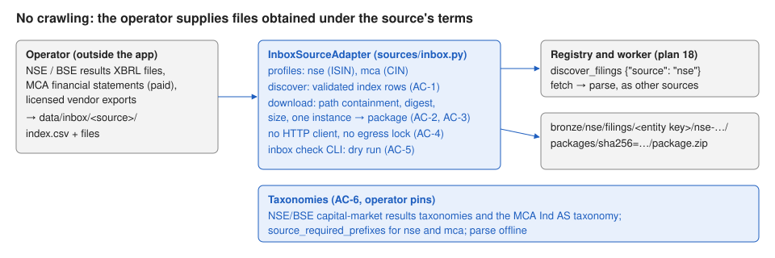

# 21 — Operator file inbox, with India (NSE and MCA) profiles

Status: draft for review (11 October 2026). Depends on plans 17 and 18. Plan 22
reuses this adapter for Singapore.

## Problem

India has machine-readable XBRL, but no free regulator API comparable to EDGAR,
EDINET or DART:

- **NSE / BSE.** Listed companies file financial results in XBRL; NSE's corporate
  filings pages link an "XBRL file" per submission ("Integrated Filing – Financials"
  from the March 2025 quarter on). No public bulk API or data licence was found
  (11 October 2026); the exchange sites use bot protection, and their terms weren't
  confirmed.
- **MCA21.** Companies file Ind AS financial statements (AOC-4 XBRL) with the
  Ministry of Corporate Affairs; public copies are sold per document.

Automated crawling of these sites isn't acceptable without confirmed terms, so this
plan doesn't fetch anything. It adds an **inbox adapter**: the operator obtains files
under the source's terms (manual download, purchase, a licensed vendor) and places
them with an `index.csv` in `data/inbox/<source>/`. From there they go through the same
discovery → fetch → parse jobs as every other source, with the same raw-artifact
guarantees.

### Before / after

| | Before | After |
|---|---|---|
| Reliance Q4 FY2024 results XBRL downloaded by the operator | can't be loaded | `index.csv` row → `nse-RELIANCE-2024-Q4`, entity key from ISIN `INE002A01018` |
| An AOC-4 XBRL bought from MCA | can't be loaded | `mca-<id>` filing, entity key from the CIN |
| A typo in the index | n/a | `xbrl-warehouse inbox check --source nse` lists it before anything is queued |

## Scope

Contract surface:

- Settings: `inbox_dir: Path = Path("data/inbox")` (`XBRL_INBOX_DIR`), created by
  `ensure_directories`.
- `sources/inbox.py`:
  - `InboxProfile(code, entity_scheme, entity_pattern, default_fiscal_period)`.
  - `NSE_PROFILE`: `code="nse"`, `entity_scheme="urn:isin"`, ISIN pattern
    `^[A-Z]{2}[A-Z0-9]{9}[0-9]$`, default `FY`.
  - `MCA_PROFILE`: `code="mca"`, `entity_scheme="https://www.mca.gov.in/cin"`, CIN
    pattern `^[LU][0-9]{5}[A-Z]{2}[0-9]{4}[A-Z]{3}[0-9]{6}$`, default `FY`.
  - `InboxSourceAdapter(settings, object_store, entity_keys, profile)`; its `code` is
    the profile's.
- **Index** `<inbox_dir>/<code>/index.csv`, UTF-8 with a header. Required columns:
  `native_id, entity_id, company_name, form, filed_date, period_end, file`; optional:
  `entity_scheme` (overrides the profile's), `fiscal_period`, `sha256`, `source_url`
  (provenance only, never fetched). A missing required column → `ValueError` naming it.
  Duplicate `native_id` → `ValueError` naming it. No folder or no rows → empty result.
- **discover**: each valid row becomes `FilingRef(accession = f"{code}-{native_id}",
  cik = resolve_entity_key(scheme, entity_id), form, filed_date, report_date =
  period_end, fiscal_period = row value or profile default, fiscal_year = period_end
  year, archive_directory_url = "inbox://<code>/<native_id>")` filtered by window
  (`filed_date`), `request.entity` and `request.forms`. Rows with an invalid key, ISO
  date or entity id (profile pattern) are skipped and logged. One `Company` per entity.
- **download_package**: resolve `file` inside `<inbox_dir>/<code>/` after following
  symlinks (absolute paths, `..` and escaping links → `ArtifactIntegrityError`), require
  it to exist and fit `filing_max_bytes`, check `sha256` when given. A `.zip` is
  validated with the existing zip limits and must contain exactly one instance
  (`.xbrl`, `.xml` with an XBRL root, `.xhtml`/`.html` inline); a single `.xbrl`/`.xml`/
  `.xhtml`/`.html` file is stored as a one-member package. Anything else →
  `ArtifactIntegrityError`. The package is stored at `filing_package_key`; the inbox
  file is never modified or deleted. Re-reading changed bytes yields a new
  content-addressed package (the earlier one stays).
- **fiscal_focus**: keeps the discovery values; fills `FY` and the `report_date` year
  when absent.
- No HTTP client and no egress lock for inbox sources; `runtime_services` builds an
  inbox adapter for each enabled inbox profile.
- **CLI** `xbrl-warehouse inbox check --source <code>`: validates every row (fields,
  key, entity id, file containment and existence, digest when given), prints one line
  per problem with the row's `native_id` or file, then `<n> valid, <m> problems`;
  exit code 1 when there are problems. Queues nothing.
- **Taxonomies (AC-6)**: pins for the NSE/BSE results taxonomies and the MCA Ind AS
  taxonomy (operator downloads with approval), `source_required_prefixes.nse/mca`.
- Docs: OPERATIONS (inbox layout, index columns, `inbox check`, the terms rule),
  DATA_MODEL (keys, `inbox://` provenance), SECURITY (path containment, operator-supplied
  files are untrusted input), `.env.example`.

Exclusions: any crawler or scraper for NSE, BSE or MCA; BSE as a separate profile
(its files can use `nse`'s ISIN profile or a later profile); PDF results.

Invariants: no network access from inbox sources; inbox files never leave
`inbox_dir/<code>`; raw bytes stored unchanged; SEC behavior unchanged.



## Acceptance criteria

- **AC-1 Index → filings.** Mapping, window/entity/form filters, fiscal fields,
  duplicates, missing columns, empty states, bad rows skipped.
- **AC-2 Packages.** Single file and zip packages, entrypoint, storage key, inbox
  unchanged, content addressing on change.
- **AC-3 Containment and limits.** `..`, absolute paths, escaping symlinks, digest
  mismatch, size, missing file, two instances, non-XBRL file.
- **AC-4 Profiles.** Codes and schemes; no network.
- **AC-5 `inbox check`.** Problems listed, summary line, exit code, nothing queued.
- **AC-6 Taxonomies (manual + review).**
- **AC-7 Canary (manual, operator).** Three operator-supplied NSE results files load
  and parse offline.
- **AC-8 Regression.** Validate gates.

| Criterion | Acceptance | Verification |
|---|---|---|
| AC-1 | mapping, window, fiscal fields | duplicates, missing column, empty, filters, bad rows, defaults |
| AC-2 | single file, zip | changed bytes |
| AC-3 | `..`, absolute, digest | symlink escape, size, two instances, text file, missing file |
| AC-4 | profiles | — |
| AC-5 | CLI | — |
| AC-6–AC-7 | manual | manual |

## Implementation sequence

1. Settings, profiles, index reader (AC-1, AC-4).
2. Package building with containment (AC-2, AC-3).
3. `inbox check` (AC-5); registry wiring for enabled inbox profiles.
4. Taxonomy entries (AC-6, operator pins). Docs. Validate.

## Verification

```bash
.venv/bin/pytest -c pyproject.toml --rootdir . ../Implementations/21-file-inbox-india/acceptance
.venv/bin/pytest -c pyproject.toml --rootdir . ../Implementations/21-file-inbox-india/verification
```

Local files only. The verification set imports `acceptance/inbox_fixtures.py`.

### Baseline (plan 17 candidate 131a87f, 11 October 2026)

All tests fail at import (`sec_xbrl_warehouse.sources` from plan 18 is missing; no
`inbox` CLI group). Rerun on the accepted plan 18 commit before implementation.

## Completion evidence

### Implementer record

### Verifier record
