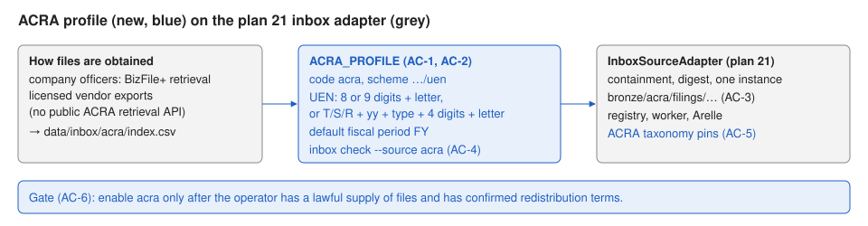

# 22 — Singapore ACRA financial statements (inbox profile)

Status: implemented, verified (accept) and merged to main. Depends on plan 21 (inbox adapter), and
through it on plans 17 and 18.

## Problem

Singapore companies file financial statements in XBRL with ACRA (BizFinx). As of 11
October 2026 there is no public ACRA retrieval API: authorised officers of a company
(directors, company secretary, registered filing agent) can retrieve that company's
own XBRL through BizFile+, ACRA's API is for submission, and third-party vendors
resell ACRA XBRL financials. SGX announcements are mostly PDF.

So, like India, Singapore comes in through the operator inbox (plan 21). This plan
adds the ACRA profile, UEN entity keys, and the ACRA taxonomy pins.

### Before / after

| | Before | After |
|---|---|---|
| A company's FY2024 XBRL statements (from its officers or a vendor) | can't be loaded | `index.csv` row → `acra-<id>`, entity key from UEN `201912345K` |
| A bad UEN in the index | n/a | row skipped; `inbox check --source acra` reports it |

## Scope

- `sources/inbox.py`: `ACRA_PROFILE = InboxProfile(code="acra",
  entity_scheme="https://www.acra.gov.sg/uen", entity_pattern=UEN pattern,
  default_fiscal_period="FY")`. UEN pattern:
  `^([0-9]{8}[A-Z]|[0-9]{9}[A-Z]|[TSR][0-9]{2}[A-Z]{2}[0-9]{4}[A-Z])$` (business,
  local company, other entities).
- `inbox check` and `runtime_services` know the `acra` profile; `acra` is a valid
  `enabled_sources` value.
- Taxonomies (AC-5): pins for the ACRA taxonomy versions in use (operator download
  with approval) and `source_required_prefixes.acra`; host allowlist addition in
  SECURITY.md.
- Docs: OPERATIONS (how ACRA files may be obtained, the inbox steps, the terms gate),
  DATA_MODEL (UEN keys), SECURITY.

Exclusions: any BizFile+ automation (it needs a company officer's Singpass login,
which the warehouse must never hold), SGX announcements, vendor API integrations
(a later plan once a vendor and licence are chosen).

Invariants: as plan 21; no credentials for ACRA systems are stored or used.



## Acceptance criteria

- **AC-1 Profile.** Code, scheme, default fiscal period; `acra` accepted in
  `enabled_sources`.
- **AC-2 UEN keys.** Valid UENs of all three shapes become entity keys; malformed or
  lower-case UENs are skipped; FY and the period-end year (June year-ends included).
- **AC-3 Package.** Stored under `bronze/acra/filings/`, instance entrypoint.
- **AC-4 `inbox check`.** Works for `acra`.
- **AC-5 Taxonomies (manual + review).**
- **AC-6 Gate (manual).** The operator records how files are obtained and confirms
  redistribution terms before enabling `acra` outside local testing.
- **AC-7 Regression.** Validate gates.

| Criterion | Acceptance | Verification |
|---|---|---|
| AC-1 | profile | enable setting |
| AC-2 | one valid, one invalid | three shapes, lower case, wrong prefix, empty |
| AC-3 | package | — |
| AC-4 | — | CLI |
| AC-5–AC-6 | manual | manual |

## Implementation sequence

1. `ACRA_PROFILE` and wiring (AC-1, AC-2, AC-4).
2. Taxonomy pins (AC-5, operator). Docs. Validate.

## Verification

```bash
.venv/bin/pytest -c pyproject.toml --rootdir . ../Implementations/22-singapore-acra/acceptance
.venv/bin/pytest -c pyproject.toml --rootdir . ../Implementations/22-singapore-acra/verification
```

`acceptance/inbox_fixtures.py` is a copy of plan 21's.

### Baseline (plan 17 candidate 131a87f, 11 October 2026)

All tests fail at import (`sec_xbrl_warehouse.sources`, plans 18 and 21). Rerun on
the accepted plan 21 commit before implementation.

## Completion evidence

### Implementer record

Branch `plan/22-singapore-acra`, from plan 21's accepted commit de96833 (13 October
2026). Only `implementation.md`, `diagrams/` and `acceptance/` were copied (identical
to the main checkout's by `diff -r` and `cmp`); `verification/` wasn't read, copied,
or run. Nothing sent a request anywhere: no code path or test touches ACRA, BizFile+,
SGX, the SEC, or a taxonomy host, and no credential was handled. The main checkout's
`.venv` and `.env` are symlinked and not committed. No container was restarted and
alembic wasn't run.

**Baseline (unmodified de96833).** Acceptance: 3 failed, 0 passed, all
`ImportError: cannot import name 'ACRA_PROFILE'`.

**Criteria.**

- AC-1: `sources/inbox.ACRA_PROFILE = InboxProfile(code="acra",
  entity_scheme="https://www.acra.gov.sg/uen", entity_pattern=<the plan's UEN
  pattern>, default_fiscal_period="FY", taxonomy_prefixes=("www.acra.gov.sg/taxonomy/",))`,
  added to `INBOX_PROFILES`. `acra` already passed `is_source_code`, so
  `XBRL_ENABLED_SOURCES=sec,acra` is accepted with no config change (tested).
- AC-2: the existing inbox adapter applies the UEN pattern with `re.fullmatch` on the
  trimmed cell, so all three shapes (business `nnnnnnnnX`, local company
  `yyyynnnnnX`, other entities `[TSR]yyPQnnnnX`) become entity keys under the UEN
  scheme, and lower-case, hyphenated, wrong-prefix, wrong-length and empty values are
  skipped (`inbox_row_skipped`). `fiscal_period` defaults to `FY`; `fiscal_year` is
  the `period_end` year (June 2024 year-end → FY 2024).
- AC-3: unchanged plan 21 package path: `bronze/acra/filings/...`, one instance
  entrypoint.
- AC-4: `inbox check --source acra` works through `INBOX_PROFILES` (help text
  updated); `runtime_services` builds an `InboxSourceAdapter` with `ACRA_PROFILE`
  and no client or lock when `acra` is enabled.
- AC-5 (partial, see operator steps): `source_required_prefixes.acra =
  [www.acra.gov.sg/taxonomy/]`, equal to `ACRA_PROFILE.taxonomy_prefixes` (the
  existing loop over `INBOX_PROFILES` now checks it), with no pinned entry, so with
  `acra` enabled `taxonomy status` and `doctor` fail and offline extraction refuses
  to start. The prefix is unverified. No host was added to the allowlist; SECURITY.md
  says to add it once a canary confirms it.
- AC-6 (manual): the gate is documented in OPERATIONS.md ("ACRA financial statements
  (Singapore)"), SECURITY.md ("No ACRA credentials"), `.env.example`, AGENTS.md and
  HANDOFF.md. Not exercised.
- AC-7: Validate gates below.

**Regression tests added:** `tests/unit/test_acra_profile.py`, 33 tests: profile
registration; 6 valid UENs (two of each shape, `T`/`S`/`R` prefixes) and 17 invalid
ones (empty, lower-case check letter, prefix or entity type, `U`/`A` prefixes, a
hyphen, an inner space, 7 and 11 digits, missing or extra check letter, digits and
letters in the wrong positions); discovery keying every valid shape and skipping
every invalid one; surrounding whitespace trimmed; fiscal fields for June, December
and March year-ends and an explicit `H1`; `inbox check --source acra` reporting a
lower-case UEN (exit 1); `enabled_sources` accepting `acra`; `runtime_services`
building the `acra` adapter with no client or lock. One existing assertion grew:
`test_profiles_have_no_network_policy` now expects `{"nse", "mca", "acra"}`; no other
existing test changed.

**Commands** (from `sec-xbrl-warehouse/`, the main checkout's venv and `.env`):

| Command | Result |
| --- | --- |
| `pytest -c pyproject.toml --rootdir . ../Implementations/22-singapore-acra/acceptance` (3 runs) | 3 passed every run |
| `python -m compileall -q src tests scripts` | pass |
| `ruff check .` / `ruff format --check .` | pass / 195 files formatted |
| `mypy src` | pass (90 files) |
| `pytest -m "not integration"` with the live `.env` | 618 passed, 1 failed (`test_repository_registry_entries_are_on_allowed_hosts`, deviation 1), 1 skipped |
| same with `XBRL_ARELLE_ALLOWED_TAXONOMY_HOSTS` set to the repository default | 619 passed, 1 skipped (sec-2024.zip not installed) |
| `python scripts/scan_stubs.py` | 0 markers |
| `RUN_XBRL_INTEGRATION=1 pytest -m integration` | 52 passed |

**Deviations.**

1. As in plans 19 to 21: the live `.env` pins the pre-plan-19 taxonomy host list, so
   the existing registry test fails with it and passes with the default. This plan
   doesn't change the allowlist.
2. The plan says "pins for the ACRA taxonomy versions in use (operator download with
   approval)". No download was allowed, so there are no pinned entries: only the
   fail-closed `source_required_prefixes.acra`, and the pinning is an operator step.
   The plan's "host allowlist addition in SECURITY.md" is documented as a pending
   step (add the confirmed host after the canary), not added to the allowlist.
3. The ACRA taxonomy prefix `www.acra.gov.sg/taxonomy/` is a guess (no ACRA file was
   read), marked unverified in code, config and docs, as plan 21 did for NSE and MCA.

**Limitations.**

- No real ACRA file was read; the instance rules are plan 21's.
- The UEN check letter isn't verified (the pattern is the plan's); a UEN of the
  right shape with a wrong check letter is accepted. `R` (18xx) other-entity UENs
  are accepted by the pattern although they are rare.
- ACRA BizFinx filings may come in formats other than one `.xml`/`.xbrl` instance or
  a zip of one; anything else is refused or quarantined at fetch until a canary
  shows otherwise.

**Left for the operator** (each step that downloads anything or starts a worker needs
approval):

1. Gate (AC-6): record how ACRA files are obtained (company officers or filing agent,
   a licensed vendor, company-published files) and confirm in writing that the terms
   allow storing them and redistributing derived facts. Until then load `acra` only
   on a local test install. Never automate BizFile+ and never give the warehouse
   Singpass or ACRA credentials.
2. Pin the taxonomy (AC-5): obtain the ACRA taxonomy package(s) your files reference
   from ACRA, record SHA-256 and size as pinned entries in
   `config/taxonomy_packages.yml`, narrow `source_required_prefixes.acra` (and
   `ACRA_PROFILE.taxonomy_prefixes`) to the confirmed schema locations, add the
   confirmed host to `XBRL_ARELLE_ALLOWED_TAXONOMY_HOSTS` and `network_policy`, then
   run `taxonomy sync` and `taxonomy status` until nothing is `uncovered`.
3. Place files and `index.csv` in `XBRL_INBOX_DIR/acra/` and run
   `inbox check --source acra` until it reports no problems.
4. Enable `acra`, discover, and parse three ACRA files with
   `XBRL_ARELLE_OFFLINE=true`; confirm their facts (OPERATIONS.md, "ACRA financial
   statements (Singapore)").

### Verifier record

**Verdict: ACCEPT** candidate 674cd0a (13 October 2026).

Setup: branch `verify/22-singapore-acra` at 674cd0a (parent de96833). `verification/`
was copied from the main checkout; `acceptance/` matches the main checkout's
(`diff -r`), and so does everything above "Completion evidence" in this file. The
main checkout's `.env` and `.venv` are symlinked and not committed. No container was
touched, alembic wasn't run, and nothing was sent to ACRA, BizFile+, SGX, the SEC or
a taxonomy host. Tests import the worktree's `src` (checked).

**Commands** (from `sec-xbrl-warehouse/`):

| Command | Result |
| --- | --- |
| verification set | 10 passed |
| acceptance set (3 runs) | 3 passed every run |
| `python -m compileall -q src tests scripts` | pass |
| `ruff check .` / `ruff format --check .` | pass / 195 files formatted |
| `mypy src` | pass (90 files) |
| `pytest -m "not integration"`, live `.env` | 618 passed, 1 failed (`test_repository_registry_entries_are_on_allowed_hosts`), 1 skipped |
| same, `XBRL_ARELLE_ALLOWED_TAXONOMY_HOSTS` = repository default | 619 passed, 1 skipped (sec-2024.zip not installed) |
| `python scripts/scan_stubs.py` | 0 markers |
| `RUN_XBRL_INTEGRATION=1 pytest -m integration` | 52 passed |

**Diff review (de96833..674cd0a).**

- AC-1: `ACRA_PROFILE` has code `acra`, scheme `https://www.acra.gov.sg/uen`, default
  `FY`, and is in `INBOX_PROFILES`. `enabled_sources=("sec", "acra")` is accepted;
  `ACRA` (upper case) is still rejected.
- AC-2: the pattern string is identical to the contract's (checked by equality). It
  is applied with `re.fullmatch` to the trimmed cell, with no `IGNORECASE`. Probes:
  all three shapes and `T`/`S`/`R` accepted; lower case in any position, a trailing
  newline, a prefix or suffix character, Arabic-Indic digits, a non-ASCII check
  letter, and wrong lengths rejected.
- AC-3/AC-4: no change to the plan 21 adapter; `inbox check` and `runtime_services`
  pick up `acra` through `INBOX_PROFILES` (worker builds an `InboxSourceAdapter` with
  no client or lock).
- AC-5: `source_required_prefixes.acra` equals `ACRA_PROFILE.taxonomy_prefixes` and
  has no pinned entry. Probe: with `sec,acra` enabled, `coverage_gaps` reports
  `www.acra.gov.sg/taxonomy/`; with `sec` alone there are no gaps. No host was added
  to the allowlist or `network_policy`.
- AC-6: the gate is in OPERATIONS.md, SECURITY.md, `.env.example`, AGENTS.md and
  HANDOFF.md. No BizFile+/Singpass automation, setting or credential exists; the only
  code mention is a comment saying the warehouse never automates BizFile+.
- Docs: ARCHITECTURE, DATA_MODEL, OPERATIONS, SECURITY and both updated SVGs (they
  parse as XML) are consistent with the code.
- No change to NSE, MCA, SEC, ESEF, EDINET or DART code paths; their tests pass
  unchanged.

**Rulings.**

- Edited test line (`set(INBOX_PROFILES) == {"nse", "mca", "acra"}`): accepted. It is
  the direct consequence of registering the profile, and the test still checks that
  no inbox profile has a network policy.
- Deviation 1 (live `.env` allowlist): accepted, environmental and the same as plans
  19 to 21; the run with the default host list passes.
- Deviation 2 (no pinned ACRA packages, host not added): accepted. No download was
  approved, and the fail-closed prefix keeps `doctor` and offline extraction from
  running `acra` without pins. AC-5 stays an open operator step.
- Deviation 3 (unverified prefix): accepted. It is marked unverified in code, config
  and docs; a wrong guess fails closed, and the operator narrows it after the canary.
- Limitation (no UEN check-letter validation, rare `R` UENs accepted): accepted. The
  contract specifies a shape pattern only, and the docs state the limitation.

AC-5 and AC-6 remain manual operator steps (listed above).
