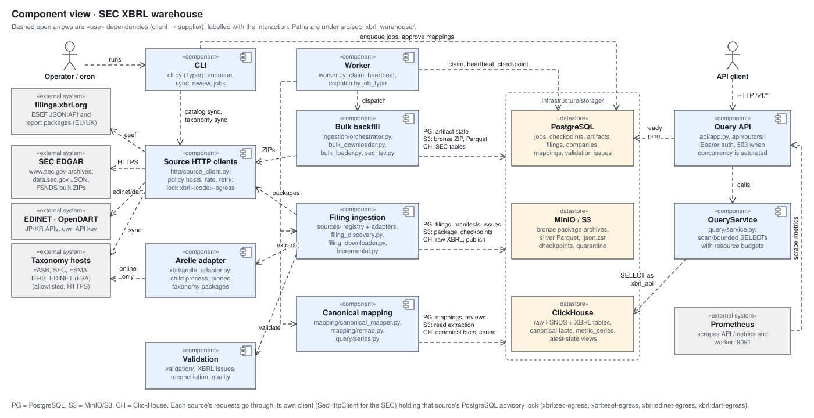
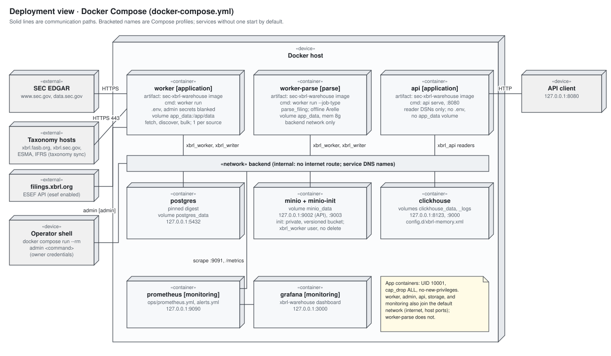

# Architecture

## Goal

Build a replayable warehouse that captures both the SEC's historical flattened XBRL data and the full semantics of newly filed XBRL/iXBRL documents.

## System overview

This file is the master architecture document. It holds the UML views listed under
[UML views](#uml-views) and the [coverage index](#coverage-index). The diagram below is
the component view; the other views follow the prose sections.

| Component | Responsibility | Source |
| --- | --- | --- |
| CLI | Operator commands: migrations, catalog sync, backfill planning, filing enqueue and discovery, mapping review, taxonomy sync, job recovery. Writes jobs to PostgreSQL; never runs pipeline stages itself, except the SEC catalog and taxonomy syncs. | `cli.py` |
| Worker | Claims jobs with `FOR UPDATE SKIP LOCKED`, heartbeats leases, dispatches one handler per `JobType`, classifies failures as retry or dead. | `worker.py` |
| SEC HTTP client | User agent, rate limit, retries with jitter, `Retry-After`, and the PostgreSQL advisory lock `SecEgressLock`, so only one process sends SEC traffic. | `infrastructure/http/` |
| Bulk backfill | FSNDS catalog, ZIP download to bronze, streaming TSV to Parquet and ClickHouse, reconciliation. | `ingestion/bulk_*.py`, `ingestion/orchestrator.py`, `ingestion/sec_tsv.py` |
| Filing ingestion | Discovery from daily indexes or submissions JSON, package download (`fetch_filing`), and extraction through publish (`parse_filing`). | `ingestion/filing_discovery.py`, `filing_downloader.py`, `incremental.py` |
| Arelle adapter | Runs Arelle in a child process against pinned taxonomy packages and returns an `XbrlExtractionBundle`. | `infrastructure/xbrl/` |
| Validation | XBRL issues, filing reconciliation, data quality, schema drift, issue grouping. | `validation/` |
| Canonical mapping | Applies approved concept mappings to raw facts, remaps published extractions, rebuilds `metric_series`. | `mapping/`, `query/series.py`, `normalization/series.py` |
| Query API | FastAPI app with bearer auth and a concurrency limit; `QueryService` runs scan-bounded, budgeted SELECTs as the `xbrl_api` reader. | `api/`, `query/service.py` |

Key flows: filings move `discover_filings` → `fetch_filing` → `parse_filing` (see the
[filing activity](#activity-views) and [sequence](#sequence-views)); bulk periods move
`download_bulk` → `load_bulk`. PostgreSQL is the control plane throughout. The
architectural invariants are the hard constraints in [`../AGENTS.md`](../AGENTS.md).

## Why two ingestion paths

The SEC bulk data is the fastest and most reliable historical backfill, but it is flattened and does not preserve every piece of original filing metadata. Arelle processing is therefore used for new filings, repair jobs, validation, and sampled historical comparison. The two sources remain separately identifiable and are reconciled rather than silently merged.

## Storage layers

### Bronze: immutable source artifacts

- SEC bulk ZIPs.
- EDGAR filing packages, stored as **one** deterministic package ZIP per filing
  (`bronze/sec/filings/<cik>/<accession>/packages/sha256=<hash>/package.zip`).
- HTTP metadata, checksums, source URLs, and acquisition timestamps.
- A manifest containing every member's SHA-256 and size, plus `package_object_key`
  and `package_checksum_sha256`.

`download_package` stages the selected members locally and stores only the package
archive: members sorted by name, fixed timestamps, and an embedded `manifest.json`
holding just the filing and members, so identical bytes give the same key and
checksum. No member is stored loose. `materialize_package` downloads the archive,
checks its SHA-256 against the manifest, applies the bulk ZIP safety checks
(traversal, member count, expanded bytes, compression ratio, CRC), refuses entries
that aren't manifest members, and verifies each extracted member's SHA-256 and size
(`ArtifactIntegrityError` on any mismatch). Legacy manifests without
`package_object_key` still materialize from loose member objects, and the ingestor
archives them as before.

Bronze object keys include a source revision or checksum. Existing objects are never overwritten with different bytes.

Filing packages contain only the files Arelle needs (selection policy 2,
`select_package_files`):

- Kept: the primary document, the instance document, `*.xsd`, XBRL instance and
  linkbase `*.xml`, `FilingSummary.xml`, and `MetaLinks.json`.
- Dropped: rendered `R<n>.htm`/`R<n>.xml` reports, `-index` pages, the `.txt`
  full submission, images, scripts, stylesheets, spreadsheets, and exhibits.
- Extra `.htm` documents of a multi-document inline set are kept only when the
  `<InputFiles>` of `FilingSummary.xml` list them. The downloader fetches
  `FilingSummary.xml` first (or reads it from a cached manifest), then fetches
  the rest concurrently, at most `XBRL_SEC_MAX_CONCURRENCY` at once, through
  the rate-limited SEC client.
- When the index lists no XBRL input but lists `<accession>-xbrl.zip`, only the
  archive is fetched and checked with the bulk ZIP limits plus
  `filing_max_members`/`filing_max_bytes`. The package archive then holds the
  `-xbrl.zip` itself and its expanded members; those members record the archive in
  `source_archive`, and the flagged instance becomes the entrypoint. A rejected
  `-xbrl.zip` is stored loose under its checksum key for diagnosis.

The manifest cache key includes the selection policy version. Manifests cached
under an earlier policy stay in place and are not reused. The Arelle adapter
builds an inline document set only from `.htm` files that declare the inline
XBRL namespace, so stray exhibits never enter the IXDS.

### Silver: typed Parquet

- One dataset per SEC table or Arelle entity type.
- Partitioned by source period, filed year, table, and/or accession.
- ZSTD compression.
- Includes source artifact ID, ingest timestamp, schema version, and row hash.

Silver is the rebuild source for ClickHouse and protects against database corruption or schema experiments.

The saved Arelle extraction (the resume and remap checkpoint) is a zstd-compressed
JSON stream, `silver/xbrl/extractions/accession=<a>/revision=<r>/sha256=<hash>.json.zst`,
where the hash is of the stored object. It is written and read as a stream through
pyarrow's compressed streams, with `XBRL_EXTRACTION_MAX_BYTES` bounding the
uncompressed JSON. Legacy uncompressed `.json` checkpoints are still read.

### Gold: ClickHouse

- Raw SEC bulk tables.
- Full-fidelity XBRL facts, contexts, concepts, and relationships. Hashes are stored
  as 32 bytes and raw values only when they differ from the typed value; standard
  taxonomy concepts are shared in `taxonomy_concepts`. The `v_*` views return the
  original hex and raw values (DATA_MODEL.md).
- Canonical facts with explicit mapping lineage.
- Standardized metric series (`metric_series`) with latest, as-reported, and as-of
  views, rebuilt per company from canonical facts; a `companies` mirror for tickers.
- Primary statements as presented (`xbrl_roles`, `xbrl_statement_lines`,
  `v_statement_lines_latest`), derived from roles, presentation arcs, and facts and
  published with the same extraction revision marker.
- Cover pages, segment/product/geographic breakdowns, and text blocks
  (`xbrl_cover_pages`, `xbrl_segment_facts`, `v_cover_pages_latest`,
  `v_segment_facts_latest`, `v_text_blocks_latest`), derived from dei and dimensional
  facts and published the same way.
- Query-optimized denormalization such as CIK, filing date, form, and period fields on facts.

### PostgreSQL control plane

- Company and filing metadata.
- Source artifacts and object locations.
- Ingestion jobs and attempts.
- Validation and reconciliation results.
- Canonical metric definitions and concept mappings.
- Schema and software version history.

## Idempotency

### Bulk artifacts

Logical identity is `(dataset_kind, source_period, source_url, checksum)`. If the SEC republishes a period with changed bytes, it becomes a new revision and is loaded with a higher `_source_revision`.

### Filings

Logical identity is the dashed accession number. Package bytes and extraction version are tracked independently, allowing a parser upgrade to produce a new extraction revision without changing the filing identity.

### ClickHouse

Tables use `ReplacingMergeTree` with explicit revision/version columns. Do not depend on background merges for correctness in user-facing queries; use `argMax`, `FINAL` only where justified, or stable latest-state views.

## Job orchestration

The first implementation uses PostgreSQL as a queue:

1. A producer inserts a job with a unique idempotency key.
2. Workers claim rows inside a transaction using `FOR UPDATE SKIP LOCKED`.
3. A heartbeat updates the lock timestamp.
4. A stale lock becomes claimable after the configured timeout.
5. Each stage writes a checkpoint so the next attempt resumes rather than restarts.
6. A worker runs up to `XBRL_WORKER_CONCURRENCY` jobs at once, claiming only when a
   slot is free; each job has its own lease, heartbeat, and checkpoint ownership.

A filing is two jobs. `fetch_filing` downloads the package from the SEC into one
archive, records the package and manifest pointers on the `filings` row, and enqueues
`parse_filing`. `parse_filing` loads the stored manifest, runs Arelle, validation,
silver and ClickHouse writes, canonical mapping, and the series rebuild, and never
downloads (a missing package is a permanent `ArtifactIntegrityError`). Workers build
the SEC client only for job types that send SEC traffic (`requires_sec`), so parse
workers scale out beside the one SEC-active worker. Legacy `ingest_filing` jobs run
both steps in one job.

This keeps the local deployment small and avoids Redis/Kafka until throughput evidence supports adding them.

## Failure domains

- **Network failure:** retry and resume download; never mark acquired until checksum is complete.
- **Malformed ZIP/package:** retain in quarantine with manifest and exception.
- **Schema drift:** stop before writes; record old/new headers.
- **Parser failure:** retain package, Arelle logs, software versions, and traceback.
- **Partial Parquet/ClickHouse write:** stage under a run/revision ID, reconcile, then promote state.
- **Mapping ambiguity:** leave raw fact unmapped and create a review candidate.

## UML views

Views follow UML 2.5.1 notation in a fixed order. Each SVG lives in
[`diagrams/`](diagrams/) and is plain, script-free SVG; edit it with any SVG or text
editor and keep node names consistent across views.

| Family | View | Diagram |
| --- | --- | --- |
| Structural | Component | [System overview](#system-overview) |
| Structural | Deployment | [Docker Compose topology](#deployment-view) |
| Structural | Class | [Core domain types](#class-view) |
| Behavioral | Activity | [Filing ingestion, bulk backfill, recovery](#activity-views) |
| Behavioral | State machine | [Job and bulk artifact lifecycles](#state-machine-views) |
| Interaction | Sequence | [Filing pipeline, API query](#sequence-views) |

### Deployment view

The local and single-host topology from `docker-compose.yml`. Production additions are
listed in [DEPLOYMENT.md](DEPLOYMENT.md).

### Class view

Core Pydantic types from `domain/`. Persisted columns are in [DATA_MODEL.md](DATA_MODEL.md).

### Activity views

Filing discovery, fetch, and parse:

Bulk FSNDS backfill:

The recovery activity (failed jobs and restore drills) lives with its procedures in
[OPERATIONS.md](OPERATIONS.md#recovery).

### State machine views

### Sequence views

## Coverage index

Paths are under `src/sec_xbrl_warehouse/` unless they start with a top-level folder.

| Subsystem, store, integration, or workflow | Views | Source |
| --- | --- | --- |
| CLI | Component; filing and bulk activity | `cli.py` |
| Worker and job queue | Component; job state machine; filing sequence; recovery activity | `worker.py`; `infrastructure/storage/postgres.py` (`claim_job`, `complete_job`, `fail_job`, `retry_job`) |
| SEC HTTP client and egress lock | Component; filing sequence; trust boundaries | `infrastructure/http/sec_client.py`, `egress_lock.py`, `rate_limiter.py` |
| Bulk backfill | Component; bulk activity; artifact state machine | `ingestion/bulk_catalog.py`, `bulk_downloader.py`, `bulk_loader.py`, `orchestrator.py`, `sec_tsv.py` |
| Filing ingestion | Component; filing activity; filing sequence | `ingestion/filing_discovery.py`, `filing_downloader.py`, `incremental.py` |
| Arelle and taxonomy packages | Component; filing activity and sequence; trust boundaries | `infrastructure/xbrl/arelle_adapter.py`, `taxonomy_packages.py`, `sec_transforms.py`; `config/taxonomy_packages.yml` |
| Validation | Component; filing and bulk activity | `validation/` |
| Statements, disclosures, fiscal fields | Class (bundle); filing activity (publish step) | `normalization/statements.py`, `disclosures.py`, `fiscal_focus.py`; `ClickHouseWarehouse.insert_xbrl_bundle` |
| Canonical mapping and series | Component; class; filing activity and sequence | `mapping/`, `query/series.py`, `normalization/series.py`; `config/canonical_metrics.yml`, `concept_seed.yml` |
| Query API | Component; API sequence; deployment; trust boundaries | `api/`, `query/service.py` |
| PostgreSQL | Component; deployment; job and artifact state machines | `infrastructure/storage/postgres.py`, `postgres_models.py`; `migrations/` |
| MinIO / S3 | Component; deployment; filing and bulk activity | `infrastructure/storage/object_store.py`, `parquet.py`, `extraction_io.py` |
| ClickHouse | Component; deployment; filing and API sequences | `infrastructure/storage/clickhouse.py`; `sql/clickhouse/`; `docker/clickhouse/` |
| SEC EDGAR (external) | Component; deployment; filing sequence; trust boundaries | `config/sources.yml` |
| Taxonomy hosts (external) | Component; deployment; trust boundaries | `config/taxonomy_packages.yml` |
| Prometheus and Grafana | Component; deployment | `observability/metrics.py`; `ops/` |
| Workflow: filing ingest | Filing activity; filing sequence | as above |
| Workflow: bulk backfill | Bulk activity; artifact state machine | as above |
| Workflow: API query | API sequence | `api/routers/` |
| Workflow: failed job and restore | Job state machine; [recovery activity](OPERATIONS.md#recovery) | `worker.is_retryable_exception`; BACKUP_RESTORE.md |
| Workflow: development and merge | [Development workflow](../../AGENTS.md#development-workflow) | root `AGENTS.md` |

### Unresolved boundaries

These were found while mapping the code and are labelled in the diagrams:

- `reconcile_artifact` and `reconcile_filing` have worker handlers, but nothing in
  `src/` enqueues them. Reconciliation runs inline in `load_artifact` and `parse`.
- `JobState.failed` and `JobState.cancelled` are never assigned.
  `ArtifactState.discovered` and `downloading` are allowed but unused, because the bulk
  downloader stores the ZIP before it creates the artifact row.
- No CLI command rebuilds ClickHouse from silver Parquet. The recovery docs describe it
  as the intent.

## Security

See [SECURITY.md](SECURITY.md) for assets, trust boundaries, API authentication,
reader identities, secrets, and resource limits.
