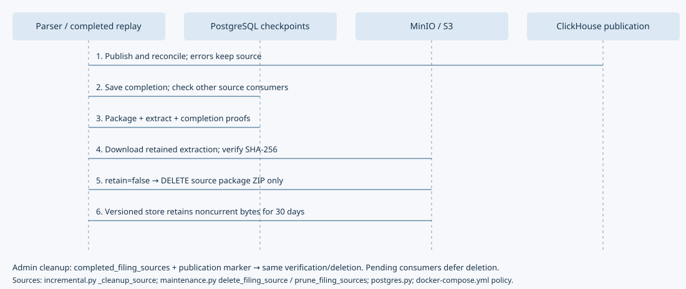
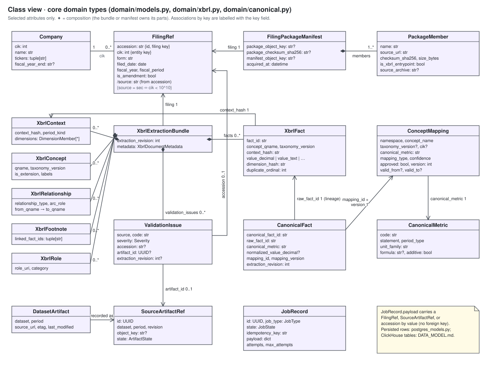
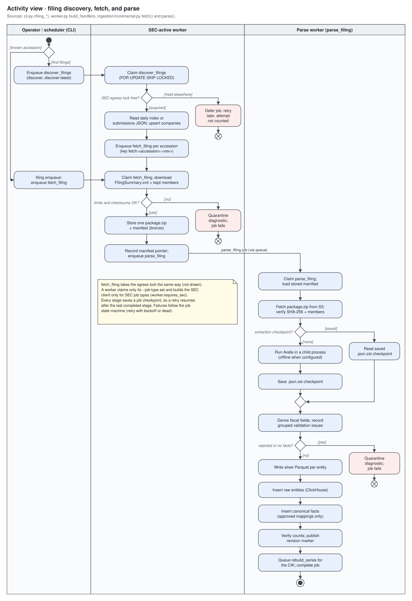
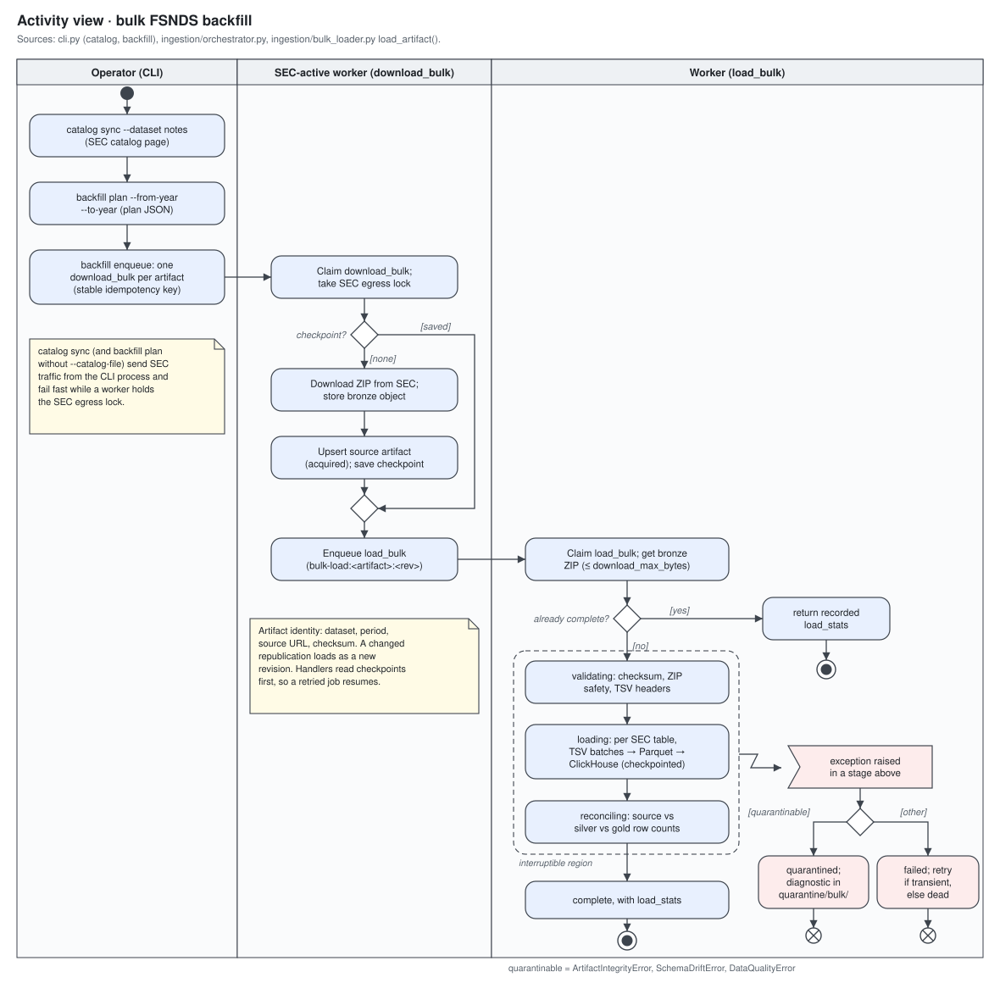
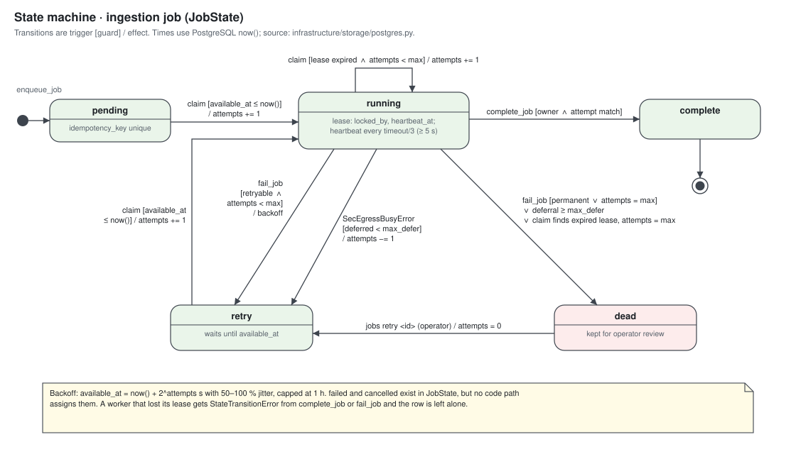
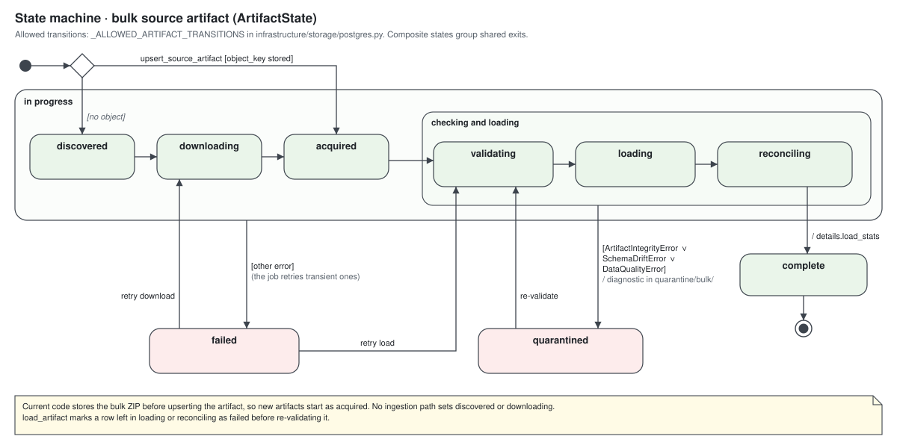
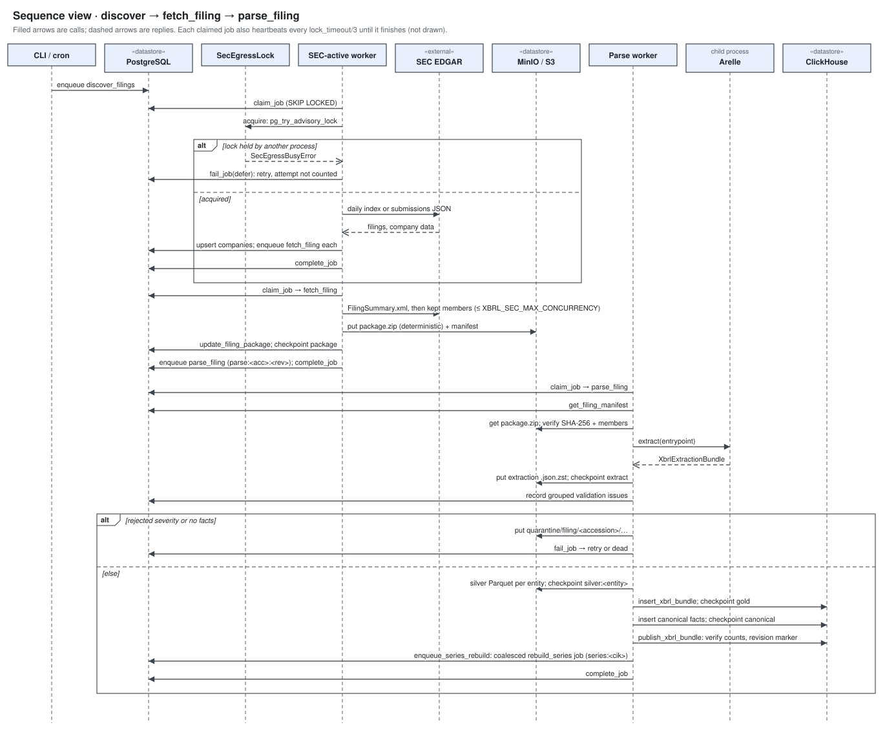
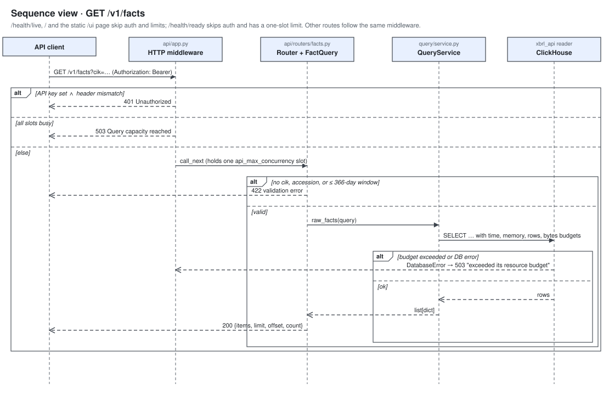
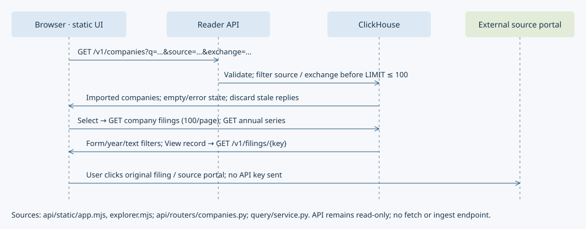

# Architecture

## Goal

Build a replayable warehouse that captures both the SEC's historical flattened XBRL data and the full semantics of newly filed XBRL/iXBRL documents.

## System overview

This file is the master architecture document. It holds the UML views listed under
[UML views](#uml-views) and the [coverage index](#coverage-index). The diagram below is
the component view; the other views follow the prose sections.

| Component | Responsibility | Source |
| --- | --- | --- |
| CLI | Operator commands: migrations, catalog sync, backfill planning, filing enqueue and discovery, mapping review, taxonomy sync, job recovery. Writes jobs to PostgreSQL; never runs pipeline stages itself, except the SEC catalog and taxonomy syncs. | `cli.py` |
| Worker | Claims jobs with `FOR UPDATE SKIP LOCKED`, heartbeats leases, dispatches one handler per `JobType`, classifies failures as retry or dead. | `worker.py` |
| Source HTTP clients | `SourceHttpClient` enforces one source's `SourcePolicy` (host allowlist, also on every redirect hop; headers; rate; concurrency), byte limits, retries with jitter, `Retry-After`, and that source's PostgreSQL advisory lock `SourceEgressLock` (`xbrl:<source>-egress`), so one process sends each source's traffic. `SecHttpClient` is the SEC policy (user agent, `XBRL_SEC_*` rate) with `SecEgressLock` (`xbrl:sec-egress`). | `infrastructure/http/` |
| Source registry and adapters | `SourceRegistry` holds one adapter per `XBRL_ENABLED_SOURCES` entry and routes by source code or filing key: discovery, package download, and filing fiscal fields. `SecSourceAdapter` wraps the SEC discovery, downloader, and dei fiscal focus unchanged. `EsefSourceAdapter` pages filings.xbrl.org's JSON:API, allocates entity keys from LEIs, stores the digest-checked report package as published, and sets `FY` and the period-end year. `EdinetSourceAdapter` (Japan) reads EDINET's daily document lists and `DartSourceAdapter` (Korea) pages OpenDART's disclosure search; both send the operator's API key only in the request (`SourcePolicy.secret_params`, masked everywhere else), store the zip as received with one instance entrypoint, and derive fiscal fields from jpdei facts or the DART report code (`sources/keyed.py` holds their shared key, redaction and package code). `InboxSourceAdapter` (`nse`, `mca` profiles for India, `acra` for Singapore) reads an operator-maintained `index.csv` and files under `XBRL_INBOX_DIR/<code>/` with no HTTP client, policy, or lock; `inbox check` validates the index without queueing. Source policies' host allowlists are disjoint. An unknown or disabled source raises `UnsupportedSourceError` (never retried). | `sources/` |
| Bulk backfill | FSNDS catalog, ZIP download to bronze, streaming TSV to Parquet and ClickHouse, reconciliation. SEC only; uses the SEC client directly. | `ingestion/bulk_*.py`, `ingestion/orchestrator.py`, `ingestion/sec_tsv.py` |
| Filing ingestion | Discovery (`discover_filings`, through the source's adapter; SEC: daily indexes or submissions JSON), package download (`fetch_filing`, `SourceRegistry.download_package`), and extraction through publish (`parse_filing`, fiscal fields from `SourceRegistry.fiscal_focus`). | `ingestion/filing_discovery.py`, `filing_downloader.py`, `incremental.py` |
| Arelle adapter | Runs Arelle in reusable child processes (a fresh controller per filing, no credentials) against pinned taxonomy packages and returns an `XbrlExtractionBundle`. | `infrastructure/xbrl/` |
| Validation | XBRL issues, filing reconciliation, data quality, schema drift, issue grouping. | `validation/` |
| Canonical mapping | Applies approved concept mappings to raw facts, remaps published extractions, rebuilds `metric_series`. | `mapping/`, `query/series.py`, `normalization/series.py` |
| Query API | FastAPI app with bearer auth and a concurrency limit; `QueryService` runs scan-bounded, budgeted SELECTs as the `xbrl_api` reader. `/v1/companies` searches the `companies` mirror and lists a company's filings from `v_cover_pages_latest`; `/v1/metrics` returns the metric catalogue. | `api/`, `query/service.py` |
| Web UI | Static HTML/CSS and browser modules at `/ui` (`/` redirects there): company search with filing-source and exchange filters, acquisition guidance for seven source adapters, four headline metrics, a five-year USD revenue chart and statement tables, and a paged filing library (type/year/text filters and extraction summaries). Original SEC filings link to EDGAR; other sources link to their portals. External links do not ingest files or provide a global stock directory. It holds no data; its `/v1` calls carry the bearer key the user enters. | `api/static/index.html` |
| MCP server | `xbrl-warehouse-mcp`: stdio JSON-RPC Model Context Protocol server with one tool per read endpoint. It is an HTTP client of the query API (`XBRL_MCP_API_URL`, `XBRL_API_KEY`) and never connects to a store. | `mcp_server.py` |

Key flows: filings move `discover_filings` → `fetch_filing` → `parse_filing` (see the
[filing activity](#activity-views) and [sequence](#sequence-views)); bulk periods move
`download_bulk` → `load_bulk`. PostgreSQL is the control plane throughout. The
architectural invariants are the hard constraints in [`../AGENTS.md`](../AGENTS.md).

## Why two ingestion paths

The SEC bulk data is the fastest and most reliable historical backfill, but it is flattened and does not preserve every piece of original filing metadata. Arelle processing is therefore used for new filings, repair jobs, validation, and sampled historical comparison. The two sources remain separately identifiable and are reconciled rather than silently merged.

## Storage layers

### Bronze: immutable source artifacts

- SEC bulk ZIPs.
- EDGAR filing packages, stored as **one** deterministic package ZIP per filing
  (`bronze/sec/filings/<cik>/<accession>/packages/sha256=<hash>/package.zip`). Keys
  are `bronze/<source>/filings/<entity key>/<filing key>/...`, where the source comes
  from the filing key, so SEC keys are as shown.
- ESEF report packages from filings.xbrl.org, stored byte-identical under the same
  key shape with the SHA-256 the site publishes (checked before storing). Its
  manifest lists the zip entries and flags the inline report under `reports/` as the
  entrypoint; `materialize_package` extracts and verifies them as below.
- EDINET (`type=1`) and OpenDART original-XBRL zips, stored byte-identical under the
  same key shape with the SHA-256 of the bytes received; the manifest flags the
  single `XBRL/PublicDoc/*.xbrl` (EDINET) or `.xbrl` (DART) instance.
- Operator inbox files (`nse`, `mca`, `acra`): a `.zip` stored byte-identical, or a single
  instance file stored as a deterministic one-member zip, under the same key shape;
  the manifest flags the one instance member. The inbox file is never changed.
- HTTP metadata, checksums, source URLs, and acquisition timestamps.
- A manifest containing every member's SHA-256 and size, plus `package_object_key`
  and `package_checksum_sha256`.

`download_package` stages the selected members locally and stores only the package
archive: members sorted by name, fixed timestamps, LZMA compression (archives written
before the storage audit use deflate and keep their bytes), and an embedded compact
`manifest.json` holding just the filing and members, so identical bytes give the same
key and checksum. No member is stored loose. `materialize_package` downloads the archive,
checks its SHA-256 against the manifest, applies the bulk ZIP safety checks
(traversal, member count, expanded bytes, compression ratio, CRC), refuses entries
that aren't manifest members, and verifies each extracted member's SHA-256 and size
(`ArtifactIntegrityError` on any mismatch). Legacy manifests without
`package_object_key` still materialize from loose member objects, and the ingestor
archives them as before.

Bronze object keys include a source revision or checksum. Existing objects are never overwritten with different bytes.

Source ZIP retention defaults to enabled. An explicit opt-out deletes only a
checksum-addressed package after successful publication and a saved completion
checkpoint, verifies its saved extraction checksum first, and leaves manifests,
Parquet, extraction snapshots and database rows intact. Completed-job replay retries
cleanup without parsing. Other pending/active source consumers defer cleanup.
The admin `storage prune-filing-sources` command covers older completed jobs and
requires matching publication/checkpoint proofs. New parsing after retirement
requires fetching the original package again. Bulk inputs and inbox files are
outside this policy. See [operations](OPERATIONS.md#filing-source-retention).

Filing packages contain only the files Arelle needs (selection policy 2,
`select_package_files`):

- Kept: the primary document, the instance document, `*.xsd`, XBRL instance and
  linkbase `*.xml`, `FilingSummary.xml`, and `MetaLinks.json`.
- Dropped: rendered `R<n>.htm`/`R<n>.xml` reports, `-index` pages, the `.txt`
  full submission, images, scripts, stylesheets, spreadsheets, and exhibits.
- Extra `.htm` documents of a multi-document inline set are kept only when the
  `<InputFiles>` of `FilingSummary.xml` list them. The downloader fetches
  `FilingSummary.xml` first (or reads it from a cached manifest), then fetches
  the rest concurrently, at most `XBRL_SEC_MAX_CONCURRENCY` at once, through
  the rate-limited SEC client.
- When the index lists no XBRL input but lists `<accession>-xbrl.zip`, only the
  archive is fetched and checked with the bulk ZIP limits narrowed to
  `filing_max_members`/`filing_max_bytes`, so an archive that declares more is
  rejected before anything is decompressed. The package archive then holds the
  `-xbrl.zip` itself and its expanded members; those members record the archive in
  `source_archive`, and the flagged instance becomes the entrypoint. A rejected
  `-xbrl.zip` is stored loose under its checksum key for diagnosis.
- The parse entrypoint is the filing's `instance_document` when set. For a classic
  (non-inline) filing (`is_inline_xbrl` false) without one, it is the standalone
  instance XML (not a linkbase, `FilingSummary.xml`, or `R<n>` page), because the
  primary document is the HTML report. Otherwise it is the primary document.

The manifest cache key includes the selection policy version. Manifests cached
under an earlier policy stay in place and are not reused. The Arelle adapter
builds an inline document set only from `.htm` files that declare the inline
XBRL namespace, so stray exhibits never enter the IXDS.

### Silver: typed Parquet

- One dataset per SEC table or Arelle entity type.
- Partitioned by source period, filed year, table, and/or accession.
- ZSTD compression.
- Includes source artifact ID, ingest timestamp, schema version, and row hash.

Silver is the rebuild source for ClickHouse and protects against database corruption or schema experiments.

Standard taxonomy concepts are stored once per namespace and taxonomy version under
`silver/xbrl/taxonomy_concepts/` and shared by every filing that loads them; each
filing's concept objects hold its own concepts (DATA_MODEL.md).

The saved Arelle extraction (the resume and remap checkpoint) is a zstd-compressed
JSON stream, `silver/xbrl/extractions/accession=<a>/revision=<r>/sha256=<hash>.json.zst`,
where the hash is of the stored object. It is written and read as a stream through
pyarrow's compressed streams, with `XBRL_EXTRACTION_MAX_BYTES` bounding the
uncompressed JSON. The Arelle child writes it, and the parent uploads that file
as written, so a bundle is serialized once. Legacy uncompressed `.json` checkpoints are still read.

### Gold: ClickHouse

- Raw SEC bulk tables.
- Full-fidelity XBRL facts, contexts, concepts, and relationships. Hashes are stored
  as 32 bytes and raw values only when they differ from the typed value; standard
  taxonomy concepts are shared in `taxonomy_concepts`. The `v_*` views return the
  original hex and raw values (DATA_MODEL.md).
- Canonical facts with explicit mapping lineage.
- Standardized metric series (`metric_series`) with latest, as-reported, and as-of
  views, rebuilt per company from canonical facts; a `companies` mirror for tickers.
- Primary statements as presented (`xbrl_roles`, `xbrl_statement_lines`,
  `v_statement_lines_latest`), derived from roles, presentation arcs, and facts and
  published with the same extraction revision marker.
- Cover pages, segment/product/geographic breakdowns, and text blocks
  (`xbrl_cover_pages`, `xbrl_segment_facts`, `v_cover_pages_latest`,
  `v_segment_facts_latest`, `v_text_blocks_latest`), derived from dei and dimensional
  facts and published the same way. The API reads them per filing under
  `/v1/filings/{accession}/cover-page`, `/segments`, and `/text-blocks`.
- Query-optimized denormalization such as CIK, filing date, form, and period fields on facts.

### PostgreSQL control plane

- Company and filing metadata.
- Source artifacts and object locations.
- Ingestion jobs and attempts.
- Validation and reconciliation results.
- Canonical metric definitions and concept mappings.
- Schema and software version history.

## Idempotency

### Bulk artifacts

Logical identity is `(dataset_kind, source_period, source_url, checksum)`. If the SEC republishes a period with changed bytes, it becomes a new revision and is loaded with a higher `_source_revision`.

### Filings

Logical identity is the filing key: the dashed SEC accession number, or
`<source>-<native id>` for another source (DATA_MODEL.md, "Filing keys and entity
keys"). The source registry sends each filing to its source's adapter; a filing whose
source isn't enabled fails with `UnsupportedSourceError` (never retried, never sent to
the SEC), and the SEC package downloader itself still refuses a non-SEC filing before
any request. An ESEF fetch of bytes already stored reuses the stored package and
manifest (keyed by the published SHA-256 and the `FilingRef`); an EDINET or DART
fetch downloads again (neither API publishes a digest) and reuses the stored package
and manifest when the bytes are the same; an inbox fetch reads the file again and does
the same. Package bytes and extraction version are tracked independently, allowing a parser upgrade to produce a new extraction revision without changing the filing identity.

### ClickHouse

Tables use `ReplacingMergeTree` with explicit revision/version columns. Do not depend on background merges for correctness in user-facing queries; use `argMax`, `FINAL` only where justified, or stable latest-state views.

## Job orchestration

The first implementation uses PostgreSQL as a queue:

1. A producer inserts a job with a unique idempotency key.
2. Workers claim rows inside a transaction using `FOR UPDATE SKIP LOCKED`.
3. A heartbeat updates the lock timestamp.
4. A stale lock becomes claimable after the configured timeout.
5. Each stage writes a checkpoint so the next attempt resumes rather than restarts.
6. A worker runs up to `XBRL_WORKER_CONCURRENCY` jobs at once, claiming only when a
   slot is free; each job has its own lease, heartbeat, and checkpoint ownership.

A completed parse, legacy ingest, or remap queues the company's `rebuild_series` job
(`series:<cik>`, delayed by `XBRL_SERIES_REBUILD_DELAY_SECONDS`), so one backfill of a
company rebuilds its series once instead of once per filing.

A filing is two jobs. `fetch_filing` downloads the package from the filing's source
(`SourceRegistry.download_package` picks the adapter from the filing key) into one
archive, records the package and manifest pointers on the `filings` row, and enqueues
`parse_filing`. `parse_filing` loads the stored manifest, runs Arelle, validation,
silver and ClickHouse writes, and canonical mapping, queues the series rebuild, and never
downloads (a missing package is a permanent `ArtifactIntegrityError`). Workers build
a source's client only for job types that send its traffic (`requires_network`; for the
SEC also `download_bulk`, `requires_sec`), so parse workers scale out beside the
network workers. Legacy `ingest_filing` jobs run both steps in one job.

`discover_filings` reads `payload["source"]` (default `sec`) and calls that adapter
with a `DiscoveryRequest` (a legacy `cik` payload becomes `entity`). It stores the
companies the adapter returns (the SEC adapter stores daily-index companies itself,
one per submissions request, so a retried run skips those already stored), refuses
filings whose key belongs to another source (`ValueError`, permanent), and enqueues
`fetch:<filing key>:<revision>` jobs. Only a missing `source` means `sec`; an empty,
malformed, or disabled source fails with `UnsupportedSourceError` and is never
retried. `map_canonical` takes filing fiscal fields from `SourceRegistry.fiscal_focus`,
as `parse_filing` does.

This keeps the local deployment small and avoids Redis/Kafka until throughput evidence supports adding them.

## Failure domains

- **Network failure:** retry and resume download; never mark acquired until checksum is complete.
- **Malformed ZIP/package:** retain in quarantine with manifest and exception.
- **Schema drift:** stop before writes; record old/new headers.
- **Parser failure:** retain package, Arelle logs, software versions, and traceback.
- **Partial Parquet/ClickHouse write:** stage under a run/revision ID, reconcile, then promote state.
- **Mapping ambiguity:** leave raw fact unmapped and create a review candidate.

## UML views

Views follow UML 2.5.1 notation in a fixed order. Each SVG lives in
[`diagrams/`](diagrams/) and is plain, script-free SVG; edit it with any SVG or text
editor and keep node names consistent across views.

| Family | View | Diagram |
| --- | --- | --- |
| Structural | Component | [System overview](#system-overview) |
| Structural | Deployment | [Docker Compose topology](#deployment-view) |
| Structural | Class | [Core domain types](#class-view) |
| Behavioral | Activity | [Filing ingestion, bulk backfill, recovery](#activity-views) |
| Behavioral | State machine | [Job and bulk artifact lifecycles](#state-machine-views) |
| Interaction | Sequence | [Filing pipeline, API query](#sequence-views) |

### Deployment view

The local and single-host topology from `docker-compose.yml`. Production additions are
listed in [DEPLOYMENT.md](DEPLOYMENT.md). Storage and application containers share the
internal `backend` network; `worker-parse` is on it alone, so it has no internet
route. With `XBRL_ENABLED_SOURCES=sec,esef` the fetch worker also reaches
`filings.xbrl.org` (its own client and `xbrl:esef-egress` lock), and `taxonomy sync`
reaches the ESMA and IFRS taxonomy hosts. `edinet` and `dart` add
`api.edinet-fsa.go.jp` and `opendart.fss.or.kr` (each with its own lock and the
operator's API key from `.env`, blanked in `worker-parse`), and `taxonomy sync` reaches
the FSA's EDINET taxonomy hosts. Inbox sources (`nse`, `mca`, `acra`) add no host: the fetch
worker reads `XBRL_INBOX_DIR` (`/app/data/inbox` in the `app_data` volume). Each service connects with its own identity (OPERATIONS.md, "Identities and the
admin service").

### Class view

Core Pydantic types from `domain/`. Persisted columns are in [DATA_MODEL.md](DATA_MODEL.md).
`FilingRef.accession` is a filing key and `FilingRef.cik` an entity key whose range
matches the key's source (`domain/sources.py`).

### Activity views

Filing discovery, fetch, and parse:

Bulk FSNDS backfill:

The recovery activity (failed jobs and restore drills) lives with its procedures in
[OPERATIONS.md](OPERATIONS.md#recovery).

### State machine views

### Sequence views

### Company search and filing library

`GET /v1/companies` accepts optional `source` and `exchange` filters. Ticker
prefixes and name substrings match; exact tickers rank first. Exchange matching is
case-insensitive and exact against imported metadata. Filters run before the
100-result maximum. SEC companies use the CIK range; other sources use membership
in published cover pages with the source's filing-key prefix. Non-SEC companies
without a published filing are therefore absent from source-filtered results.
All queries retain the reader's scan, memory, time, and response budgets.

The UI discards stale searches/selections, loads company filings in pages of 100,
and filters only the pages loaded so far. A series failure does not hide the filing
library. The financial presentation accepts USD and USD/share series; other
currencies remain available through filing records and original reports.
Acquisition labels describe adapter requirements, not live configuration status.
Non-US adapters currently provide no ticker/exchange metadata; use company names.

## Coverage index

Paths are under `src/sec_xbrl_warehouse/` unless they start with a top-level folder.

| Subsystem, store, integration, or workflow | Views | Source |
| --- | --- | --- |
| CLI | Component; filing and bulk activity | `cli.py` |
| Worker and job queue | Component; job state machine; filing sequence; recovery activity | `worker.py`; `infrastructure/storage/postgres.py` (`claim_job`, `complete_job`, `fail_job`, `retry_job`) |
| Source HTTP clients and egress locks | Component; filing sequence; job state machine; trust boundaries | `infrastructure/http/source_client.py`, `sec_client.py`, `egress_lock.py`, `rate_limiter.py` |
| Source registry and adapters | Component; deployment (one fetch worker per source); filing sequence | `sources/base.py` (`check_disjoint_hosts`), `registry.py` (`source_policies`), `sec.py`, `esef.py`, `edinet.py`, `dart.py`, `keyed.py`, `inbox.py` (`INBOX_PROFILES`); `worker.runtime_services`; `Settings.enabled_sources`, `esef_*`, `edinet_*`, `dart_*`, `inbox_dir`; `cli.py` `inbox check` |
| Bulk backfill | Component; bulk activity; artifact state machine | `ingestion/bulk_catalog.py`, `bulk_downloader.py`, `bulk_loader.py`, `orchestrator.py`, `sec_tsv.py` |
| Filing ingestion | Component; class (FilingRef); filing activity; filing sequence | `ingestion/filing_discovery.py`, `filing_downloader.py`, `incremental.py`; filing and entity keys in `domain/sources.py` |
| Arelle and taxonomy packages | Component; filing activity and sequence; trust boundaries | `infrastructure/xbrl/arelle_adapter.py` (report packages: `report_package_root`, catalog remappings), `taxonomy_packages.py` (`required_prefixes` adds `source_required_prefixes` of enabled sources), `sec_transforms.py`; `config/taxonomy_packages.yml` |
| Validation | Component; filing and bulk activity | `validation/` |
| Statements, disclosures, fiscal fields | Class (bundle); filing activity (publish step) | `normalization/statements.py`, `disclosures.py`, `fiscal_focus.py`; `ClickHouseWarehouse.insert_xbrl_bundle` |
| Canonical mapping and series | Component; class; filing activity and sequence | `mapping/`, `query/series.py`, `normalization/series.py`; `config/canonical_metrics.yml`, `concept_seed.yml` |
| Query API | Component; API sequence; deployment; trust boundaries | `api/`, `query/service.py` |
| Web UI and MCP server (API clients) | Component; API and company-search sequences; trust boundaries | `api/static/` (`index.html`, `style.css`, `app.mjs`, `explorer.mjs`); `mcp_server.py` (`TOOLS`, `WarehouseTools`) |
| PostgreSQL | Component; deployment; job and artifact state machines | `infrastructure/storage/postgres.py`, `postgres_models.py`; `migrations/`; `ops/provision/` |
| MinIO / S3 | Component; deployment; filing and bulk activity | `infrastructure/storage/object_store.py`, `parquet.py`, `extraction_io.py`; `minio-init` in `docker-compose.yml` |
| Storage maintenance and optional source retirement | Deployment; source retention sequence | `infrastructure/storage/maintenance.py` (`delete_filing_source`, `prune_filing_sources`), `inventory.py`; `ingestion/incremental.py` (`_cleanup_source`); `postgres.py` (`completed_filing_sources`, `source_package_in_use`); `cli.py` `storage` commands |
| ClickHouse | Component; deployment; filing and API sequences | `infrastructure/storage/clickhouse.py`; `sql/clickhouse/`; `docker/clickhouse/` |
| SEC EDGAR (external) | Component; deployment; filing sequence; trust boundaries | `config/sources.yml` |
| filings.xbrl.org (external, ESEF) | Component; deployment; trust boundaries | `sources/esef.py` (`ESEF_POLICY`) |
| EDINET API v2 (external, Japan FSA) | Component; deployment; trust boundaries | `sources/edinet.py` (`EDINET_POLICY`) |
| OpenDART (external, Korea FSS) | Component; deployment; trust boundaries | `sources/dart.py` (`DART_POLICY`) |
| Operator file inbox (nse, mca, acra) | Component; trust boundaries | `sources/inbox.py`; `XBRL_INBOX_DIR`; OPERATIONS.md, "Operator file inbox" and "ACRA financial statements (Singapore)" |
| Taxonomy hosts (external) | Component; deployment; trust boundaries | `config/taxonomy_packages.yml` |
| Prometheus and Grafana | Component; deployment | `observability/metrics.py`; `ops/` |
| Workflow: filing ingest | Filing activity; filing sequence | as above |
| Workflow: bulk backfill | Bulk activity; artifact state machine | as above |
| Workflow: API query | API sequence | `api/routers/` |
| Workflow: failed job and restore | Job state machine; [recovery activity](OPERATIONS.md#recovery) | `worker.is_retryable_exception`; BACKUP_RESTORE.md |
| Workflow: development and merge | [Development workflow](../../AGENTS.md#development-workflow) | root `AGENTS.md` |

### Unresolved boundaries

These were found while mapping the code and are labelled in the diagrams:

- `reconcile_artifact` and `reconcile_filing` have worker handlers, but nothing in
  `src/` enqueues them. Reconciliation runs inline in `load_artifact` and `parse`.
- `JobState.failed` and `JobState.cancelled` are never assigned.
  `ArtifactState.discovered` and `downloading` are allowed but unused, because the bulk
  downloader stores the ZIP before it creates the artifact row.
- No CLI command rebuilds ClickHouse from silver Parquet. The recovery docs describe it
  as the intent. `storage retire-revisions` therefore keeps a revision's ClickHouse
  rows unless its saved extraction is still stored.

## Security

See [SECURITY.md](SECURITY.md) for assets, trust boundaries, API authentication,
reader identities, secrets, and resource limits.
