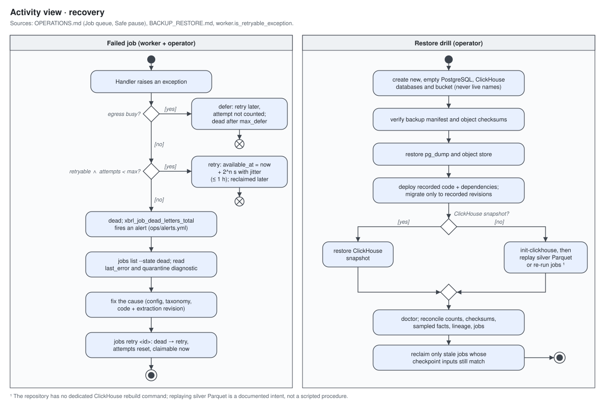

# Operations Runbook

## Service order

1. PostgreSQL
2. ClickHouse
3. MinIO/object storage, then `minio-init` (bucket, versioning, worker user)
4. Alembic migration (`admin` service)
5. ClickHouse DDL (`admin` service)
6. Identities: `ops/provision/provision_identities.sh`
7. worker
8. API


## Identities and the admin service

Each Compose service connects with the least privilege its job needs:

| Service | PostgreSQL | ClickHouse | Object store |
| --- | --- | --- | --- |
| `worker`, `worker-parse` | `xbrl_worker`: DML on the control tables | `xbrl_writer`: SELECT, INSERT | `xbrl_worker`: get, put, list (no delete) |
| `api` | `xbrl_api`: CONNECT only | `xbrl_api`: SELECT, `xbrl_api_profile` budgets | none |
| `admin` (on demand) | owner (`POSTGRES_USER`) | admin (`CLICKHOUSE_USER`) | root |

- `minio-init` (every `up`) creates the bucket, keeps it private, turns on
  versioning with a 30-day expiry for noncurrent versions, and creates the
  `xbrl_worker` object-store user with the `xbrl-worker` policy.
- `ops/provision/provision_identities.sh` creates or updates the PostgreSQL and
  ClickHouse identities and the `xbrl_api_profile` settings profile (readonly with the
  API query budgets, see SECURITY.md). Run it after the migrations and again after
  changing a password. Passwords come from the environment or `.env`
  (`XBRL_WORKER_POSTGRES_PASSWORD`, `XBRL_API_POSTGRES_PASSWORD`,
  `XBRL_WRITER_CLICKHOUSE_PASSWORD`, `XBRL_API_CLICKHOUSE_PASSWORD`,
  `XBRL_WORKER_OBJECT_STORE_SECRET_KEY`); the defaults are development values that
  `XBRL_ENV=production` rejects.
- The worker services read `.env` for their settings, but Compose blanks the owner,
  admin, root, and API secrets in their environment.
- Migrations, `db init-clickhouse`, `db upgrade-clickhouse`, `taxonomy sync`,
  `doctor`, and the `storage` maintenance commands run through the `admin` service,
  which holds the owner credentials and runs only on demand:

  ```bash
  docker compose run --rm --entrypoint alembic admin upgrade head
  docker compose run --rm admin db init-clickhouse
  ./ops/provision/provision_identities.sh
  ```

  Operator commands that only queue or read jobs (`filing`, `backfill`, `mapping`,
  `company`, `jobs`, `catalog`) work through either service.

## Routine checks

- `/health/ready` is green.
- Job queue has no unexplained `dead` growth (`xbrl-warehouse jobs list --state dead`).
- SEC 429/5xx and retry counts remain low.
- Bronze object count and PostgreSQL artifact count reconcile.
- ClickHouse disk free space exceeds the configured safety threshold.
- Quarantine and mapping-review queues are triaged.

## SEC egress lock

Only one process sends SEC traffic at a time (see SEC_ACCESS.md). If `catalog sync`,
`taxonomy sync`, or a second worker reports "another process holds the SEC egress
lock", wait for the SEC-active worker to finish or stop it. Workers scoped to non-SEC
jobs aren't affected. A worker that hits the lock defers the job by
`XBRL_SEC_EGRESS_BUSY_RETRY_SECONDS` without spending an attempt and without recording
validation issues. Deferral is capped: after `XBRL_SEC_EGRESS_MAX_DEFER_SECONDS`
(default 6 hours) from the first deferral the job goes `dead` with that reason
(`xbrl_job_dead_letters_total{reason="egress_busy_timeout"}`); `XbrlSecEgressDeferrals`
fires after about 30 minutes of continued deferrals (15-minute window held 15 minutes).

A worker keeps the lock for its whole lifetime once it has sent an SEC request, so
`catalog sync` and `taxonomy sync` fail as busy until that worker stops. The holder
checks its lock connection at most every `XBRL_SEC_EGRESS_CHECK_SECONDS` (default 30)
before SEC requests; if the connection dropped (which releases the lock), it
re-acquires the lock or stops with `SecEgressBusyError` instead of sending.

## Sources and per-source egress

`XBRL_ENABLED_SOURCES` (default `sec`, comma-separated source codes such as
`sec,esef`) lists the regulators this deployment fetches from. Each enabled source gets
an adapter in the worker's `SourceRegistry`, its own HTTP client (host allowlist, rate,
headers), and its own egress lock, `xbrl:<source>-egress` (`xbrl:sec-egress` for the
SEC, unchanged). Locks of different sources don't block each other; a second process
sending the same source's traffic gets `EgressBusyError` (`SecEgressBusyError` for the
SEC) and defers the job exactly as described above.

- **Use the same `XBRL_ENABLED_SOURCES` in every worker and CLI process** that shares
  the control database. A `discover_filings`, `fetch_filing`, or `parse_filing` job for
  a source that isn't enabled fails permanently (`UnsupportedSourceError`) and is never
  sent to the SEC instead.
- **One fetch worker per source.** `--job-type` can't filter by source, so a fetch
  worker claims fetch and discovery jobs for every enabled source and takes a source's
  lock on its first request for it, holding it until it stops. Run one fetch worker
  per enabled source; each source's jobs settle on the worker that first holds its
  lock, and the others defer those jobs as busy without spending attempts.
- **Discovery for a source:** enqueue `discover_filings` with `{"source": "<code>", ...}`.
  Without `source` the job is SEC discovery as before (`filing discover`,
  `filing discover-latest`); a legacy `cik` payload is the SEC entity.
- **Taxonomy coverage.** `config/taxonomy_packages.yml` may list
  `source_required_prefixes: {<code>: [prefixes]}`. `doctor` and offline extraction
  require the US `required_prefixes` plus those of each enabled source.
- Adapters exist for `sec`, `esef`, `edinet` and `dart`; enabling any other code makes `worker run` stop
  at startup with `ConfigurationError` until that source's adapter is added. The
  sources' host allowlists may not overlap (checked at startup).

## ESEF filings

`esef` fetches EU and UK annual reports in ESEF (inline XBRL, IFRS) from XBRL
International's free JSON:API at `https://filings.xbrl.org/api`. Keys and fields are
in DATA_MODEL.md, "ESEF filings".

**Reuse terms.** The API is free, "may be changed at any time", may be rate limited
or withdrawn, and the site states no data licence. Before enabling `esef` in
production, confirm reuse terms with XBRL International and record the answer.
filings.xbrl.org is a third-party aggregator, not a regulator: it can be
incomplete or late, and its digests prove only that the bytes are the ones it
published (SECURITY.md).

Enable it (each step that sends traffic needs the operator's approval):

1. **Pin the taxonomies.** `config/taxonomy_packages.yml` lists
   `source_required_prefixes.esef` (the ESMA ESEF taxonomy and IFRS Accounting
   Taxonomy years) but no pinned entries, so with `esef` enabled `taxonomy status`
   shows those prefixes `uncovered`, `doctor` fails, and offline extraction refuses to
   start. For each ESEF taxonomy (`www.esma.europa.eu`) and IFRS Accounting Taxonomy
   (`www.ifrs.org` or `xbrl.ifrs.org`) package: download it once from the publisher,
   record its SHA-256 and size, and add an entry as in "Adding a taxonomy year"
   (`package` when it carries `META-INF/taxonomyPackage.xml`). Then run
   `taxonomy sync` and `taxonomy status` until no row is `uncovered`. Check the
   listed years against the canary's filings and add newer ESMA years they import.
2. **Allow the taxonomy hosts.** The default `XBRL_ARELLE_ALLOWED_TAXONOMY_HOSTS` now
   includes `www.esma.europa.eu` and `www.ifrs.org`. An existing `.env` that sets the
   variable keeps its old list: add both hosts there (the unit test
   `test_repository_registry_entries_are_on_allowed_hosts` compares the effective list
   with `network_policy.allowed_taxonomy_hosts` and fails until they match).
3. **Enable the source** in every process: `XBRL_ENABLED_SOURCES=sec,esef`.
   `XBRL_ESEF_PAGE_SIZE` (default 100), `XBRL_ESEF_MAX_PAGES` (default 50 per run, per
   country) and `XBRL_ESEF_COUNTRIES` (comma-separated ISO codes; empty = one feed for
   all countries) bound discovery.
4. **Run one ESEF fetch worker.** Its traffic goes only to `filings.xbrl.org` at no
   more than 2 requests/s with `XBRL_SEC_USER_AGENT`, under the `xbrl:esef-egress`
   lock, so it can run beside the SEC worker. As with every source, a fetch worker
   claims both sources' jobs (see "Sources and per-source egress"):

   ```bash
   XBRL_ENABLED_SOURCES=sec,esef xbrl-warehouse worker run --job-type fetch_filing --job-type discover_filings
   XBRL_ENABLED_SOURCES=sec,esef XBRL_ARELLE_OFFLINE=true xbrl-warehouse worker run --job-type parse_filing
   ```

5. **Discover** by enqueueing a `discover_filings` job with
   `{"source": "esef", "filed_from": "2024-04-01", "filed_to": "2024-04-30"}`
   (dates are when filings.xbrl.org added the report; add `"entity": "<LEI>"` for one
   issuer). It pages newest first and stops once past `filed_from`.
6. **Canary (AC-6).** Discover one week, ingest three filings with offline parsing,
   and confirm `ifrs-full` facts in `v_xbrl_facts_latest` and canonical revenue.

Fetch re-reads the filing's record, downloads the package, and checks it against the
published SHA-256 before storing it. A digest mismatch stores nothing and fails
permanently; rediscover after filings.xbrl.org corrects the record. A package that
fails the archive checks is kept under `quarantine/esef/` for diagnosis.

## EDINET and DART filings

`edinet` fetches Japanese securities reports from the FSA's EDINET API v2
(`api.edinet-fsa.go.jp`); `dart` fetches Korean periodic reports from the FSS's
OpenDART API (`opendart.fss.or.kr`). Keys, forms and fiscal rules are in
DATA_MODEL.md, "EDINET filings" and "DART filings".

**API keys.** Both APIs are free but need a per-user key: register on the EDINET
site (EDINET API specification v2, 2-3) and on opendart.fss.or.kr. Use your own keys
and don't share them (OpenDART's terms forbid it). Put them only in `.env` (or the
deployment's secret store):

```bash
XBRL_EDINET_API_KEY=<your EDINET key>
XBRL_DART_API_KEY=<your 40-character OpenDART key>
```

A worker whose job types send that source's traffic (`fetch_filing`,
`discover_filings`, `ingest_filing`, or no `--job-type` filter) refuses to start
with `ConfigurationError` when the key is missing; parse-only workers don't need it.
The key goes only into the outgoing request (`Subscription-Key` / `crtfc_key`); it is
masked in every log line, error and download sidecar, and is never part of a filing
reference, manifest, object key, job payload or metric label (SECURITY.md). To rotate
a key, reissue it on the regulator's site, update `.env`, and restart the workers.

**Limits.** Each client sends at most 1 request/s, one at a time, under its own
`xbrl:edinet-egress` / `xbrl:dart-egress` lock.

- *OpenDART* allows about 20,000 calls per key per day (status `020`). A `020`
  answer raises `SourceRateLimited`: the job goes back to the queue no earlier than
  00:05 Korea time (the next day) and spends an attempt, so a long backfill should
  stay under the daily budget (one call per result page of 100 reports, plus one per
  package). Without a company (`entity`), OpenDART searches at most three months,
  so discovery splits a longer window into consecutive searches of up to three
  calendar months each (more calls: plan the budget per search, not per job).
- *EDINET* publishes no daily quota but answers bursts with status 429
  (`SourceRateLimited`, retried after 15 minutes). One discovery run reads one
  document list per day, at most `XBRL_EDINET_MAX_DAYS` (default 31) days.

Enable them (each step that sends traffic needs the operator's approval):

1. **Pin the taxonomies.** `source_required_prefixes` lists
   `disclosure.edinet-fsa.go.jp/taxonomy/` for `edinet` and `dart.fss.or.kr/` for
   `dart` (unverified: confirm DART's taxonomy namespaces with the canary) but no
   pinned entries, so with either source enabled `taxonomy status` shows the prefix
   `uncovered`, `doctor` fails, and offline extraction refuses to start. Download the
   FSA's yearly EDINET taxonomy packages (from `disclosure2dl.edinet-fsa.go.jp`) and
   the taxonomy DART filings import, record each SHA-256 and size, add pinned entries
   as in "Adding a taxonomy year", then narrow the required prefixes to the releases
   in use. Run `taxonomy sync` and `taxonomy status` until nothing is `uncovered`.
2. **Allow the taxonomy hosts.** The default `XBRL_ARELLE_ALLOWED_TAXONOMY_HOSTS` now
   includes `disclosure.edinet-fsa.go.jp` and `disclosure2dl.edinet-fsa.go.jp`. An
   existing `.env` that sets the variable keeps its old list: add both hosts there.
   Add DART's taxonomy host only after confirming it.
3. **Set the keys** (above) and **enable the sources** in every process, e.g.
   `XBRL_ENABLED_SOURCES=sec,edinet,dart`. `XBRL_EDINET_DOC_TYPES` (default
   `120,130,140,150,160,170`) and `XBRL_DART_PAGE_COUNT` (default 100) bound discovery.
4. **Run one fetch worker per source**, as for every source (see "Sources and
   per-source egress"). Each fetch worker needs both keys when both sources are
   enabled, because it claims both sources' jobs.
5. **Discover** with `discover_filings` jobs:
   `{"source": "edinet", "filed_from": "2024-06-24", "filed_to": "2024-06-28"}`
   (EDINET file dates; `"entity": "E02144"` for one filer, `"forms": ["120"]` for one
   document type) or
   `{"source": "dart", "filed_from": "2024-03-01", "filed_to": "2024-03-31"}`
   (receipt dates; `"entity": "00126380"` for one corp_code, `"forms": ["11011"]`).
6. **Canary (AC-9).** With approval and your own keys, discover one week of each
   source, ingest three filings each with offline parsing, and confirm their facts.

A JSON or XML error body instead of a zip stores nothing; a zip that fails the
archive checks or has no single instance is kept under `quarantine/edinet/` or
`quarantine/dart/`.

## Fetch and parse workers

`fetch_filing`, `ingest_filing`, `discover_filings`, and `download_bulk` send SEC
traffic (`requires_sec`). A worker builds the SEC client and egress lock only when its
`--job-type` set includes one of them (or has no filter). A worker scoped to
`parse_filing` (and other non-SEC types) builds no SEC client, so it can run beside the
SEC-active worker:

```bash
XBRL_WORKER_CONCURRENCY=4 xbrl-warehouse worker run --job-type fetch_filing --job-type discover_filings
XBRL_WORKER_CONCURRENCY=4 xbrl-warehouse worker run --job-type parse_filing
```

- **SEC worker concurrency.** One filing fetch is three sequential stages (index,
  `FilingSummary.xml`, members), so at concurrency 1 the rate limiter is idle between
  them. The limiter, `XBRL_SEC_MAX_CONCURRENCY`, and the egress lock are shared by all
  jobs of the process, so `XBRL_WORKER_CONCURRENCY=3` or `4` on the fetch worker stays
  within the SEC limit. Keep Arelle off that worker (no `parse_filing`), or size its
  memory for the parse jobs too.
- **Series rebuilds.** A completed `parse_filing`, `ingest_filing`, or `map_canonical`
  queues the company's `rebuild_series` job (`series:<cik>`), which runs
  `XBRL_SERIES_REBUILD_DELAY_SECONDS` (default 60) later. Requests for the same company
  in the meantime share that one rebuild; a request while it runs queues one
  follow-up. A worker whose `--job-type` set includes one of those job types also
  claims `rebuild_series`. A failed rebuild retries like any job.

- **Offline Arelle (recommended for parse workers).** With `XBRL_ARELLE_OFFLINE=true`
  a parse worker never touches the SEC or the egress lock. In online mode Arelle may
  resolve taxonomies from SEC hosts, so a parse worker takes the egress lock lazily
  before its first extraction and holds it until it stops, exactly like a SEC-active
  worker; a second online parse worker then defers its jobs as busy.
- **Concurrency.** `XBRL_WORKER_CONCURRENCY` (default 1, at most 32) is how many jobs
  one worker runs at once. It claims a job only when a slot is free; each job has its
  own lease, heartbeat, and checkpoint ownership (`FOR UPDATE SKIP LOCKED` still
  prevents double claims). Each running extraction is an Arelle child process, so
  `XBRL_WORKER_CONCURRENCY x XBRL_ARELLE_MEMORY_LIMIT_BYTES` must fit the container
  memory limit; `doctor` reports "Worker memory" and fails when it doesn't. On stop, a
  worker lets its running jobs finish.
- **Warm Arelle children.** An Arelle child process serves up to
  `XBRL_ARELLE_CHILD_MAX_TASKS` (default 20) successful extractions before it is
  replaced, so Arelle, its plugins, and the taxonomy package checks load once per child
  rather than once per filing. Every filing still gets a new Arelle controller and
  model, and Arelle's global plugin and package registries are reset between
  filings. A child that fails, times out, or crashes is never reused. Set it to 1 for
  a new process per filing. The child gets no database, object-store, or API
  credentials.
- Compose: `docker compose --profile parse up -d worker-parse` starts an offline
  parse-only worker (`XBRL_PARSE_WORKER_CONCURRENCY`, default 2;
  `WORKER_PARSE_MEMORY_LIMIT`, default 8g).

## Job queue

- **Retries.** A failed job is retried when the error is transient: network and
  timeout errors, HTTP 403 (SEC throttling), 408, 429 and 5xx responses (other 4xx
  are permanent), ClickHouse connection errors and server codes listed in
  `TRANSIENT_CLICKHOUSE_CODES` (for example 252 `TOO_MANY_PARTS`, 241
  `MEMORY_LIMIT_EXCEEDED`, 159 `TIMEOUT_EXCEEDED`), and S3/MinIO connection errors,
  timeouts, and codes such as `SlowDown`, `ServiceUnavailable`, `InternalError`,
  `RequestTimeout`, or HTTP 500/503. A wrapped error is classified by its cause.
  Integrity and schema-drift errors, ClickHouse syntax or missing-table errors, and
  S3 `AccessDenied`/`NoSuchBucket` stay permanent.
- **Backoff.** `available_at` is database time plus 2^attempts seconds with 50-100%
  jitter, capped at one hour; worker clocks don't affect it.
- **Dead-lettering.** A job goes `dead` on a permanent error, after its last retry,
  or when its lease expired on its last attempt (for example the process crashed).
  The claim that finds the latter records the reason in `last_error` and claims the
  next job in the same call. A worker started with `--job-type` never claims or
  dead-letters other types.
- **Recovery.**

  ```bash
  xbrl-warehouse jobs list --state dead [--type parse_filing]
  xbrl-warehouse jobs retry <job-id>   # dead -> retry, attempts reset, claimable now
  ```

  `retry` keeps the previous error in `last_error` and refuses jobs that aren't dead.
- **Metrics.** The worker metrics endpoint exports, at scrape time,
  `xbrl_queue_jobs{job_type,state}`, `xbrl_queue_oldest_ready_age_seconds`, and
  `xbrl_queue_snapshot_up`, plus counters `xbrl_job_transitions_total` and
  `xbrl_job_dead_letters_total{job_type,reason}`. `ops/alerts.yml` alerts on dead
  jobs, new dead letters, a ready job older than an hour, and a failing snapshot.

## Taxonomy packages

Standard taxonomies (us-gaap, srt, dei, and the other SEC families) load from
pinned, unmodified files published by FASB and the SEC, listed in
`config/taxonomy_packages.yml` and kept under `XBRL_ARELLE_TAXONOMY_PACKAGES_DIR`.
Entries have one of three kinds:

- `package`: an XBRL Taxonomy Package; Arelle reads its catalog (FASB us-gaap
  2017+ and srt).
- `archive`: an official zip mapped by explicit URI prefix to a directory inside it
  (us-gaap 2015/2016, the SEC per-family zips, and the SEC combined annual zips
  `https://xbrl.sec.gov/<year>.zip`, mapped per family and year).
- `file`: a schema the SEC publishes only as an individual file (exch 2018,
  stpr 2018, invest 2013).

Every prefix maps under both `http://` and `https://`. `required_prefixes` lists the
family/years the corpus uses; each must be served by an enabled entry.

```bash
xbrl-warehouse taxonomy status   # verify files on disk; no network access
xbrl-warehouse taxonomy sync     # download missing or corrupt enabled packages
```

- `sync` checks every URL first (HTTPS, port 443, no credentials, a host in
  `XBRL_ARELLE_ALLOWED_TAXONOMY_HOSTS`). It downloads through the rate-limited client
  with the configured user agent and byte limits, verifies the SHA-256, and only then
  renames the file into place. Verified packages aren't downloaded again.
- Every Arelle child verifies each enabled package before its first extraction and
  again whenever the file's size, modification time, or inode changes. A checksum mismatch or an
  unsafe filename stops extraction. A missing package stops it when
  `XBRL_ARELLE_OFFLINE=true` or `XBRL_ENV=production`. Elsewhere, extraction records a
  `warehouse:taxonomyPackageMissing` warning and resolves that taxonomy through the
  allowlisted web cache, so results can depend on the cache until `sync` runs.
- `taxonomy status` reports `mapping_missing` for an `archive` entry whose mapped
  directory has no files in the zip, which also stops extraction.
- `taxonomy status` and `doctor` report an `uncovered` row for each required prefix
  with no enabled entry. `doctor` fails its "Taxonomy packages" check when any
  enabled entry isn't `ok`, any required prefix is uncovered, or `XBRL_ENV=production`
  and `XBRL_ARELLE_OFFLINE` is false. Offline or production extraction also refuses
  to start while a required prefix is uncovered.
- The W3C `xml.xsd` schemas that the taxonomy package schema imports are shipped with
  the application and never fetched.

### Adding a taxonomy year

1. Find the official package URL on the publisher's site (FASB `xbrl.fasb.org`, SEC
   `xbrl.sec.gov`, ESMA `www.esma.europa.eu`, IFRS Foundation `www.ifrs.org` or
   `xbrl.ifrs.org`). The host must be on the allowlist.
2. Download it once and record its SHA-256 and size.
3. If it contains `META-INF/taxonomyPackage.xml` and a catalog limited to that
   family/year, add a `package` entry with its `prefixes`. Otherwise add an `archive`
   entry whose `mappings` point each `https://<host>/<family>/<year>/` prefix at the
   matching directory in the zip (`""` for the zip root). Don't repackage the file.
   Two enabled entries may not claim the same prefix.
4. Add the family/year to `required_prefixes` (or, for one source's taxonomies, to
   `source_required_prefixes.<code>`).
5. Run `taxonomy sync` and `taxonomy status`, then re-extract a filing that uses the
   year offline. Package changes alter extraction input, so they ship with an
   extraction revision bump.

## Metrics and dashboard

Start the local monitoring profile with:

```bash
make monitoring
```

Prometheus is available at `http://127.0.0.1:9090` and Grafana at `http://127.0.0.1:3000` unless their host ports are overridden. Grafana provisions the **SEC XBRL Warehouse** dashboard from `ops/grafana/dashboards/xbrl-warehouse.json`.

The API exposes process metrics at `/metrics`; the worker exposes `XBRL_WORKER_METRICS_HOST:XBRL_WORKER_METRICS_PORT`. Keep both endpoints private. Alert at minimum on dead/lease-lost jobs, sustained SEC 429/5xx responses, schema drift, validation-error growth, reconciliation differences, and a missing scrape target.

## Scheduled discovery

Use the host's native scheduler. The rolling scan deliberately overlaps completed UTC days; PostgreSQL idempotency prevents duplicate filing jobs.

Example cron entry:

```cron
15 03 * * * cd /srv/sec-xbrl-warehouse && .venv/bin/xbrl-warehouse filing discover-latest --lookback-days 3 >> /var/log/xbrl-discovery.log 2>&1
```

Run workers as supervised long-lived services. Do not schedule parallel worker launches or pass `--refresh` in a routine schedule.

## Object-store inventory and storage maintenance

`xbrl-warehouse storage report [--keys-file PATH]` lists every object and prints JSON: objects and bytes per kind (package
archives, legacy loose members, manifests, `.json` and `.json.zst` extraction
checkpoints, silver Parquet, quarantine) and the reclaimable legacy objects:

- `loose_members_in_archives`: loose bronze members that a stored manifest records
  inside an existing package archive (materialization reads the archive);
- `json_checkpoints_with_zst`: uncompressed extraction checkpoints whose accession
  and revision also have a `.json.zst` checkpoint.

It only lists; nothing is deleted or written. `--keys-file` writes the reclaimable
keys locally, one per line. Deleting them is a separate, operator-approved retention
decision. Completed jobs and `mapping remap` read the checkpoint key their job
recorded, so before deleting a JSON checkpoint confirm that the latest completed job
for that accession and revision points at the `.json.zst` key (re-ingest otherwise).

Two maintenance commands change stored data. Both are dry runs without `--yes` and
need the `admin` service (the worker identities can't delete):

- `storage recompress-extractions [--yes] [--delete-legacy]` rewrites each legacy
  plain-JSON saved extraction as `.json.zst` (the JSON bytes are compressed
  unchanged, and the new object must load as the same filing and revision), then
  points every completed job's `extract` checkpoint at it. `--delete-legacy` deletes
  each plain object once no checkpoint uses it. On the versioned bucket a deleted
  object stays recoverable as a noncurrent version for 30 days.
- `storage retire-revisions [--yes]` deletes the ClickHouse rows of extraction
  revisions older than each filing's published revision, in every revisioned table
  (`xbrl_*`, `xbrl_concept_labels`, `canonical_facts`). A revision is retired only
  when its saved extraction is still in the object store; `xbrl_extractions`, silver
  Parquet, and the saved extraction keep its lineage. Run it after a re-extraction is
  verified, not during one.

## Recovery

Failed jobs recover through the queue (see [Job queue](#job-queue)); lost or corrupt
stores recover through an isolated restore (see [BACKUP_RESTORE.md](BACKUP_RESTORE.md)).



## Safe pause

Stop producers first, then wait for active jobs to checkpoint. Stop workers only after heartbeats cease. PostgreSQL and object storage are the source of recovery state; ClickHouse can be rebuilt from silver Parquet.

## Incident categories

- Source/access: reduce concurrency/rate, inspect identity and SEC status, preserve retries.
- Schema drift: quarantine only the changed artifact, compare SEC documentation and captured header.
- Parser regression: pin Arelle version, retain package/log, rerun corpus.
- Partial warehouse write: replay the same artifact/accession revision and reconcile latest-state counts.
- Mapping error: create a new mapping version; never mutate historical mapping lineage in place.

## Capacity tuning

Benchmark (operator follow-up): re-ingest the AAPL filings with one fetch worker and
one parse worker at concurrency 4; compare `xbrl_stage_latency_seconds` per stage and
the total wall time with the 43-minute serial baseline (2 October 2026).

1. Start with one worker and one recent artifact while measuring RSS, temporary disk, object throughput, ClickHouse insert latency, and SEC throttle time.
2. Set `XBRL_ARROW_BATCH_ROWS` so one batch plus conversion overhead fits comfortably inside the worker memory limit; 50,000 is only a starting point.
3. Before a backfill, reserve space for bronze bytes, silver Parquet, ClickHouse data/merges (plus replication overhead), one preserving schema copy, and the temporary directory; check open-file limits.
4. Increase workers one at a time. Stop when SEC throttling, PostgreSQL claims, object throughput, Arelle memory, or ClickHouse latency becomes the bottleneck.
5. Keep the aggregate SEC request ceiling at or below policy. The limiter is process-local; the SEC egress lock lets only one process sharing this control database send SEC traffic, so extra worker replicas can only run non-SEC jobs.

Before a preserving ClickHouse upgrade, `doctor` must pass and free ClickHouse space must exceed 110% of the affected table bytes. The upgrade command refuses insufficient capacity and retains named backup tables.

### ClickHouse memory

ClickHouse caps its total memory at 0.9 × the container limit (3.6 GiB with the
default `CLICKHOUSE_MEMORY_LIMIT=4g`). Every query, background merge and cache counts
against that one cap, and when it's reached ClickHouse stops whichever query it picks
(`MEMORY_LIMIT_EXCEEDED`, code 241), often an unrelated small one.
`docker/clickhouse/config.d/xbrl-memory.xml`, mounted by Compose, keeps the server
inside its limit:

- `system.metric_log` and `system.query_metric_log` are off. They have about a
  thousand columns, and each background merge of `metric_log` took 3.1 GiB for about
  a second, killing whatever query ran at that moment. The warehouse exports its own
  Prometheus metrics instead.
- `system.trace_log` (the sampling profiler) is off; `text_log` keeps information
  and above. Other system logs expire (processor logs after 3 days, text and
  asynchronous-metric logs after 7, query and part logs after 14).
- The server log files rotate at 50 MB, three files each (the image default, 1000 MB
  times ten, reached 1 GB on the log volume).
- Caches are capped at 128–256 MiB each; the defaults (5–8 GiB) exceed the container.

When a container that predates this file is recreated, ClickHouse keeps the old log
tables as `system.<log>_0` without expiry, and the old `metric_log` and
`query_metric_log` still merge. Detach them (`DETACH TABLE system.metric_log
PERMANENTLY`, same for `query_metric_log`); the `_0` tables can be dropped when their
history is no longer needed.

### ClickHouse compression and indexes

Tables use `default_compression_codec = 'ZSTD(3)'` for columns without their own
codec (about 15% smaller than LZ4 on this data). `xbrl_facts` and `canonical_facts`
(sorted by CIK) have a bloom-filter index on `accession`, and the SEC NUM and TXT
tables on `adsh`. `db init-clickhouse` applies both to existing tables
(`050_storage_settings.sql`); existing parts take the codec as they merge, and the
indexes need one build:

```sql
ALTER TABLE xbrl.xbrl_facts MATERIALIZE INDEX idx_accession SETTINGS mutations_sync = 1;
ALTER TABLE xbrl.canonical_facts MATERIALIZE INDEX idx_accession SETTINGS mutations_sync = 1;
ALTER TABLE xbrl.sec_numeric_facts MATERIALIZE INDEX idx_adsh SETTINGS mutations_sync = 1;
ALTER TABLE xbrl.sec_text_facts MATERIALIZE INDEX idx_adsh SETTINGS mutations_sync = 1;
```

To diagnose a code-241 failure, check what else held memory at that second:
`system.text_log` lines from `MemoryTracker` ("Background process (mutate/merge) peak
memory usage") and `system.query_log` `memory_usage` for queries in the same minute.

## Production boundary

The Compose profile binds dashboards and the API to localhost, but production still needs authentication, TLS, managed secrets, network policy, backup monitoring, object replication/lifecycle rules, pinned image digests, and routed alerts.
