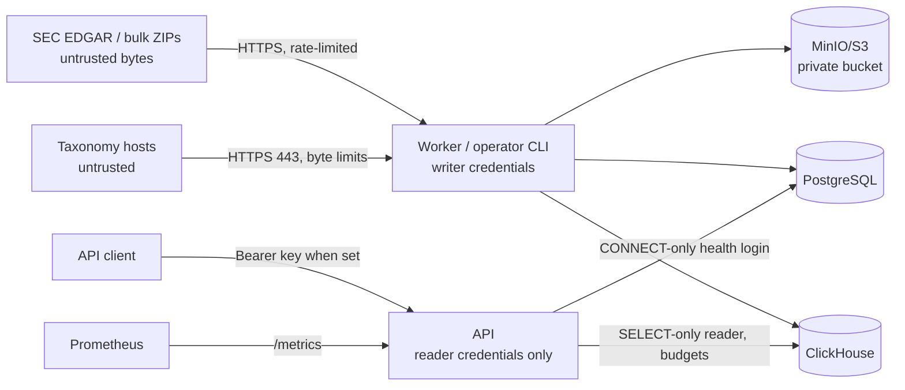

# Security

This document describes the security model as it stands in code and Compose.
Dated audit and hardening reports record how it got here; this file holds the current state.

## Assets

| Asset | Where it lives | Why it matters |
| --- | --- | --- |
| Raw source artifacts (bronze) | MinIO/S3 bucket | The replay source. Ingestion never deletes them, and `XBRL_RETAIN_FILING_SOURCE_FILES=false` is rejected. |
| Silver Parquet and checkpoints | Object store | The ClickHouse rebuild source. Checkpoints bind the source checksum, code hashes, schema, and row counts. |
| Control state | PostgreSQL | Jobs, leases, artifacts, validation issues, mapping versions, and review decisions. |
| Warehouse facts | ClickHouse | Raw and canonical facts served by the API. |
| Credentials | `.env` (local), secret manager (production) | Writer DSNs, ClickHouse writer/reader passwords, MinIO root keys, `XBRL_API_KEY`. |
| SEC identity | `XBRL_SEC_USER_AGENT` | The SEC identifies and throttles traffic by this identity. |

## Trust boundaries



- **SEC and taxonomy content is untrusted.** ZIP members, filing packages, TSV
  rows, and taxonomy responses are bounded before allocation. Unsafe names,
  traversal paths, and symlinks are rejected, and checksums are verified before parsing.
- **Taxonomy packages are pinned.** `taxonomy sync` is a separate outbound path: it
  downloads only registry URLs that use HTTPS on port 443, carry no credentials, and
  name a host in `XBRL_ARELLE_ALLOWED_TAXONOMY_HOSTS`. It uses the rate-limited
  client and byte limits, and installs a file only after its SHA-256 matches the
  registry. Extraction re-verifies every package. `archive` and `file` entries are
  the publishers' unmodified files; only verified files are mapped into Arelle. `xbrl.sec.gov` is on the default
  allowlist because it serves the SEC taxonomies (dei and others) and their packages.
  The W3C `xml.xsd` schemas are shipped with the application, so `www.w3.org` is never
  contacted.
- **The object store is trusted.** Manifest-cache and checkpoint verification detect
  corruption and mismatched reuse. They don't defend against a malicious storage administrator.
- **The API is a separate, lower-privilege identity.** Compose passes it an explicit
  environment allowlist with no `.env`, no writer or MinIO credentials, and no
  application-data volume. Bootstrap and operator CLI commands run through the
  `worker` service image, not `api`.

## Authentication and authorization

- **API.** When `XBRL_API_KEY` is set (at least 32 characters), every route except
  `/health/live` and `/health/ready` requires `Authorization: Bearer <key>`, compared
  in constant time. That includes `/docs`, `/metrics`, and queries. Without a key the API
  is unauthenticated and is safe only on loopback.
- **Production startup** (`XBRL_ENV=production`) fails unless an API key and a separate,
  non-empty ClickHouse reader identity are configured. See `src/sec_xbrl_warehouse/api/app.py`.
- **ClickHouse reader.** Production expects a SELECT-only user whose settings profile
  enforces the API query budgets. The API refuses to start if the effective limits are
  missing or looser than configured.
- **PostgreSQL API login.** The API needs a login with CONNECT and no table or writer
  privileges (`XBRL_API_POSTGRES_DSN`).
- **Unknown:** the repository contains no script that provisions the `xbrl_api`
  PostgreSQL or ClickHouse identities. Until an operator creates them, the Compose
  `api` service can't reach its databases with the default DSN.
- **Grafana** in the monitoring profile allows anonymous Viewer access. That's for local use only.
- **Workers** have no inbound API. Their metrics port stays on the Compose network.

## Secrets

- `.env` and `.env.*` are git-ignored; only `.env.example` is tracked, and it holds
  development placeholders, never release credentials.
- Production secrets come from a secret manager or protected environment. Prometheus
  reads the API bearer token from a credentials file when auth is enabled.
- `minio-init` passes credentials as quoted environment values and fails closed,
  and the bucket is set to no anonymous access.

## Sensitive data

Filing data is public SEC data. The sensitive items are credentials, the operator's
SEC contact identity, and the integrity of stored artifacts and lineage.

## Abuse and resource limits

- Raw fact queries require a CIK, an accession, or a complete filing-date window of at
  most 366 days. Offsets are capped, accessions are syntax-checked, and per-process
  concurrency is bounded. ClickHouse queries carry time, memory, rows-read, and
  result-byte budgets.
- Each API process runs one readiness probe at a time. Overlapping probes get 503.
- SEC requests use the configured user agent. They default to 8 req/s with jitter and
  honor `Retry-After`. **The limiter is process-local**, so a PostgreSQL advisory lock
  (`SecEgressLock`, see SEC_ACCESS.md) lets only one process send SEC traffic at a
  time. A second SEC-active process fails fast instead of doubling the rate.
- Containers run as UID/GID `10001:10001` with all capabilities dropped and
  `no-new-privileges`. Host ports bind to `127.0.0.1`.
- Disk reserve checks (`XBRL_DISK_RESERVE_BYTES`) pause claims and downloads
  when local space runs low.

## Dependencies

- Taxonomy packages are third-party files pinned by URL and SHA-256 in
  `config/taxonomy_packages.yml`. They are downloaded at deployment, never committed.
- `constraints-tested.txt` snapshots tested Python versions. It isn't a hash-locked,
  cross-platform lock.
- Third-party images are pinned by digest. The application image builds with
  npm for Arelle EFM's PythonMonkey dependency.
- Not yet established: OS-package and JavaScript dependency scanning, and a scan of
  a pinned release image. `pip-audit` isn't installed in the dev environment.

## Checks for security-sensitive behavior

Run from `sec-xbrl-warehouse/` with the virtualenv active:

```bash
pytest tests/unit/test_api.py tests/unit/test_config.py tests/unit/test_deployment.py tests/unit/test_bulk_security.py tests/unit/test_sec_client.py tests/unit/test_object_store.py
```

These cover API auth and capacity, production credential checks, API environment
isolation, bucket setup quoting, ZIP limits and unsafe names, SEC retry behavior, and
bounded object restores. The full gates are listed in the root `AGENTS.md`.

## Before public exposure

Grant the API's ClickHouse reader (`xbrl_api`) `SELECT` on the tables and views added
by the statement, series, and disclosure work: `metric_series`, `companies`,
`xbrl_roles`, `xbrl_statement_lines`, `v_statement_lines_latest`, `xbrl_cover_pages`,
`xbrl_segment_facts`, `v_cover_pages_latest`, `v_segment_facts_latest`, and
`v_text_blocks_latest` (in addition to the existing latest views). The API reads them only through bounded `QueryService` queries.


Production authentication, a dedicated bounded ClickHouse reader, TLS, managed
secrets, synced taxonomy packages with offline parsing, private service networks, a pinned and scanned release image, and a completed
backup restore drill. The remaining limits are tracked in `HANDOFF.md` and
`docs/HARDENING_REMEDIATION_2026-09-08.md`.
